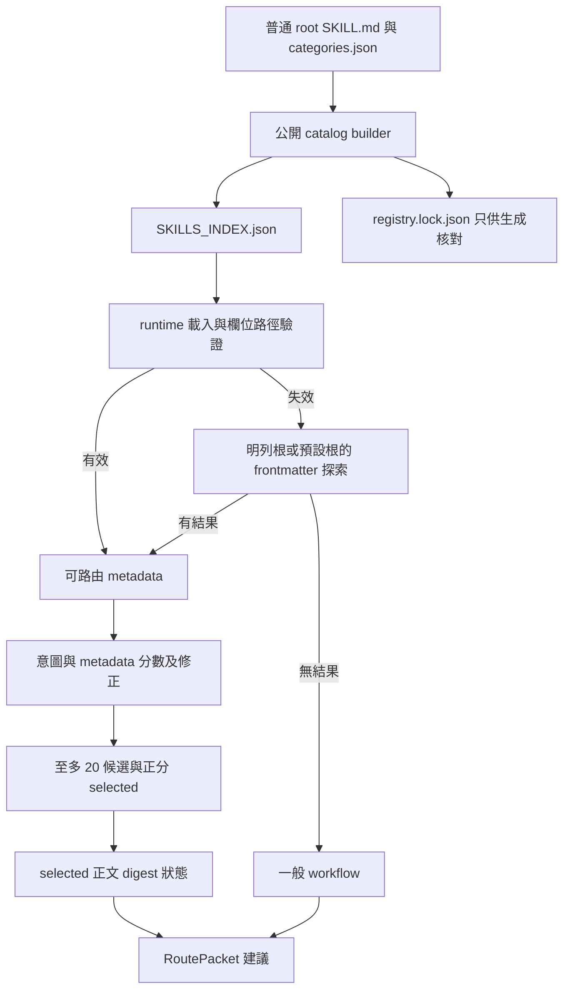

# V3 元件參考

本文件依 [V3 helper](../../runtime/skills-router/tool_master.py)、[catalog builder](../../scripts/build_v3_catalog.py)、[installer](../../scripts/install_v3.py) 及其測試描述現有行為。所有程式路徑均相對 repo；個人環境使用占位符，不是公開安裝依賴。

## 實際元件

| 元件 | 確切路徑 | 責任與副作用 |
|---|---|---|
| 母技能 | [using-superpowers/SKILL.md](../../using-superpowers/SKILL.md) | 指示任務理解、發現、執行與驗證；載入方式與副作用仍依宿主 |
| 共用 repo 規則 | [AGENTS.md](../../AGENTS.md) | 宣告 advisory 邊界、維護命令與來源權利 |
| 編排摘要 | [.superpowers/ORCHESTRATOR.md](../../.superpowers/ORCHESTRATOR.md) | 精簡說明；不是 permission authority |
| metadata index | [.superpowers/SKILLS_INDEX.json](../../.superpowers/SKILLS_INDEX.json) | 公開 14 個 record 的描述、相對路徑與 digest |
| 生成記錄 | [.superpowers/registry.lock.json](../../.superpowers/registry.lock.json) | 保存 catalog revision、index hash 與分母；runtime 不讀它作 gate |
| 路由 helper | [runtime/skills-router/tool_master.py](../../runtime/skills-router/tool_master.py) | Python 標準庫；讀 metadata 與 selected 正文，輸出封包；不呼叫模型或宿主工具 |
| catalog builder | [scripts/build_v3_catalog.py](../../scripts/build_v3_catalog.py) | 掃描普通根目錄技能，生成 index／lock；`--check` 只比對生成內容 |
| installer wrapper | [install.sh](../../install.sh) | 優先執行與 wrapper 同目錄的 installer；stdin bootstrap 下載官方 main 的 installer |
| installer | [scripts/install_v3.py](../../scripts/install_v3.py) | clone／明示 ff-only update、managed links／config 切換與失敗回復；可選複製 OpenCode adapter |
| 安裝分類 | [categories.json](../../categories.json) | essential／coding 與 minimal／default／full 選擇；不是 runtime 路由規則 |
| OpenCode adapter | [runtime/skills-router/adapters/opencode/skills-router.js](../../runtime/skills-router/adapters/opencode/skills-router.js) | 路由建議注入、已識別 metadata 壓縮與 session 隔離；工具執行 hook 為 no-op |
| OpenCode primary 入口 | [runtime/skills-router/adapters/opencode/工具大師V3.md](../../runtime/skills-router/adapters/opencode/工具大師V3.md) | 可選 primary，無 model／permissions 欄位 |
| OpenCode 模組宣告 | [runtime/skills-router/adapters/opencode/package.json](../../runtime/skills-router/adapters/opencode/package.json) | `private: true`、ES module 宣告；沒有第三方依賴清單 |
| Claude hook | [runtime/skills-router/adapters/claude/skills-router-hook.py](../../runtime/skills-router/adapters/claude/skills-router-hook.py) | UserPromptSubmit 成功只加 additionalContext；失敗輸出空物件、exit 0 |
| Claude wrapper | [runtime/skills-router/adapters/claude/claude-user-prompt.sh](../../runtime/skills-router/adapters/claude/claude-user-prompt.sh) | helper 缺少／失敗時回傳空物件；installer 不自動安裝或登記 hook |
| 核心測試 | [test_tool_master.py](../../runtime/skills-router/tests/test_tool_master.py)、[test_claude_slim_hook.py](../../runtime/skills-router/tests/test_claude_slim_hook.py)、[test_v3_advisory.mjs](../../runtime/skills-router/tests/test_v3_advisory.mjs) | fixture／CLI／adapter contract；不等於所有宿主 live E2E |
| 安裝測試 | [tests/test_v3_install.py](../../tests/test_v3_install.py) | disposable HOME 與本機 Git fixture；不動真實 HOME |
| CI | [.github/workflows/personal-tool-master-v3.yml](../../.github/workflows/personal-tool-master-v3.yml) | Ubuntu、Python 3.12、Node 22 執行公開測試；實際 run 結果另查 GitHub |
| 來源與權利 | [THIRD_PARTY_NOTICES.md](../../THIRD_PARTY_NOTICES.md)、[授權範圍](../授權範圍.md)、[來源表](../第三方來源與授權.json) | 記錄原創範圍、固定上游與修改；不把 routing eligibility 當 license grant |

只有 OpenCode 與 Claude 有本 repo 的專用 adapter。Codex、Hermes、DSH 用母技能與當次工具，沒有隱藏的宿主服務。[宿主映射與證據](V3_WORKFLOW_AND_TOOL_MAPPING.md) 說明支援程度。

## helper 公開介面

| 介面 | 輸入 | 輸出／責任 |
|---|---|---|
| `load_skill_index(root)` | 技能 repo 根目錄 | `skills`、`source`、`revision`、`root`、`diagnostics`；catalog 失效則探索 metadata |
| `build_route_packet(task, *, root, host="generic", tools=None, profile="normal", index=None)` | 非空任務文字；當次工具；可選既有 index | JSON 可序列化建議字典；空任務或未知 host／profile 為輸入錯誤 |
| `render_packet(packet)` | 建議字典 | TASK／SKILLS／TOOLS／CONTEXT TO READ／WORKFLOW／DONE WHEN；有診斷時另列 DIAGNOSTICS |
| `route` CLI | 任務 positional text，或 `--stdin` 的文字／task 或 text JSON | 文字或 `--json`；`--tools-json` 接檔案，`-` 接 stdin |

支援 host 值為 `codex`、`opencode`、`dsh`、`hermes`、`claude`、`generic`。這是選擇名稱提示的參數，不是宿主認證。`--root` 預設由 helper 檔案位置推得 repo 根目錄；任務專案規則與現物仍由 Agent 在後續讀取。

同時使用 `--stdin` 與 `--tools-json -` 時，共用 JSON 必須提供 `task`／`text` 以及 `tools`；缺少工具資料記錄 `TOOLS_UNAVAILABLE`，不把提示名稱填成真正 `available`。

```sh
python3 runtime/skills-router/tool_master.py route \
  '除錯：重現排序錯誤，最小修正並驗證' \
  --root . --host generic --profile guided --json
```

上述示例沒有提供工具 schema，封包會提示先發現宿主工具。實際 task 與 tools 可由 stdin 傳入；不要把範例或前一次 session 的工具清單冒充當次已暴露能力。

## 圖 03：catalog 到建議封包

```text
乾淨公開來源中的普通 root/SKILL.md + categories.json
                         |
               build_v3_catalog.py
                         |
                         +--> .superpowers/SKILLS_INDEX.json
                         +--> .superpowers/registry.lock.json [生成核對用]

runtime load_skill_index
        |
        v
index 可讀／欄位與路徑有效？
        +-- 是 --> 可路由 records ----+
        |                            |
        +-- 否 --> 明列根或預設「.」 |
                     |
            有界 frontmatter 探索 ---+
                     |               |
              無結果：一般流程       v
                               intent + metadata 分數／修正
                                      |
                               至多 20 候選／正分 selected
                                      |
                              selected 正文 digest 狀態
                                      |
                                      v
                                 RoutePacket 建議
```



## metadata 發現與驗證

`load_skill_index` 優先讀 `.superpowers/SKILLS_INDEX.json`。每個 record 需要非空且不重複的 `skill_id`、repo 內的 `relative_path`，以及正確型別的 description、canonical_name、triggers、aliases。絕對路徑、`..` 或解析後逃離 repo 的 symlink 不接受。`route_eligible: false` 或 `deprecated: true` 不參與路由。這一步不讀全庫正文。

catalog 缺少、損毀、超出讀取上限，或非空卻沒有有效 record 時，使用 `_discover`。它會嘗試 `runtime/skills-router/catalog/discovery-roots.json`；**這是可選讀取位置，公開快照沒有該檔案**。缺少或格式錯誤時只探索預設根 `.`。探索只檢查指定根的直接子目錄，不遞迴追蹤 symlink；隱藏目錄、runtime／docs／tests／node_modules 及設定排除名稱會跳過。缺少完整 frontmatter 或 description 的技能不憑正文猜測。

有效但空的 catalog 可以直接產生無技能的一般 workflow，不必強行補足候選。完整數值與「有界」的實際範圍見 [測試與限制](V3_TESTING_AND_LIMITATIONS.md)。

builder 則只掃 repo 根目錄的普通技能目錄，從 frontmatter 擷取 name／description，計算正文 SHA-256。它沒有自行詢問 Git tracked 狀態或查核授權；公開 catalog 應在已核查的乾淨隔離樹生成。`--check` 比對 index 與 lock 的確切生成內容，並非背景 freshness monitor。

## 意圖、metadata 分數與排序修正

`_intent` 依序檢查 `review → debug → research → code → simple` 的中英文正規表示式，第一個命中者決定 workflow，否則為 `general`。多意圖任務可能以較早命中者為主；Agent 仍需核對原始需求。

`_rank` 把 canonical_name、description、aliases、triggers 組成 metadata 文件；任務與命中意圖的同義詞組成查詢。英文使用小寫、簡單複數處理與停用詞；中文以相鄰二字片段比對；純數字不參與排名。排序是 BM25 形式的詞頻／逆文件頻率計分，實碼常數為 `k1=1.2`、`b=0.75`，每個查詢詞權重至多 2。它沒有 embedding、向量庫、遠端模型或 learned reranker。

分數另做以下既有修正：

- 任務明示 canonical_name、skill_id 或 alias 的子字串時，該項增加 20 分。
- 沒有真正 PR 語境時排除 PR 專用技能；`no PR` 與「不要建立 PR」不被視為已有 PR。
- 對描述恰好符合產品專用 docs 模式的技能，任務未提產品則分數歸零。
- 巢狀 `/skills/` 領域庫未匹配其領域詞時，分數乘以 0.45。
- 同分以 `skill_id` 排序，取至多 20 候選，再只從正分候選選技能。

這些規則是現有排序修正，不是新的模型 rerank 階段。guided／normal／high 最多選 3／5／8 個；simple 意圖最多 3 個，可以選零個。母技能建議人工先流程、再領域、再實作／驗證；helper 不會保證每個結果都剛好包含這三種角色。

## 正文 digest 與封包欄位

只有 selected 正文被讀取作 SHA-256 一致性檢查，正文內容不塞入封包。`body_status` 為 `verified`、`unverified`、`digest_mismatch` 或 `unavailable`。失配的 record 仍在 selected 陣列中標示狀態；工作流程要求略過失配／不可用正文，fallback 的 unverified 先自行核對。helper 沒有自動重新生成 catalog 或重新排序；重新發現由 Agent 視需要處理。

digest 代表與 metadata 的一致性，不證明正文可信、授權合法、工具獲准或已載入到模型上下文。runtime 也不會用 lock hash、revision、TTL 或 lease 禁止工作。

| 封包欄位 | 語意 |
|---|---|
| `version`、`advisory` | 目前為 `3-slim`、`true` |
| `task`、`intent`、`host`、`profile` | 封包內的任務摘要與路由參數 |
| `index_source`、`catalog_revision`、`skills_root` | metadata 來源與本機根路徑；不是授權憑證 |
| `candidates` | id 與四捨五入至 3 位小數的分數 |
| `skills` | id、name、path、digest、score、body_status |
| `tools` | 每種能力的 available、host_hints、additional_count |
| `context_to_read` | 專案規則、README、相關現物與少量任務檔案片段建議 |
| `workflow`、`done_when` | 需要由 Agent 執行與核實的步驟／完成條件 |
| `diagnostics` | metadata、digest、工具輸入等診斷；不是 deny decision |

長任務的 TASK／PLAN／STATE、installer 持久化檔案與 OpenCode 的暫存 Map，另見 [儲存與狀態](V3_STORAGE_AND_STATE.md)。
