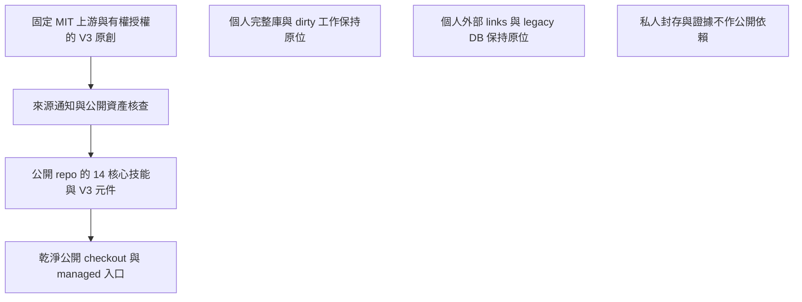
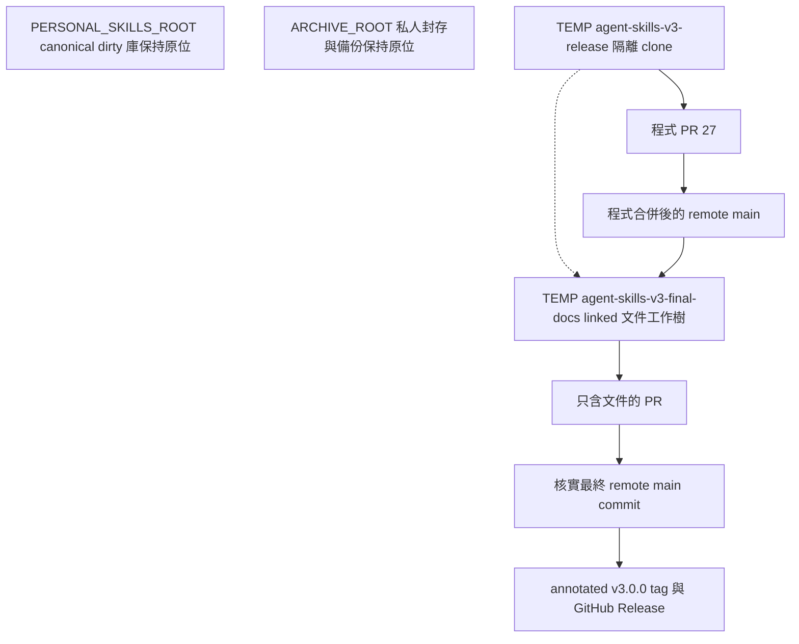
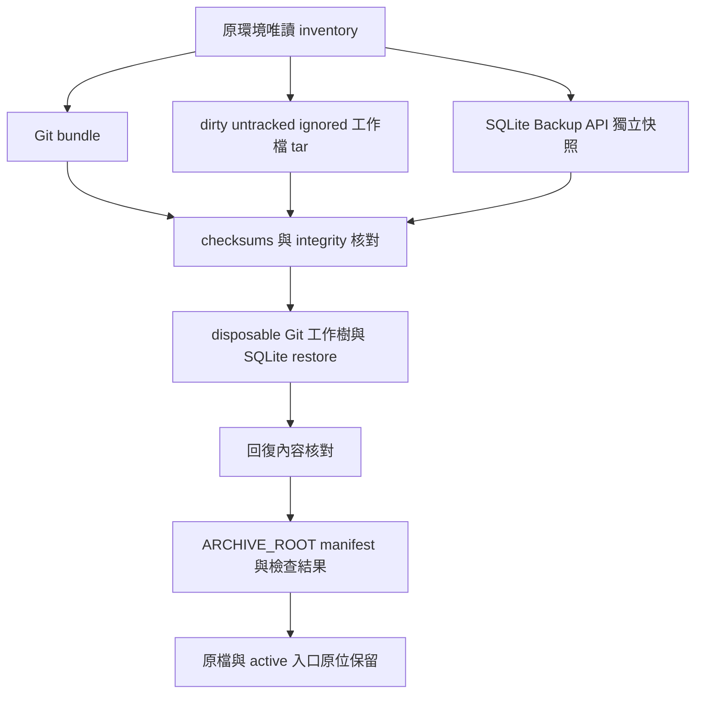

# V3 發布與遷移

本次收束把已完成的 Personal Tool Master V3、公開架構文件與正式 Git 發布連接起來。程式來源為 [PR #27](https://github.com/juhjuhx/agent-skills/pull/27) 的 `402b972aadcef221f1cfd9c7f03b6423e76f34ee`，已合併至 main `a570dd639d06b8b7d164493bac98f01a55cdbc6f`；文件使用 `docs/v3-final-architecture` 獨立工作樹，合併後才以核實的最終 main 建立 tag／Release。

本文記錄程式合併的已知事實；最終文件與 tag 的自身 commit 不嵌入文件作循環身分。正式結果以 [程式 PR](https://github.com/juhjuhx/agent-skills/pull/27)、本次文件 PR 與 [GitHub Releases](https://github.com/juhjuhx/agent-skills/releases) 為準，不從文件標題推定完成。

## 正式發布身分與查驗

| 項目 | 可核實身分與來源 |
|---|---|
| V3 程式與精簡封裝來源 | PR #27 head：`402b972aadcef221f1cfd9c7f03b6423e76f34ee` |
| 程式合併與 CI | PR #27 checks PASS；main／merge：`a570dd639d06b8b7d164493bac98f01a55cdbc6f` |
| 架構文件流程 | `docs/v3-final-architecture`；本次獨立文件 PR、fresh review 與 checks，狀態由該 PR 查驗 |
| 最終 main／文件版本 | 以正式 `v3.0.0` 的 peeled commit 與 Release 驗收紀錄為準；不預造或自引用最終 SHA |
| annotated tag `v3.0.0` | 用遠端 tag object 與 peeled commit 查驗；未建立前查詢不會回傳該物件 |
| GitHub Release `v3.0.0` | 用 Release API／GitHub 頁面的 URL、tag 與發布時間查驗；建好以前不能宣稱完成 |
| 舊 V1／V2 GitHub Releases | 不補造不存在的歷史發布物件 |

以下是公開唯讀查證命令；需已有 Git／GitHub CLI 與可讀網路。不修改個人 canonical 庫，`origin` 應指向公開 repo：

```sh
gh pr view 27 --repo juhjuhx/agent-skills \
  --json state,mergedAt,mergeCommit,statusCheckRollup
git ls-remote --tags origin refs/tags/v3.0.0 'refs/tags/v3.0.0^{}'
gh release view v3.0.0 --repo juhjuhx/agent-skills \
  --json tagName,targetCommitish,publishedAt,url
```

`targetCommitish` 可能是分支文字，不能單獨代替 peeled commit；要同時核對 Release 所指 tag 的遠端 commit。文件分支準備時仍需完成文件 PR 合併與 tag／Release，以上查詢讓正式發布後的讀者取得實際結果。

正式收束不再停在過去 Phase A 的 push／PR 範圍；它包含必要驗收、程式合併、文件合併與最後的 tag／Release。原 [2026-10-12 候選驗收紀錄](../發布驗收.md) 保留當時 Phase A 的日期、測試與批准範圍，不能改寫成當時已完成正式發布。

## 公開與個人範圍

公開快照為 14 個普通根目錄 SKILL.md、14 個 metadata-ready record、14 個分類可安裝目標。分母可由 [index](../../.superpowers/SKILLS_INDEX.json)、[categories](../../categories.json) 與 builder check 核對；`full` 意味著此快照的全部 14 個，不是個人完整技能庫。

個人完整庫的分母由本機盤點，與公開 14 不同；不從舊 README 數字推定完整或可路由數。原有 dirty 工作、未核實材料、26 個既有外部／失效 links 的目標、legacy DB 與私人封存保持原位，不因公開縮小而刪除或複製進 repo。舊 DB 是否仍有 active consumer 尚未確認。

## 圖 08：公開快照與個人完整庫

```text
固定 Superpowers MIT 上游 + 有權授權的 V3 原創
                         |
             來源／通知／公開資產核查
                         |
                         v
公開 repo：14 核心技能 + helper／adapters／tests／installer／docs
                         |
                    可攜式安裝
                         v
             乾淨公開 checkout／managed 入口

個人環境：<PERSONAL_SKILLS_ROOT>             <ARCHIVE_ROOT>
  完整技能庫與 dirty 工作                    私人證據與備份
  既有外部 links、legacy DB                  保持原位
  分母依本機盤點                            不作公開依賴

公開縮小不刪個人庫；未核實材料不進公開快照。
```



## 來源、授權與歷史風險

[THIRD_PARTY_NOTICES.md](../../THIRD_PARTY_NOTICES.md) 固定 Superpowers `8ca22dba9a94f28898bbce59f2537ff4d87c747d`，保留 Jesse Vincent 的 MIT notice；每個技能目錄與 [licenses/obra__superpowers/LICENSE](../../licenses/obra__superpowers/LICENSE) 有完整通知。來源表有 53 份檔案 record：`using-superpowers/SKILL.md` 的 V3 改寫與 `writing-skills/SKILL.md` 的外部文件連結修改均有記錄。

根 MIT 只適用於 [授權範圍](../授權範圍.md) 明列的有權授權 V3 原創檔案與新寫文件；不把第三方、字型、資產或歷史內容一併改成 JuhJuhX 的 MIT。routing eligibility 與 license clearance 是不同判定。

受限制 PowerPoint 與未完成來源／通知核查的材料已排除本次新版樹；這不是對所有材料的侵權判定。新版移除不會清除 Git 歷史中的受限制內容與疑似 credential literal。沒有使用、驗證或撤銷那些憑證，也沒有重寫歷史；公開快照核查不能宣稱歷史風險已消失。

## 圖 09：本機 Git 與封存布局

這是本次收束採用的隔離布局。`<TEMP>` 是暫存位置占位符；文件工作樹與 release clone 可共享 Git object storage，個人 canonical 庫是另一份原始工作環境。

```text
<PERSONAL_SKILLS_ROOT>                 <ARCHIVE_ROOT>
  canonical 個人庫                      私人證據／備份／草稿
  dirty 工作與 active 入口              原位保留，非公開依賴
  不切 branch／不 reset／不 clean

<TEMP>/agent-skills-v3-release
  isolated release clone
  release/personal-tool-master-v3 --> PR #27 --> remote main
  獨立 .git
       |
       +-- linked docs worktree（從程式合併後的 main 建立）
             <TEMP>/agent-skills-v3-final-docs
             docs/v3-final-architecture：只改文件 --> 文件 PR --> remote main
                                                          |
                                               核實最終 main commit
                                                          |
                                                annotated tag／Release
```



## 正式收束順序

1. 核對 PR #27 的確切 head、checks、獨立審查與當前範圍，僅處理本次程式 PR。
2. 合併程式後核對 remote main；從該基準建立隔離 docs 工作樹，轉入六份架構及入口文件。
3. 在 docs 工作樹檢查只改文件、相對連結、十組 ASCII／Mermaid 圖、術語與公開安全內容；由 fresh context 做獨立文件審查。
4. 文件 PR 的 checks／審查通過後合併，核對最終 main 仍包含原 V3 實作、14 技能與來源通知。
5. 以實際最終 commit 建立 annotated `v3.0.0`，核對遠端 tag 的 commit 與 GitHub Release，把確切 tag object／peeled commit、URL 與時間記錄於 Release 驗收紀錄。

文件分支不改 code、test、schema、CI、catalog 或技能正文。它不啟動 V4、不處理其他無關 PR、不接回 enforcing。任何失敗都保留實際結果與下一步；發布分支修正用正常新 commit，回復用 reviewed revert PR，不 force-push 或 reset 個人工作。

## 乾淨安裝與既有庫遷移

先確認下載來源已包含 V3 程式與正式文件；發布狀態由上述 PR／Release 核實。一般 clone 安裝见 [安裝與使用](../安裝與使用.md)。要驗證 installer，使用 disposable HOME；不要把正式發布的精簡 repo 更新到有個人工作與未追蹤技能的 canonical 庫。

| 選項 | 現有作用 |
|---|---|
| `--minimal` | essential 的 3 技能：using-superpowers、systematic-debugging、verification-before-completion |
| `--default`／`--all` | 此公開快照的 14 技能；`--all` 採 manifest 的 full profile |
| `--category essential,coding` | 指定目前打包的分類；母技能一定包含 |
| `--home <disposable_directory>` | 改安裝目的 HOME；供隔離驗證 |
| `--repo <source>` | 改 clone 來源；必須與既有 origin 相符 |
| `--update` | 明示更新 origin-tracking 乾淨 checkout，額外拒絕 ignored／cache 內容，使用 ff-only |
| `--no-links` | 不建宿主 skills 入口與 universal pointer；仍準備 managed 集合與 config |
| `--opencode-advisory` | 額外複製 advisory plugin 與可選 primary；不改全域設定 |

首次 clone 到 `<HOME>/.agents/skills`。既有 checkout 默認不 pull；dirty／untracked、wrong origin、nonmanaged enabled 內容或目的 adapter 已存在時拒絕。明示更新乾淨舊版 checkout 會由 Git 移除新版排除的 tracked 檔案；先把需要保留且可合法使用的材料備份到獨立私人位置。保護 dirty 工作不等於保留乾淨 tracked 舊快照的全部材料。

installer 只對已存在且符合路徑條件的宿主目錄建立缺少的 skills link，支援 `.config/opencode`、`.claude`、`.codex`、`.gemini`、`.cursor`、`.windsurf`、`.continue`、`.aider`，以及可建立的 `.local/share/agent-skills` pointer。這是入口連結清單，不是八個宿主的 live E2E 認證；沒有 Hermes／DSH 專用入口。

## 圖 10：本次私人封存與回復演練

本次封存從唯讀盤點建立獨立備份，再在 disposable 位置演練回復；原始檔案保持原位。SQLite Backup API 只為個人 legacy DB 產生備份，不增加公開 V3 的資料庫依賴。私人 archive 的實際路徑、manifest 與內容不打包。

```text
原環境唯讀 inventory：Git／dirty／untracked／ignored／SQLite／入口
                               |
              +----------------+----------------+
              |                |                |
          Git bundle       工作檔 tar       SQLite Backup API
                        dirty/untracked/ignored   |
              |                |                |
              +----------------+----------------+
                               v
                   checksums／archive／DB integrity
                               |
                               v
             disposable Git／working-tree／SQLite restore
                               |
                          回復內容核對
                               |
                               v
                <ARCHIVE_ROOT> manifest／檢查結果
                               |
                     原檔與 active 入口原位保留

archive 不作公開 runtime 依賴；未知 SQLite consumer 不動。
installer rollback 與已合併版本 revert 是另外的回復範圍。
```



installer 成功重選只保留舊 managed links 備份，舊 config 不另永久保存；需要完整人工回復時，變更前在私人位置保存 config 與入口資料。錯誤回復涵蓋本輪檔案切換，不涵蓋 clone／fetch／pull，也沒有並行鎖與斷電恢復保證。

停用 optional OpenCode adapter 前先核對檔案身分與來源，移到 plugins-disabled 後仍可載入 native 母技能。目的 plugin 已存在時 installer 拒絕覆寫；舊 enforcing 不移回 active plugins。人工恢復只針對已辨識的檔案與 link，不刪除未知 SQLite、外部 links 或個人 dirty 檔案。

## catalog 維護與核對命令

以下命令在乾淨隔離公開 checkout 使用。`--check` 不重寫；生成命令會改 index／lock，應由維護者於有權變更來源時執行並審查 diff。不要因 stale 而把它變成宿主工具 gate。

```sh
python3 scripts/build_v3_catalog.py --check
python3 runtime/skills-router/tool_master.py route \
  '讀取專案狀態並完成下一項工作' --root . --host generic --profile normal
git status --short
git diff --check
```

需要重新生成時：

```sh
python3 scripts/build_v3_catalog.py
python3 scripts/build_v3_catalog.py --check
git diff -- .superpowers/SKILLS_INDEX.json .superpowers/registry.lock.json
```

公開文件、封包輸出與 review 證據只保留必要安全摘要；不用私人絕對路徑、raw logs、session ID、完整個人 catalog、provider config 或 credentials。詳見 [儲存與狀態](V3_STORAGE_AND_STATE.md)。
