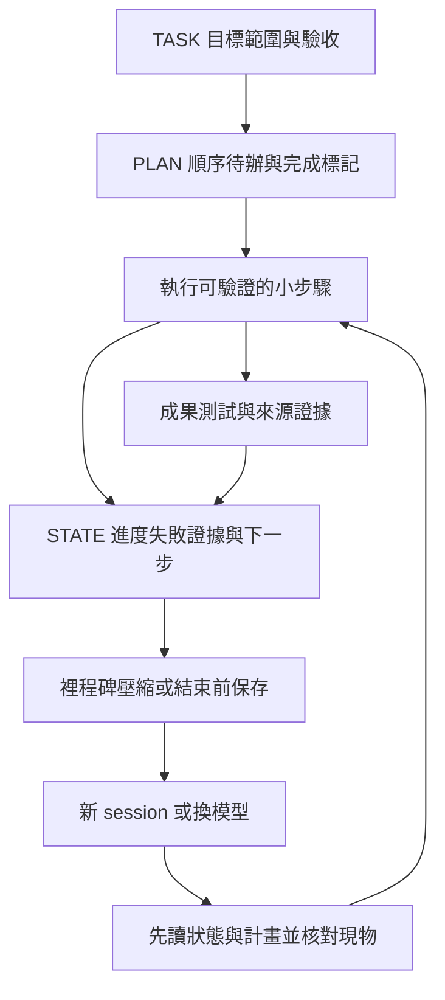
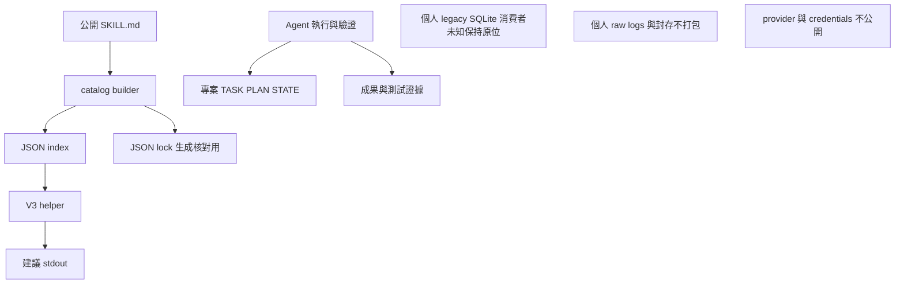

# V3 儲存與狀態

V3 的技能來源是普通檔案與 JSON metadata；任務續接使用專案文件。helper 不寫資料庫、不保存 task、不發送 telemetry。builder 與 installer 有各自明示的檔案寫入操作，和 runtime 建議封包分開。

本文件以 [helper](../../runtime/skills-router/tool_master.py)、[builder](../../scripts/build_v3_catalog.py)、[installer](../../scripts/install_v3.py) 與 [母技能](../../using-superpowers/SKILL.md) 為依據。`<HOME>`、`<PERSONAL_SKILLS_ROOT>`、`<ARCHIVE_ROOT>` 是個人位置占位符；公開使用不要求這些私人材料存在。

## 資料分類

| 資料 | 位置／形式 | 寫入者與持久性 | 使用邊界 |
|---|---|---|---|
| 技能正文與 references | `<skill>/SKILL.md` 與隨技能素材 | repo／使用者管理，持久 | 按需載入；runtime 只讀 selected 正文作一致性檢查 |
| 公開技能 index | [.superpowers/SKILLS_INDEX.json](../../.superpowers/SKILLS_INDEX.json) | catalog builder 生成，持久 | runtime 優先 metadata；失效可 fallback |
| catalog lock | [.superpowers/registry.lock.json](../../.superpowers/registry.lock.json) | builder 生成，持久 | `--check` 比對；runtime 不讀它決定許可 |
| 安裝分類 | [categories.json](../../categories.json) | repo 管理，持久 | 選 managed 技能集合，不能代替 routing 或授權 |
| RoutePacket | Python 字典、stdout 文字／JSON | helper 每次產生，預設不持久 | 如需留作證據，由呼叫者在範圍內保存及清理私人資訊 |
| OpenCode 建議與 request identity | adapter 的 `pending`／`revisions` Map | 程序記憶體；各最多 100 筆，dispose 清空 | 只供建議與 session 隔離；不是任務進度、票據或持久 cache |
| TASK／PLAN／STATE | 任務專案內的 Markdown 或同等文件 | Agent／使用者依長任務需要寫入，持久 | 續接時核對現物；不授權工具，不自動恢復 |
| 安裝選擇 | `<HOME>/.agents/skills-config.json` | installer，持久 | 記錄其 managed links／分類，不保存 task 或 tool permission |
| 啟用集合 | `<HOME>/.agents/skills-enabled` 的 symlinks | installer，持久 | 指向技能來源；不是複製模型上下文 |
| 舊 SQLite | 個人環境既有 legacy DB／備份 | V3 helper／adapters 不讀寫；仍有哪些 active consumer 未確認 | 保持原位，不刪除、不遷移，也不列為公開 runtime 依賴 |
| 私人證據／封存 | `<ARCHIVE_ROOT>` 與原個人環境 | 私人維護，持久 | 可以支持本機稽核；不打包 raw logs／sessions／credentials |

## JSON 與來源的一致性

index schema 名稱為 `personal-tool-master-public-index/1`，包含 `catalog_revision`、counts、counting_method、excluded 與 skills。record 保存 `skill_id`、`canonical_name`、`aliases`、`description`、`relative_path`、`body_digest`、`body_available`、`route_eligible`、`deprecated`。目前公開 builder 沒有生成 triggers，但 helper 可接受正確型別的 triggers 陣列。

`catalog_revision` 是 skills records 正規化 JSON 的 SHA-256；lock 的 `index_sha256` 是完整生成 index 文字的 SHA-256，另保存 counts。它們不是 Git commit SHA。record 的 `body_digest` 是正文 bytes 的 SHA-256，也不是模型載入證明。三者用途不同，不能互換。

runtime 載入時檢查必要型別與 repo 內路徑，選定後才檢查正文。它沒有持續監測檔案、不與 lock 作授權核對、不自動修正內容。metadata 只描述相關性，不能判定秘密、授權或信任。完整來源／修改記錄在 [第三方來源與授權.json](../第三方來源與授權.json)，其權利範圍仍以 [授權範圍](../授權範圍.md) 為準。

## 圖 06：文件式長任務狀態

這是 Agent 的工作慣例，不是 helper 自動執行的狀態機。檔名可以使用專案既有等價名稱。

```text
TASK：目標、範圍、驗收
        |
        v
PLAN：有順序的待辦與完成標記
        |
        v
執行一個可驗證的小步驟 -----> 成果／測試／來源證據
        |                              |
        +-------------+----------------+
                      v
STATE：已完成／正在做／失敗／證據／下一步
                      |
             裡程碑／壓縮／結束前保存
                      |
               新 session／換模型
                      |
                      v
         先讀 STATE／PLAN／TASK + 核對現物
                      |
             從下一個未完成步驟接續

helper 不寫這三份檔案；宿主 session cache 不能代替它們。
```



TASK 應說明何時算完成；PLAN 每完成有證據的一步才勾選；STATE 留下目標、已完成、正在做、證據位置、失敗與下一步。重要決策或待確認事項也需留下，避免新 session 根據巨大歷史報告猜測。

狀態文件可能落後或被其他工作修改。續接要先核對 source、產物、測試和適用指令，不把「先前 PASS」當成當下結果。若需要新確認，原因應是結果、範圍或不可逆操作的實際差異；單純換 session 不要求重新取得已持續有效的授權。

母技能指示重要長任務保存狀態；helper 在任務長度超過 500 字元，或匹配 multi-stage／migration／resume 等中英文詞時，加入 TASK／PLAN／STATE 建議。它不建立這些檔案、不辨識所有長任務、不排程 watchdog，也不建立模型治理或 lease 系統。

## 圖 07：SQL、JSON 與證據的定位

箭頭只畫目前實際讀取關係。私人 SQLite 沒有連向 V3 runtime 的依賴箭頭。

```text
公開 repo
  SKILL.md ----> builder ----> JSON index／lock
                                |
                    index ------+--> V3 helper --> 建議 stdout
                    lock ------------ 生成／fresh check 用

任務專案
  TASK／PLAN／STATE <-------- Agent 執行與驗證 ----------> 成果／tests

個人環境（不打包）
  legacy SQLite／備份      active consumer：未知，保持原位
  raw logs／session資料   留在原環境或 <ARCHIVE_ROOT>
  provider／credentials  不複製進公開文件／封包證據
  安全摘要                可人工核對後引用；不是runtime依賴
```



## installer 保存的狀態

首次 clone 來源到 `<HOME>/.agents/skills`；選取的 symlinks 在 `<HOME>/.agents/skills-enabled`。`skills-config.json` 包含 installer 身分、`mode: categories`、categories、managed_links、enabled_skills_count；它用來辨識哪些入口由安裝器管理，不是工具權限設定。

來源必須是 origin 相符的乾淨 Git checkout；已有 nonmanaged enabled 內容會拒絕。選取完成後先準備 stage、config 與可選 adapter，再啟用。失敗時嘗試回復舊 managed 集合、config 及本輪新建 links。成功重選留下先前 managed links 備份並列出位置；**成功時的舊 config 不另作永久自動備份**，若要完整人工回復，應先在私人位置保存 config 與相關入口身分。

installer 不記錄模型進度，不改全域 model、default agent 或 permissions。clone／pull 不屬此檔案切換回復範圍，沒有並行安裝鎖或停電恢復保證；操作與回復方式見 [發布與遷移](V3_RELEASE_AND_MIGRATION.md)。

## 私人資料與公開安全

helper 的 `skills_root` 和錯誤診斷可能帶入本機絕對路徑；任務文字、tools descriptions 與 caller 保存的 JSON 也可能含專案資訊。公開前應只引用必要安全摘要，把個人位置替換為占位符，不複製 raw evidence、session ID、provider config、credentials、私人資料庫或完整本機 catalog。

V3 沒有自動秘密移除或資料分級服務。既有歷史材料保留原位不等於可重新散布；目前快照檢查與 Git 歷史風險分開。原始個人庫、封存、未知 DB consumer 及工作中的 dirty 檔案，不因公開文件收束而刪除、移動或重新授權。
