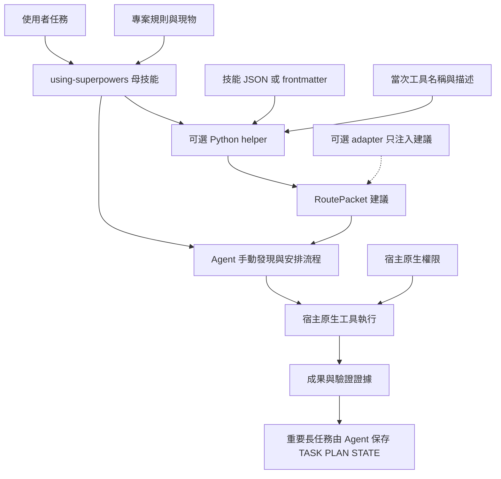
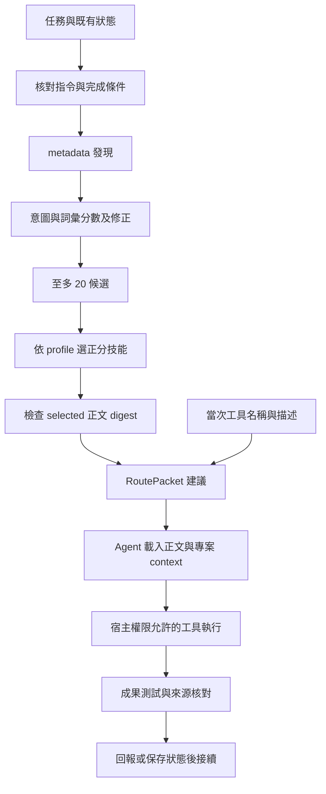

# V3 系統架構

Personal Tool Master V3 是以 `using-superpowers` 為母技能的工作流程層。它協助 Agent 理解任務、尋找技能、核對當次工具、形成小流程並驗證成果；工具執行與權限由宿主處理。

本系列說明已完成的 V3 實作，以 [程式 PR #27](https://github.com/juhjuhx/agent-skills/pull/27) 的 `402b972aadcef221f1cfd9c7f03b6423e76f34ee` 為讀碼基準。它記錄現有行為與限制，沒有新增 runtime。正式合併、文件版本、tag 與 GitHub Release 的核實位置見 [發布與遷移](V3_RELEASE_AND_MIGRATION.md)。文件存在本身不表示 Release 已建立。

## 原始需求與完成方式

使用者需要一個共用入口，把自然語言任務轉成可執行且可驗證的小流程。它應能沿用個人既有技能庫與宿主工具，避免每次預載整庫；強模型能自主選擇，較弱模型能得到具體步驟。研究、除錯、實作、審查與長任務續接應共用同一條路徑。

V3 以母技能指示、可選的標準庫 helper、兩個 advisory adapter 與文件式任務狀態實現需求。helper 選技能與產生封包；Agent 仍需真正載入正文、讀取專案、呼叫工具並取得驗證證據。跨宿主的設計目標與目前已測能力分開，見 [測試與限制](V3_TESTING_AND_LIMITATIONS.md)。

| 需求 | 現有實作 | 可檢查的邊界 |
|---|---|---|
| 單一任務入口 | [using-superpowers/SKILL.md](../../using-superpowers/SKILL.md) | 可由 native Skill 或原始檔案讀取載入；無 adapter 也能使用 |
| 找到少量相關技能 | metadata 先行、詞彙排序與有限候選 | 不把名稱當固定分類；不保證自然語言分類完整 |
| 對應真實工具 | 當次工具名稱與描述形成能力映射 | 名稱提示與工具存在都不是權限授予 |
| 對強／弱模型給合適指引 | guided、normal、high 共用流程 | 是封包詳細程度與選取上限；不切換模型或 provider |
| 長任務可續接 | TASK／PLAN／STATE 或專案等價文件 | Agent 自行寫入與核對；helper 不自動保存或恢復 |
| 路由故障仍能工作 | metadata fallback、一般流程與手動路由 | 宿主原生工具仍受原有權限控制 |
| 可公開安裝 | 14 技能、來源通知、installer、測試 | 個人完整庫、私人證據與未核實材料不是公開依賴 |

## 從技能庫到 advisory

| 階段 | 做法與問題 | V3 的決定 |
|---|---|---|
| 技能庫階段 | 收集技能與宿主入口；Agent 常收到大量 metadata，仍需自行選擇流程 | 保留技能檔案與按需載入，減少無關上下文 |
| 舊 enforcing 嘗試 | 歷史事故紀錄指出 `SKILL_CATALOG_STALE` 曾讓 `read`、`skill`、`bash`、`glob` 被路由前置 gate 阻擋 | 不讓 catalog freshness 或路由建議成為工具許可條件 |
| V3 advisory | 母技能與 helper 提供工作建議，adapter 故障降級；`tool.execute.before` 明確不執行 gate | 由宿主控制執行與權限，採少量技能與可驗證的小步驟 |

舊事故屬於使用者與歷史文件記錄；本輪沒有啟用舊 enforcing 來重演。舊 SQLite、policy、RuntimeDecision、TTL、TaskLease 或 ActionGrant 不構成 V3 的執行前置條件。這項判定來自 [V3 helper](../../runtime/skills-router/tool_master.py)、[OpenCode adapter](../../runtime/skills-router/adapters/opencode/skills-router.js) 與 [Claude adapter](../../runtime/skills-router/adapters/claude/skills-router-hook.py) 的實際控制流程。

## 圖 01：整體架構

以下框線代表責任分工，沒有額外服務程序。helper 與 adapter 可省略。

```text
使用者任務
    |
    v
using-superpowers 母技能 <----- 專案規則／README／source／tests
    |
    +---- 直接由 Agent 查 metadata、手動安排流程 ------+
    |                                                |
    +---- 可選 helper <---- 技能 JSON／frontmatter    |
              ^                                      |
              +--------- 本次已暴露工具名稱／描述    |
              |                                      |
              v                                      v
       RoutePacket 建議 ----------------------> Agent 執行
                                                     |
                                宿主工具 + 宿主權限  |
                                                     v
                                                  驗證證據
                                                     |
                                         重要長任務自行保存
                                                     v
                                             TASK／PLAN／STATE

可選 adapter：把建議放進宿主上下文；不決定工具是否准用。
```



## 圖 02：請求、發現與執行

metadata 發現、正文載入、工具執行與完成判定是四個不同動作。`--root` 指技能 repo，不是任務專案；封包的 `context_to_read` 只是下一步讀取建議，不表示 helper 已讀完專案。

```text
任務／既有狀態
    |
    v
核對適用指令與完成條件
    |
    v
metadata 發現 --> 意圖／分數／修正 --> 至多 20 候選
                                           |
                                    profile 選正分技能
                                           |
                                           v
                               只檢查 selected 正文 digest
                                           |
當次工具名稱／描述 ------------------------+
                                           v
                                     RoutePacket 建議
                                           |
                           Agent 載入需要的正文與專案 context
                                           |
                                    宿主權限允許的工具
                                           |
                                           v
                                  成果／測試／來源核對
                                           |
                               回報或更新長任務狀態後接續
```



## 權限與完成責任

母技能、metadata、分數、digest 與封包都不能授權工具。宿主判斷工具呼叫是否可用及是否需要確認；使用者與更高層指令決定任務範圍。Agent 不得將 `available`、被推薦技能、先前狀態或資料庫紀錄當成新的許可。

V3 不提供工具執行器、web search 引擎、模型調度、事件匯流排、policy server 或資料庫服務。需要 web／Git／委派時，使用當次已提供且範圍允許的能力；缺少能力就說明缺口並繼續可完成部分。[母技能](../../using-superpowers/SKILL.md) 同時要求把外部內容當資料，學習只形成可審查建議，不自動改寫共享技能。

## 文件導覽

| 文件 | 回答的問題 |
|---|---|
| 本文件 | V3 為何存在、系統邊界與演化 |
| [元件參考](V3_COMPONENT_REFERENCE.md) | 哪些檔案是實際元件、helper 怎麼選技能 |
| [工作流程與工具映射](V3_WORKFLOW_AND_TOOL_MAPPING.md) | 宿主差異、工具發現、模式與故障處理 |
| [儲存與狀態](V3_STORAGE_AND_STATE.md) | 哪些狀態保存、JSON／SQLite／私人證據如何區分 |
| [測試與限制](V3_TESTING_AND_LIMITATIONS.md) | 測試證明什麼、實碼的大小與時間上限 |
| [發布與遷移](V3_RELEASE_AND_MIGRATION.md) | 公開／個人範圍、Git 隔離、正式發布與回復 |

歷史候選驗收保留於 [2026-10-12 發布驗收紀錄](../發布驗收.md)。它記錄當時的範圍，不替代最終 Release、目前 CI 或新一輪模型實測。
