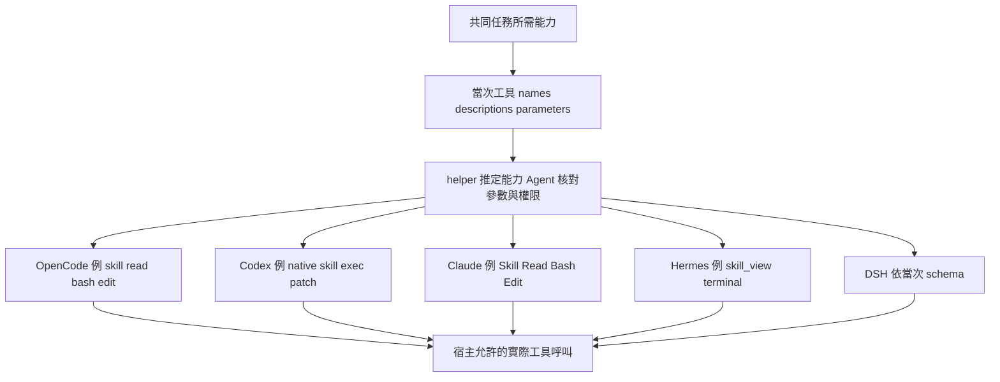
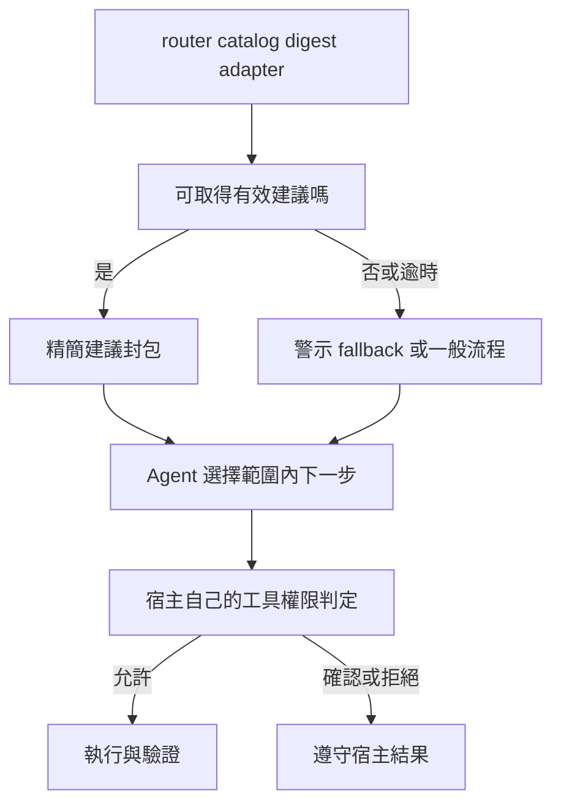

# V3 工作流程與工具映射

母技能安排工作；宿主提供當次工具並控制權限。helper 的 ToolMap 是以實際輸入的名稱與描述推得的建議，不能用先前 session、範例名稱或 host 參數取代本次工具發現。

實作來源為 [母技能](../../using-superpowers/SKILL.md)、[helper](../../runtime/skills-router/tool_master.py)、[OpenCode adapter](../../runtime/skills-router/adapters/opencode/skills-router.js) 與 [Claude hook](../../runtime/skills-router/adapters/claude/skills-router-hook.py)。

## 一次任務的操作

1. 讀適用規則、已有狀態與相關現物，確認目標、範圍和可觀察的完成條件。
2. 先查技能 metadata，選少量相關正文；需要時執行 helper。名稱只是查找鍵。
3. 檢查宿主真正提供的工具名稱、描述與參數 schema，把所需能力對應到可呼叫工具。
4. 載入必要正文與專案 context，形成小流程，執行第一個具體動作。
5. 取得成果、測試或來源證據，再回報完成。重要長任務由 Agent 更新 TASK／PLAN／STATE。

native Skill loader 可能處理模板、inline shell、計數或其他副作用；唯讀任務應選符合範圍的讀取方式。工具存在也不表示使用者已允許所有操作。

| 任務模式 | 母技能安排的流程 | helper 實際產生的建議 |
|---|---|---|
| 小修改／解釋 | 理解、執行、核對 | simple／general 不要求每次研究或 TDD |
| 研究／比較 | 查來源、讀原文、比较與引用 | research 建議使用已提供的搜尋／web 工具並核對日期 |
| 除錯 | 重現、找根因、最小修正、回歸 | debug 建議重現與實際測試 |
| 實作 | context、適用計畫、增量實作、驗證 | code 建議沿用介面與檢視 diff |
| 審查 | 唯讀核對、具體問題與證據 | review 明示不修改受審內容；PR 專用技能需真正 PR 語境 |
| 設計 | 依使用者需求確認方向、再使用領域技能 | 目前沒有獨立 design intent，依命中意圖或 general 處理 |

`guided`、`normal`、`high` 是建議 profile，預設 normal。helper 的 selected 上限分別為 3／5／8；guided 加入逐步說明提示，high 加入必要時拆分工作／驗證提示。它們不設定模型、推理強度、provider、費率、context window 或工具權限，也不代表弱模型已全面通過測試。

## 圖 04：宿主工具映射

圖中的名稱是需核對的例子；箭頭不代表本次 session 已暴露工具。

```text
共同任務需求：LOAD_SKILL / READ / SEARCH / PATCH / SHELL / WEB / ...
                                 |
                   本次實際 names + descriptions + parameters
                                 |
             helper 只推定能力；Agent 核對參數與宿主權限
                                 |
          +-------------+-------------+-------------+-------------+
          |             |             |             |             |
       OpenCode       Codex        Claude        Hermes          DSH
      skill/read      native       Skill/Read     skill_view      依本次
      bash/edit       exec/patch   Bash/Edit      terminal        schema
          |             |             |             |             |
          +-------------+-------------+-------------+-------------+
                                 |
                         宿主允許的實際工具呼叫

OpenCode：可選 advisory adapter；Claude：hook 格式契約，未預設安裝。
Codex／Hermes／DSH：母技能與原生工具；本 repo 無專用執行 adapter。
```



## 能力、實際工具與提示

helper 接受工具名稱陣列、工具物件、`tools`／`functions` 容器、OpenAI 形式的 `function` 物件，或名稱映射。它只讀名稱與描述；**不解析或驗證 parameters schema，不測試工具可達性，也不查詢宿主 permission**。參數與呼叫條件仍需在當次工具文件核對。

| 能力 | helper 可識別的名稱／描述例 | 使用邊界 |
|---|---|---|
| LOAD_SKILL | `skill`、`load_skill`、`skill_view`，或載入技能描述 | 身分、來源及 loader 副作用仍需核對 |
| READ | `read`、`read_file`、`view_file`，或明示讀取 local file | SQL 的 read-only query 不等於讀檔能力 |
| SEARCH | grep／glob／檔案搜尋描述 | 與 web search 分開；shell 也可提供檔案搜尋 |
| WRITE／PATCH | `write_file`、`edit`、`apply_patch` 等 | 路由不能擴大可寫路徑或覆寫範圍 |
| SHELL | `bash`、`shell`、`exec_command`、`terminal` 或 shell command 描述 | helper 同時映射 READ／SEARCH／WRITE／PATCH／TEST／GIT_READ／GIT_WRITE，但宿主可以限制這些動作 |
| WEB_SEARCH／WEB_FETCH | web search／fetch 描述；`web.run`／`web__run` 可辨識兩者 | fetch 單頁不等於已完成搜尋；不能編造來源 |
| DELEGATE | `task`、`agent`、`spawn_agent` 或委派描述 | 只有當次可用且指令允許時委派；沒有就自行順序完成 |
| TEST | `test`／`run_tests` 或測試描述 | 執行合適的專案命令，不以空口承諾代替 |
| GIT_READ／GIT_WRITE | 對應 Git 描述或 shell | 讀取與 commit／push／merge 的授權範圍不同 |

每個能力分開保存 `available` 與 `host_hints`。Codex 的內建提示包括 exec_command／apply_patch／web.run／spawn_agent；OpenCode 與 Claude 有各自常見名稱。`hermes`、`dsh`、`generic` 的 helper 提示表為空，仍可由實際名稱／描述映射。沒有傳入工具資料時，所有 `available` 都為空。

上游 [Hermes reference](../../using-superpowers/references/hermes-tools.md)、[Codex reference](../../using-superpowers/references/codex-tools.md) 與 [Claude reference](../../using-superpowers/references/claude-code-tools.md) 是特定版本的資料。版本說明、設定建議與費用敘述不能替代本次 schema、更高層指令或 live 驗證；V3 installer 不自動照 reference 改全域設定。

## 目前的宿主證據

| 宿主 | 現有整合與證據 | 未完整驗證 |
|---|---|---|
| OpenCode | 專用 advisory plugin；歷史 OpenCode 1.18.34／oh-my-openagent 5.1.19／MiMo 免費模型曾完成 research、debug 與文件式新 session 續接 | 本次公開 14 技能的模型 live E2E、所有版本／provider、每次 autoload、穩定 token 或 latency |
| Codex | 母技能／原生讀檔路徑；歷史真實 exec／patch／test 映射 | 所有 Codex 版本、第二個弱模型或完整跨宿主測試 |
| Claude Code | UserPromptSubmit additionalContext 與失敗空物件的契約測試 | hook 未預設安裝；live E2E 尚未完整驗證 |
| Hermes | 母技能 reference；`skill_view` 的 LOAD_SKILL mapping fixture | 無專用 adapter／installer host 入口；live E2E 尚未完整驗證 |
| DSH | 母技能 mapping 知識；有 CLI tools fixture | 無專用 adapter／installer host 入口；live E2E 尚未完整驗證 |

OpenCode 歷史研究案例記錄真實 search 2 次與 fetch 2 次；必要原生工具成功與完整模型輸出成功分開。最近一次歷史執行的 native tools 已完成，但整段摘要在 180 秒 timeout。這些紀錄不是本次精簡快照的 fresh 模型測試。公開可引用的歷史摘要與性能限制見 [測試與限制](V3_TESTING_AND_LIMITATIONS.md)，不公開原始 session／provider 資料。

## OpenCode adapter 的實際行為

`chat.message` 依 session ID 建立不重用的 Symbol request identity，擷取有界文字後呼叫 helper，將有效封包或 fallback 建議放進暫存 Map。預設 subprocess 只傳 `task`，**沒有提供完整宿主工具清單**；因此 Agent 仍需發現與核對本次 schema。不能把 adapter 啟動成功當成工具發現成功。

`experimental.chat.system.transform` 注入建議，且只有完整已識別的 native catalog 格式可縮小顯示 metadata；母技能與 selected 名稱保留。未知格式、包含範例／專案規則的混合文字保持原樣。`tool.definition` 沒有 session ID，只對完整已識別的 oh-my catalog 保留真正的母技能入口與提示，不拿其他 session 的 selected 名單當過濾條件。

這些處理可改變 catalog 的呈現，不修改 parameters、工具執行或 permission。未列出的技能與 command 仍可由宿主載入。`tool.execute.before` 是明確 no-op。逾時、損毀、舊回應或未知格式均只使路由降級；數值與 cache 上限見 [限制表](V3_TESTING_AND_LIMITATIONS.md)。

## Claude adapter 的實際行為

hook 從 stdin 讀 prompt／user_prompt，可接收 payload 中的 tools；成功時輸出 UserPromptSubmit 的 `additionalContext`。失敗輸出 `{}` 且 exit 0，沒有 `decision`、`suppressOriginalPrompt` 或工具 gate。

shell wrapper 在 hook 缺少或 Python 失敗時也回傳空物件。它沒有自己的執行逾時；測試程式的 10 秒 subprocess timeout 不是 runtime 的 timeout。installer 沒有寫入 Claude settings 或自動註冊 hook。安裝步驟與檔案身分核對見 [安裝與使用](../安裝與使用.md)。

## 圖 05：advisory 故障與宿主權限

```text
router／catalog／digest／adapter
              |
              v
       可取得有效建議？
          |          |
          是         否／timeout／malformed
          |          |
       精簡封包    警示／fallback／一般流程
          |          |
          +-----+----+
                v
        Agent 選擇範圍內的下一步
                |
                v
         宿主自己的工具權限判定
             |             |
          允許呼叫       宿主要求確認／拒絕
             |             |
          執行與驗證     遵守宿主結果

路由故障不產生 deny；宿主拒絕也不能由路由解除。
```



## 故障處理準則

catalog 損毀先探索 metadata，仍無結果用一般 workflow；helper 不存在就手動發現技能。digest 失配只略過該正文，重新確認來源或 metadata；不要禁用其他工具，也不要為了通過而悄悄改 digest。缺少 web、委派或測試能力時說明缺口，用已提供的替代完成可完成部分。

宿主拒絕與路由失敗是不同結果。V3 不自行安裝 MCP、不更換 provider、不擴權、不要求舊 preflight／TTL／資料庫票據。已在有效上下文的正文可沿用；壓縮、換模型或新 session 後，先讀狀態及必要正文，不能把以前載入成功當成現在仍在上下文的證明。
