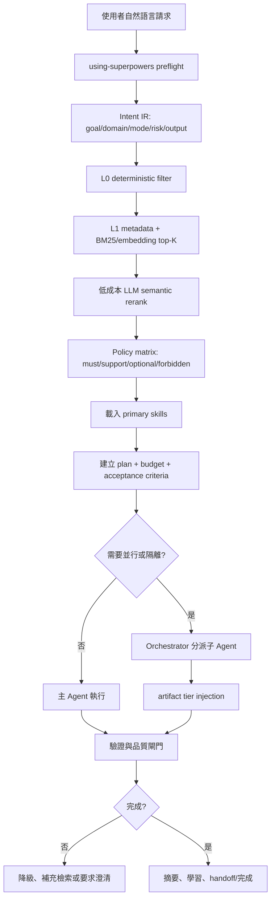

# juhjuhx/agent-skills 完整能力目錄與 using-superpowers 路由架構

> 產生日期：2026-08-02（15:30 依本機現況重新快照）
> 來源：`https://github.com/juhjuhx/agent-skills` 的目前安裝內容
> 安裝根目錄（Codex）：`/home/admin/.codex/skills`
> 安裝根目錄（OpenCode）：`~/.config/opencode/skills` + `~/.agents/skills`

## 1. 結論先行

本環境目前有 **214 個可用 repo skills**（Codex 與 OpenCode 兩端技能集合一致），每個目錄都包含 `SKILL.md`；另有 `brooks-_shared` 與 `logic-_shared` 兩個共用依賴，不計入 skill 數量。這份報告把每個 skill 的目錄名、顯示名、能力摘要與主要章節全部列出，並提供一套可讓 `using-superpowers` 成為固定前置閘門的意圖路由架構。

### 1.1 2026-08-02 安裝快照（重新驗證）

| 位置 | 實體 skill 目錄 | 其他項目 | 說明 |
|---|---|---|---|
| `~/.codex/skills` | 217 | `.system` | 214 個共享 skill + `agent-workspace-linux`（2026-08-02 新增，Codex 專用）+ `brooks-_shared`、`logic-_shared`；README 歷史數字 238（含 24 個 `addy-*` symlink）已不復存在 |
| `~/.config/opencode/skills` | 167 | 23 個失效 symlink、`categories.json` | 23 個 `addy-*` 分類 symlink 指向已刪除的 `/tmp/addy-skills`（重開機後失效），載入時自動略過，可安全刪除 |
| `~/.agents/skills` | 216 | `README.md`、`install.sh`、`skill-manager.sh`、`categories.json`、`.git` | 與 Codex 共用同一份 214 集合 + 2 個 `_shared` 依賴 |

`addy-*` 外部絕對路徑 symlink 沒有可攜的 `SKILL.md`，不算作可執行的 skill。九大類目錄（§9）與先前快照一致：**未新增、未移除任何共享 skill**。

### 這份架構的核心原則

1. 使用者指令永遠優先；`using-superpowers` 能強制工作流，但不能越過 system、權限、sandbox 或安全限制。
2. 每個任務先做 `using-superpowers` preflight，再做語意路由；不把 214 個完整 SKILL.md 一次塞入上下文。
3. 先用 metadata/關鍵字/向量檢索縮小候選，再用低成本 LLM 做語意 rerank，最後才載入 1-5 個真正需要的 skill。
4. 主 Agent 保留規劃、決策、整合與驗證；大型探索、測試、文件生成才隔離給子 Agent。
5. 每一步都有 budget、停止條件、驗證證據與 fallback；沒有驗證就不能宣稱完成。

## 2. 能力分層總覽

| 層 | 作用 | 典型 skill |
|---|---|---|
| L0 意圖與政策 | 判斷任務類型、風險、輸出與必用技能 | `using-superpowers`, `find-skills`, `pro-thoroughness-scoring` |
| L1 路由 metadata | 用名稱、描述、觸發詞與 embedding 找候選 | 全部 skill 的 frontmatter |
| L2 方法論 | 載入選定 skill 的流程、檢查表與限制 | `systematic-debugging`, `tdd`, `frontend-design` |
| L3 專用資源 | 只在需要時讀 references、scripts、templates、schemas | 各 skill 內的 `references/`, `scripts/`, `templates/` |
| L4 執行與驗證 | 工具、檔案、子 Agent、測試、review、handoff | `verification-before-completion`, `pro-orchestrate` |

## 3. 使用 `using-superpowers` 的強制啟用契約

### 3.1 建議的任務前置契約

把以下規則放入 workspace 的 `AGENTS.md`，或放入你使用的 Agent system/policy layer：

```yaml
skill_policy:
  preflight:
    must_load: [using-superpowers]
    must_emit:
      - normalized_intent
      - selected_skills
      - why_each_skill
      - risk_level
      - token_budget
      - latency_mode
      - acceptance_criteria
  routing:
    scan_full_catalog_when_no_exact_match: true
    max_primary_skills: 5
    max_optional_skills: 3
    process_skills_before_implementation_skills: true
  execution:
    do_not_act_before_preflight: true
    do_not_claim_done_without_evidence: true
    read_before_write: true
    compact_at_context_pct: 50
  safety:
    user_instructions_override_skill: true
    require_explicit_confirmation_for_external_side_effects: true
    never_infer_missing_permissions: true
```

這是真正可執行的「強制」邊界：在你自己的 orchestrator 中，可以讓沒有完成 preflight 的 task 不進入 `ready/running`；但 skill 不能凌駕使用者、系統安全規則或工具權限。

### 3.2 強制輸出格式

每次執行前，要求 Agent 先產生這個小型 routing record；它不是長篇解釋，而是可機器驗證的控制資料：

```json
{
  "normalized_intent": {
    "goal": "修復登入失敗問題",
    "domain": "software",
    "task_mode": "debug_fix",
    "artifact": "code_change",
    "risk": "medium",
    "external_side_effect": false,
    "acceptance_criteria": ["既有測試通過", "新增回歸測試"]
  },
  "selected_skills": [
    {"name": "using-superpowers", "role": "gate", "required": true},
    {"name": "systematic-debugging", "role": "process", "required": true},
    {"name": "tdd", "role": "implementation", "required": true},
    {"name": "verification-before-completion", "role": "verify", "required": true}
  ],
  "budget": {"max_tool_calls": 30, "max_context_pct": 70},
  "latency_mode": "balanced",
  "stop_conditions": ["tests pass", "acceptance criteria satisfied"]
}
```

## 4. 語意理解與路由架構



### 4.1 Intent IR: 讓模型理解「意圖」而不是只找關鍵字

```json
{
  "goal": "使用者真正想達成的結果",
  "domain": "software|ui|content|visual|video|3d|research|integration|meta",
  "task_mode": "answer|research|plan|create|edit|debug|review|publish|orchestrate",
  "objects": ["repo", "file", "image", "url", "PRD", "database"],
  "constraints": ["不要改 API", "使用繁中", "保持向後相容"],
  "artifact": "answer|code|image|html|pptx|markdown|issue|report",
  "risk": "low|medium|high|critical",
  "external_side_effect": false,
  "freshness_required": false,
  "ambiguity": 0.12,
  "token_budget": 12000,
  "latency_budget_ms": 120000,
  "acceptance_criteria": [],
  "language": "zh-TW"
}
```

### 4.2 四階段語意路由

| 階段 | 模型/方法 | 輸入 | 輸出 | 速度策略 |
|---|---|---|---|---|
| 1. Filter | regex、prefix、task metadata | 使用者請求 + skill name/description | 10-30 個候選 | 不呼叫大模型 |
| 2. Retrieve | BM25 或 embedding | 候選 skill 的短描述 | top-8 | 快速、可快取 |
| 3. Rerank | 小型 LLM、JSON schema | 請求 + top-8 描述 | top-3 primary + top-3 optional | 低 token、低延遲 |
| 4. Plan gate | 主模型 | Intent IR + selected skill | 執行計畫、依賴、驗證 | 只有複雜任務才執行 |

不要讓主模型直接讀 214 個 SKILL.md。最有效的上下文順序是：精準檢索 -> 只載入被選的 skill -> 需要時再讀 references/scripts；這遵循 `context-engineering` 的 Write、Select、Compress、Isolate 四個操作。

## 5. Skill 啟用矩陣

欄位語意：`GATE` = 永遠先用；`MUST` = 沒有它不應開始；`SUPPORT` = 視情況加入；`VERIFY` = 完成前必須執行；`STOP` = 何時停止，避免無限擴張。

| 任務意圖 | GATE | MUST | SUPPORT | VERIFY | 建議上限 |
|---|---|---|---|---|---|
| 一般問答/解釋 | `using-superpowers` | 無或 `understand-explain` | `logic-explain`, `zoom-out`, `find-skills` | 回答是否直接命中問題 | 1-2 skills |
| 找 skill/擴充能力 | `using-superpowers` | `find-skills` | `skill-development`, `write-a-skill` | skill 觸發條件可命中 | 2-3 |
| 新功能/多檔案開發 | `using-superpowers` | `brainstorming`, `writing-plans`, `pro-orchestrate` | `tdd`, `official-feature-dev`, `using-git-worktrees` | `verification-before-completion`, `requesting-code-review` | 4-6 |
| 小型 bug 修復 | `using-superpowers` | `systematic-debugging` | `diagnose`, `logic-locate`, `tdd` | `verification-before-completion` | 2-4 |
| 高難度 bug/性能回歸 | `using-superpowers` | `diagnose`, `systematic-debugging` | `logic-locate`, `logic-review`, `mathguard` | 測試、benchmark、回歸證據 | 3-5 |
| Code review/PR | `using-superpowers` | `requesting-code-review` 或 `official-code-review` | `pr-review-toolkit`, `brooks-review`, `code-review-excellence` | findings 有檔案/行號與嚴重度 | 3-5 |
| 架構/技術債 | `using-superpowers` | `zoom-out`, `improve-codebase-architecture` | `brooks-audit`, `brooks-debt`, `module-map` | 有優先級、影響與可執行 roadmap | 3-5 |
| UI/前端建立 | `using-superpowers` | `frontend-design` 或 `ui-ux-pro-max` | `design-system`, `ui-styling`, `design-taste-frontend` | `baseline-ui`, `fixing-accessibility`, `fixing-motion-performance` | 3-6 |
| UI redesign | `using-superpowers` | `redesign-existing-projects`, `design-taste-frontend` | `popular-web-designs`, `styleseed`, `gpt-taste` | `baseline-ui`, accessibility、responsive QA | 3-6 |
| 圖片/視覺資產 | `using-superpowers` | 對應 `baoyu-*`、`agnes-vision` 或 `baoyu-imagine` | `brandkit`, `banner-design`, `baoyu-diagram`, `baoyu-compress-image` | 尺寸、格式、可讀性、輸出檔案 | 2-5 |
| 文章/內容加工 | `using-superpowers` | `baoyu-url-to-markdown`、`baoyu-translate` 或 `baoyu-format-markdown` | `humanizer`, `youtube-content`, `baoyu-markdown-to-html` | 來源、語意、格式與引用 | 2-5 |
| 社群發佈 | `using-superpowers` | 對應 `baoyu-post-to-*` | `baoyu-image-cards`, `baoyu-translate`, `humanizer` | 發佈前預覽；外部 side effect 要確認 | 2-4 |
| 影片/簡報 | `using-superpowers` | `cinema-worldbuilder`, `visual-atelier` 或 `slides` | `baoyu-slide-deck`, `web-video-presentation`, `manim-video` | aspect ratio、分鏡、輸出可播放 | 2-5 |
| Three.js 3D | `using-superpowers` | `threejs-fundamentals` | geometry/materials/loaders/lighting/animation/interaction | `threejs-postprocessing`, shader/效能檢查 | 3-8 |
| 研究/Wiki/知識庫 | `using-superpowers` | `pro-wiki-builder` 或 `pro-wiki-query` | `pro-wiki-research-loop`, `pro-survey-generator`, `understand-knowledge` | 來源、去重、引用、budget | 2-5 |
| 多 Agent 調度 | `using-superpowers` | `multi-agent-orchestrator` 或 `pro-orchestrate` | `pro-agent-teams`, `dispatching-parallel-agents`, `subagent-driven-development` | plan validation、artifact、review | 4-8 |
| 高風險/外部副作用 | `using-superpowers` | `safe-mode`, `permission-tuner` | `llm-gate`, `runaway-guard`, `verification-before-completion` | 明確 confirmation、dry-run、audit trail | 3-6 |

## 6. 最有價值的 skill 組合

### 6.1 「理解 -> 規劃 -> 實作 -> 驗證」軟體工作流

`using-superpowers` -> `replay-learnings` -> `zoom-out` -> `understand` -> `brainstorming` -> `writing-plans` -> `pro-orchestrate` -> `tdd` -> `requesting-code-review` -> `verification-before-completion` -> `pro-wrap-up`

適合跨模組、需求不明確或需要可追蹤交付的工作。小修正不要啟用整串，使用下方的 fast path。

### 6.2 「根因優先」Bug workflow

`using-superpowers` -> `systematic-debugging` -> `diagnose` -> `logic-locate` -> `tdd` -> `verification-before-completion`

若是效能問題，加 `mathguard` 或 `fixing-motion-performance`；若是架構症狀，加 `brooks-audit` 或 `improve-codebase-architecture`。

### 6.3 「高品質前端」workflow

`using-superpowers` -> `brainstorming` -> `ui-ux-pro-max` -> `design-system` -> `frontend-design` -> `ui-styling` -> `baseline-ui` -> `fixing-accessibility` -> `fixing-motion-performance`

若需要品牌，加 `brand`/`brandkit`；若要反 AI 通用感，加 `design-taste-frontend`；若是既有網站改造，加 `redesign-existing-projects`。

### 6.4 「研究 -> 知識資產」workflow

`using-superpowers` -> `pro-wiki-query` -> `pro-wiki-research-loop` -> `pro-survey-generator` -> `pro-wiki-builder` -> `pro-wiki-viewer`

`pro-wiki-query` 先避免重複研究；`research-loop` 負責有 budget 的擴展；`builder/viewer` 把結果變成長期可查資產。

### 6.5 「多 Agent 且不污染主上下文」workflow

`using-superpowers` -> `multi-agent-orchestrator` -> `pro-context-engineering` -> `dispatching-parallel-agents` -> `pro-token-efficiency` -> `pro-llm-gate` -> `verification-before-completion`

Orchestrator 持有 state、routing、memory、artifact；worker 只產出 artifact，不直接修改 orchestrator state。使用 tiered injection：metadata + 200-token summary 優先，必要時才注入 excerpt 或檔案路徑。

## 7. Token 用量與生成速度控制

### 7.1 三種速度模式

| 模式 | 適用 | 路由深度 | Context 策略 | 典型 tool-call 上限 |
|---|---|---|---|---:|
| Fast | 問答、單檔、小修 | L0 -> L1 -> 1 個 primary skill | 不啟動子 Agent、不讀大型 reference | 20 |
| Balanced | 一般 bug、標準功能、UI | L0 -> L1 -> LLM rerank -> 2-5 skills | 50% compact、精準讀檔 | 30-50 |
| Deep | 大型功能、研究、跨層架構 | 完整 plan、並行 Agent、review gate | isolate、artifact tier、階段 compact | 65-80 |

這些是 orchestration policy 的控制上限，不是模型本身的硬性 token limit。真正的 input/output token 仍要依模型與工具計費資料測量。

### 7.2 上下文策略

- L0 只放 skill name、description、triggers；不要放完整 SKILL.md。
- L1 只載入 top-K 候選的 frontmatter 與必要規則。
- L2 只讀被選 skill 的流程段落；大型 reference 使用 progressive disclosure。
- L3 結果寫入 `NOTES.md`、artifact store 或 handoff，避免重複注入原始輸出。
- context 約 50% 時開始 compact；70% 以上停止無關探索；90% 以上直接 compact 或開新 session。
- MCP 與工具 schema 也算固定 overhead；只啟用當前 domain 需要的 connector。

### 7.3 不同任務的預算公式

```text
effective_budget = min(user_budget, model_budget, safety_budget)
retrieval_budget = 8 candidate summaries + 3 rerank results
primary_skill_budget = 1 gate + 1-2 process + 1-2 implementation + 1 verify
optional_skill_budget = max(0, 3 - primary_skill_count)
artifact_budget = metadata + summary first; excerpt only when confidence < threshold
```

當 `ambiguity > 0.35` 且 `risk >= medium`，先問一個最小澄清問題；當風險低時，採用最安全且可逆的預設並把假設寫進 routing record。

## 8. Orchestrator 的資料模型

如果要把這套方法真正做成可重複的系統，建議使用 SQLite 作 source of truth，而不是用 Markdown 當併發狀態：

| 資料表 | 保存內容 |
|---|---|
| `tasks` | intent、status、owner、risk、priority、budget、version |
| `events` | preflight、route、claim、tool、review、failure、done 的事件流 |
| `skills` | directory、name、description、triggers、embedding、version |
| `plans` | subtasks、dependencies、execution order、review strategy |
| `artifacts` | summary、excerpt、patch、test_log、file_path、provenance |
| `decisions` | 為何選/不選某 skill、模型、路由與 fallback |
| `resource_status` | Agent 可用性、並發數、目前負載 |
| `plan_metrics` | validation level、重試、降級、健康分數、實際 token/延遲 |

狀態機建議：`inbox -> planning -> planned -> ready -> claimed -> running -> review -> done`；另有 `blocked`、`failed`、`archived`。禁止 `running -> done`，必須經過 review/verification。

## 9. 完整 skills 目錄

以下每一筆都來自已安裝目錄的 `SKILL.md` frontmatter；「主要章節」用來提示需要進一步載入哪些方法與資源。

> 2026-08-02 重驗：九大類合計 214 個共享 skill，與先前快照完全一致；`agent-workspace-linux` 為 Codex 專用（codex-desktop Linux），未列於此目錄。

## 1. Agent foundations (14)

建立與擴充 Agent 生態：agents、commands、hooks、MCP、plugins、skills、handoff、觸發條件與規則驗證。

| 目錄 | 顯示名稱 | 能力摘要 | 主要章節 |
|---|---|---|---|
| `agent-development` | `Agent Development` | This skill should be used when the user asks to "create an agent", "add an agent", "write a subagent", "agent frontmatter", "when to use description", "agent examples", "agent tools", "agent colors", "autonomous agent", or needs guidance on agent structure, system prompts, triggering conditions, or agent development best practices for Claude Code plugins. | Overview, Agent File Structure, Complete Format, Frontmatter Fields, name (required), description (required), model (required), color (required), tools (optional), System Prompt Design, Structure, Best Practices, Creating Agents, Method 1: AI-Assisted Generation, Method 2: Manual Creation, Validation Rules, Identifier Validation, Description Validation, System Prompt Validation, Agent Organization, Plugin Agents Directory, Namespacing, Testing Agents, Test Triggering, Test System Prompt, Quick Reference, Minimal Agent, Frontmatter Fields Summary, Additional Resources, Reference Files, Example Files, Utility Scripts, Implementation Workflow |
| `command-development` | `Command Development` | This skill should be used when the user asks to "create a slash command", "add a command", "write a custom command", "define command arguments", "use command frontmatter", "organize commands", "create command with file references", "interactive command", "use AskUserQuestion in command", or needs guidance on slash command structure, YAML frontmatter fields, dynamic arguments, bash execution in commands, user interaction patterns, or command development best practices for Claude Code. | Overview, Command Basics, What is a Slash Command?, Critical: Commands are Instructions FOR Claude, Command Locations, File Format, Basic Structure, With YAML Frontmatter, YAML Frontmatter Fields, description, allowed-tools, model, argument-hint, disable-model-invocation, Dynamic Arguments, Using $ARGUMENTS, Using Positional Arguments, Combining Arguments, File References, Using @ Syntax, Multiple File References, Static File References, Bash Execution in Commands, Command Organization, Flat Structure, Namespaced Structure, Best Practices, Command Design, Argument Handling, Bash Commands, Documentation, Common Patterns, Review Pattern, Testing Pattern, Documentation Pattern, Workflow Pattern, Troubleshooting, Plugin-Specific Features, CLAUDE_PLUGIN_ROOT Variable, Plugin Command Organization, Plugin Command Patterns, Integration with Plugin Components, Agent Integration, Skill Integration, Hook Coordination, Multi-Component Workflows, Validation Patterns, Argument Validation, File Existence Checks, Plugin Resource Validation, Error Handling |
| `find-skills` | `find-skills` | Helps users discover and install agent skills when they ask questions like "how do I do X", "find a skill for X", "is there a skill that can...", or express interest in extending capabilities. This skill should be used when the user is looking for functionality that might exist as an installable skill. | When to Use This Skill, What is the Skills CLI?, How to Help Users Find Skills, Step 1: Understand What They Need, Step 2: Check the Leaderboard First, Step 3: Search for Skills, Step 4: Verify Quality Before Recommending, Step 5: Present Options to the User, Step 6: Offer to Install, Common Skill Categories, Tips for Effective Searches, When No Skills Are Found |
| `handoff` | `handoff` | Compact the current conversation into a handoff document for another agent to pick up. | SKILL.md 主流程 |
| `hook-development` | `Hook Development` | This skill should be used when the user asks to "create a hook", "add a PreToolUse/PostToolUse/Stop hook", "validate tool use", "implement prompt-based hooks", "use ${CLAUDE_PLUGIN_ROOT}", "set up event-driven automation", "block dangerous commands", or mentions hook events (PreToolUse, PostToolUse, Stop, SubagentStop, SessionStart, SessionEnd, UserPromptSubmit, PreCompact, Notification). Provides comprehensive guidance for creating and implementing Claude Code plugin hooks with focus on advanced prompt-based hooks API. | Overview, Hook Types, Prompt-Based Hooks (Recommended), Command Hooks, Hook Configuration Formats, Plugin hooks.json Format, Settings Format (Direct), Hook Events, PreToolUse, PostToolUse, Stop, SubagentStop, UserPromptSubmit, SessionStart, SessionEnd, PreCompact, Notification, Hook Output Format, Standard Output (All Hooks), Exit Codes, Hook Input Format, Environment Variables, Plugin Hook Configuration, Matchers, Tool Name Matching, Common Patterns, Security Best Practices, Input Validation, Path Safety, Quote All Variables, Set Appropriate Timeouts, Performance Considerations, Parallel Execution, Optimization, Temporarily Active Hooks, Hook Lifecycle and Limitations, Hooks Load at Session Start, Hook Validation at Startup, Debugging Hooks, Enable Debug Mode, Test Hook Scripts, Validate JSON Output, Quick Reference, Hook Events Summary, Best Practices, Additional Resources, Reference Files, Example Hook Scripts, Utility Scripts, External Resources, Implementation Workflow |
| `mcp-integration` | `MCP Integration` | This skill should be used when the user asks to "add MCP server", "integrate MCP", "configure MCP in plugin", "use .mcp.json", "set up Model Context Protocol", "connect external service", mentions "${CLAUDE_PLUGIN_ROOT} with MCP", or discusses MCP server types (SSE, stdio, HTTP, WebSocket). Provides comprehensive guidance for integrating Model Context Protocol servers into Claude Code plugins for external tool and service integration. | Overview, MCP Server Configuration Methods, Method 1: Dedicated .mcp.json (Recommended), Method 2: Inline in plugin.json, MCP Server Types, stdio (Local Process), SSE (Server-Sent Events), HTTP (REST API), WebSocket (Real-time), Environment Variable Expansion, MCP Tool Naming, Using MCP Tools in Commands, Lifecycle Management, Authentication Patterns, OAuth (SSE/HTTP), Token-Based (Headers), Environment Variables (stdio), Integration Patterns, Pattern 1: Simple Tool Wrapper, Pattern 2: Autonomous Agent, Pattern 3: Multi-Server Plugin, Security Best Practices, Use HTTPS/WSS, Token Management, Permission Scoping, Error Handling, Connection Failures, Tool Call Errors, Configuration Errors, Performance Considerations, Lazy Loading, Batching, Testing MCP Integration, Local Testing, Validation Checklist, Debugging, Enable Debug Logging, Common Issues, Quick Reference, Configuration Checklist, Best Practices, Additional Resources, Reference Files, Example Configurations, External Resources, Implementation Workflow |
| `output-skill` | `full-output-enforcement` | Enforce complete, unabridged code output — no truncation, no placeholders. Use when: full output、完整輸出、don't truncate、write full file、no placeholders、完整代碼、exhaustive output、no shortcuts。 | Baseline, Banned Output Patterns, Execution Process, Handling Long Outputs, Quick Check |
| `plugin-settings` | `Plugin Settings` | This skill should be used when the user asks about "plugin settings", "store plugin configuration", "user-configurable plugin", ".local.md files", "plugin state files", "read YAML frontmatter", "per-project plugin settings", or wants to make plugin behavior configurable. Documents the .claude/plugin-name.local.md pattern for storing plugin-specific configuration with YAML frontmatter and markdown content. | Overview, File Structure, Basic Template, Example: Plugin State File, Reading Settings Files, From Hooks (Bash Scripts), From Commands, From Agents, Parsing Techniques, Extract Frontmatter, Read Individual Fields, Read Markdown Body, Common Patterns, Pattern 1: Temporarily Active Hooks, Pattern 2: Agent State Management, Pattern 3: Configuration-Driven Behavior, Creating Settings Files, Template Generation, Configuration, Best Practices, File Naming, Gitignore, Defaults, Validation, Restart Requirement, Changing Settings, Security Considerations, Sanitize User Input, Validate File Paths, Permissions, Real-World Examples, multi-agent-swarm Plugin, ralph-wiggum Plugin, Quick Reference, File Location, Frontmatter Parsing, Body Parsing, Quick Exit Pattern, Additional Resources, Reference Files, Example Files, Utility Scripts, Implementation Workflow |
| `plugin-structure` | `Plugin Structure` | This skill should be used when the user asks to "create a plugin", "scaffold a plugin", "understand plugin structure", "organize plugin components", "set up plugin.json", "use ${CLAUDE_PLUGIN_ROOT}", "add commands/agents/skills/hooks", "configure auto-discovery", or needs guidance on plugin directory layout, manifest configuration, component organization, file naming conventions, or Claude Code plugin architecture best practices. | Overview, Directory Structure, Plugin Manifest (plugin.json), Required Fields, Recommended Metadata, Component Path Configuration, Component Organization, Commands, Agents, Skills, Hooks, MCP Servers, Portable Path References, ${CLAUDE_PLUGIN_ROOT}, Path Resolution Rules, File Naming Conventions, Component Files, Supporting Files, Auto-Discovery Mechanism, Best Practices, Organization, Naming, Portability, Maintenance, Common Patterns, Minimal Plugin, Full-Featured Plugin, Skill-Focused Plugin, Troubleshooting |
| `skill-development` | `Skill Development` | This skill should be used when the user wants to "create a skill", "add a skill to plugin", "write a new skill", "improve skill description", "organize skill content", or needs guidance on skill structure, progressive disclosure, or skill development best practices for Claude Code plugins. | About Skills, What Skills Provide, Anatomy of a Skill, Progressive Disclosure Design Principle, Skill Creation Process, Step 1: Understanding the Skill with Concrete Examples, Step 2: Planning the Reusable Skill Contents, Step 3: Create Skill Structure, Step 4: Edit the Skill, Additional Resources, Reference Files, Example Files, Step 5: Validate and Test, Step 6: Iterate, Plugin-Specific Considerations, Skill Location in Plugins, Auto-Discovery, No Packaging Needed, Testing in Plugins, Examples from Plugin-Dev, Progressive Disclosure in Practice, What Goes in SKILL.md, What Goes in references/, What Goes in examples/, What Goes in scripts/, Writing Style Requirements, Imperative/Infinitive Form, Third-Person in Description, Objective, Instructional Language, Validation Checklist, Common Mistakes to Avoid, Mistake 1: Weak Trigger Description, Mistake 2: Too Much in SKILL.md, Mistake 3: Second Person Writing, Mistake 4: Missing Resource References, Examples, Quick Reference, Minimal Skill, Standard Skill (Recommended), Complete Skill, Best Practices Summary, Study These Skills, Implementation Workflow |
| `using-superpowers` | `using-superpowers` | Meta-skill: establishes skill discovery and invocation rules. Use when: starting any session, skill not triggering, find available skills, use superpowers,能力啟用。 | Instruction Priority, How to Access Skills, Platform Adaptation, The Rule, Red Flags, Skill Priority, Skill Types, User Instructions, Pitfalls |
| `write-a-skill` | `write-a-skill` | Create new agent skills with proper structure, progressive disclosure, and bundled resources. Use when user wants to create, write, or build a new skill. | Process, Skill Structure, SKILL.md Template, Quick start, Workflows, Advanced features, Description Requirements, When to Add Scripts, When to Split Files, Review Checklist |
| `writing-rules` | `Writing Hookify Rules` | This skill should be used when the user asks to "create a hookify rule", "write a hook rule", "configure hookify", "add a hookify rule", or needs guidance on hookify rule syntax and patterns. | Overview, Rule File Format, Basic Structure, Frontmatter Fields, Advanced Format (Multiple Conditions), Message Body, Event Type Guide, bash Events, file Events, stop Events, prompt Events, Pattern Writing Tips, Regex Basics, Testing Patterns, Common Pitfalls, File Organization, Workflow, Creating a Rule, Refining a Rule, Disabling a Rule, Examples, Quick Reference |
| `writing-skills` | `writing-skills` | Use when creating new skills, editing existing skills, or verifying skills work before deployment | Overview, What is a Skill?, TDD Mapping for Skills, When to Create a Skill, Skill Types, Technique, Pattern, Reference, Directory Structure, SKILL.md Structure, When to Use, Core Pattern (for techniques/patterns), Quick Reference, Implementation, Common Mistakes, Real-World Impact (optional), Claude Search Optimization (CSO), 1. Rich Description Field, 2. Keyword Coverage, 3. Descriptive Naming, 4. Token Efficiency (Critical), 4. Cross-Referencing Other Skills, Flowchart Usage, Code Examples, File Organization, Self-Contained Skill, Skill with Reusable Tool, Skill with Heavy Reference, The Iron Law (Same as TDD), Testing All Skill Types, Discipline-Enforcing Skills (rules/requirements), Technique Skills (how-to guides), Pattern Skills (mental models), Reference Skills (documentation/APIs), Common Rationalizations for Skipping Testing, Bulletproofing Skills Against Rationalization, Close Every Loophole Explicitly, Address "Spirit vs Letter" Arguments, Build Rationalization Table, Create Red Flags List, Red Flags - STOP and Start Over, Update CSO for Violation Symptoms, RED-GREEN-REFACTOR for Skills, RED: Write Failing Test (Baseline), GREEN: Write Minimal Skill, REFACTOR: Close Loopholes, Anti-Patterns, ❌ Narrative Example, ❌ Multi-Language Dilution, ❌ Code in Flowcharts, ❌ Generic Labels, STOP: Before Moving to Next Skill, Skill Creation Checklist (TDD Adapted), Discovery Workflow, The Bottom Line |

## 2. Orchestration, context and safety (42)

管理複雜任務的階段、上下文、子代理、Token、成本、權限、品質閘控、工作樹與交接。

| 目錄 | 顯示名稱 | 能力摘要 | 主要章節 |
|---|---|---|---|
| `brainstorming` | `brainstorming` | Explore intent, requirements, and design before implementation. Use when: 腦力激盪、brainstorm、創意發想、explore ideas、design before code、discuss approach、think through design、explore options。 | Anti-Pattern: "This Is Too Simple To Need A Design", Checklist, Process Flow, The Process, After the Design, Key Principles, Visual Companion |
| `caveman` | `caveman` | Ultra-compressed communication mode. Cuts token usage ~75% by dropping filler, articles, and pleasantries while keeping full technical accuracy. Use when user says "caveman mode", "talk like caveman", "use caveman", "less tokens", "be brief", or invokes /caveman. | Persistence, Rules, Examples, Auto-Clarity Exception |
| `dispatching-parallel-agents` | `dispatching-parallel-agents` | Dispatch one agent per independent problem for concurrent investigation. Use when: 並行代理、parallel agents、multiple bugs、independent tasks、concurrent work、parallel investigation、多任務並行。 | Overview, When to Use, The Pattern, 1. Identify Independent Domains, 2. Create Focused Agent Tasks, 3. Dispatch in Parallel, 4. Review and Integrate, Agent Prompt Structure, Common Mistakes, When NOT to Use, Real Example from Session, Key Benefits, Verification, Real-World Impact |
| `executing-plans` | `executing-plans` | Load and execute a written implementation plan with review checkpoints. Use when: 執行計劃、execute plan、implement plan、run plan、carry out plan、執行方案、implementation time。 | Overview, The Process, Step 1: Load and Review Plan, Step 2: Execute Tasks, Step 3: Complete Development, When to Stop and Ask for Help, When to Revisit Earlier Steps, Remember, Integration |
| `finishing-a-development-branch` | `finishing-a-development-branch` | Use when implementation is complete, all tests pass, and you need to decide how to integrate the work - guides completion of development work by presenting structured options for merge, PR, or cleanup | Overview, The Process, Step 1: Verify Tests, Step 2: Detect Environment, Step 3: Determine Base Branch, Step 4: Present Options, Step 5: Execute Choice, Summary, Test Plan, Step 6: Cleanup Workspace, Quick Reference, Common Mistakes, Red Flags |
| `grill-me` | `grill-me` | Interview the user relentlessly about a plan or design until reaching shared understanding, resolving each branch of the decision tree. Use when user wants to stress-test a plan, get grilled on their design, or mentions "grill me". | SKILL.md 主流程 |
| `grill-with-docs` | `grill-with-docs` | Grilling session that challenges your plan against the existing domain model, sharpens terminology, and updates documentation (CONTEXT.md, ADRs) inline as decisions crystallise. Use when user wants to stress-test a plan against their project's language and documented decisions. | Domain awareness, File structure, During the session, Challenge against the glossary, Sharpen fuzzy language, Discuss concrete scenarios, Cross-reference with code, Update CONTEXT.md inline, Offer ADRs sparingly |
| `multi-agent-handoff` | `multi-agent-handoff` | Pick up work when another agent (Codex, Claude Code, agy, OpenCode) runs out of credits, crashes, or the user says "X is done, continue with Y". Covers context discovery, commit organization, task board updates, and validation. | When to use, Step 1: Discover Context (2-3 min), Step 1b: Review Dirty Diff Before Committing, Pitfall: Protected file violations, Step 2: Commit Pending Work FIRST, Organize commits by logical group:, Pitfall: Git secret-detection hooks, Pitfall: Mixed agent work in one commit, Step 3: Continue the Work Queue, Step 4: Validate Against Actual Codebase, Step 5: Write Handoff Document to Task Board, ═══════════════════════════════════════════, Current Git State, Uncommitted Dirty Files, Work Completed (next agent does NOT need to redo), Code Review Findings (if dirty diff was reviewed), Exact Recovery Steps, Blocking Items Requiring User Action, Remaining Tasks (Phase N), Step 6: Report Back, ArtFactory-Specific Reference |
| `multi-agent-orchestrator` | `multi-agent-orchestrator` | Design and build multi-agent orchestration systems — SQLite task store, state machines with transition matrices, plan validation with progressive degradation, artifact injection pipelines, optimistic locking for concurrency, CLI-first DX. Use when: 多agent調度、orchestrator、task store、agent routing、state machine、plan validation、multi-agent coordination、任務分派。 | When to Use, Architecture Pattern, Core Components, 1. SQLite State Store, 2. State Machine with Transition Matrix, 3. Plan Validation + Progressive Degradation, 4. Artifact Injection (Tiered), 5. Concurrency Control, 6. Recovery Metrics & Health Report, 7. CLI Migration (Gemini → Antigravity), Pitfalls, CLI DX Patterns (Pre-GUI Phase), Test Strategy, Full-System Audit Pattern (Parallel Subagents), CLI Command Reference (`hermes-orch`), References |
| `plan` | `plan` | Plan mode: write an actionable markdown plan to .hermes/plans/, no execution. Bite-sized tasks, exact paths, complete code. | Core behavior, Output requirements, Save location, Interaction style, Overview, When a Full Implementation Plan Helps, Bite-Sized Task Granularity, Task 1: Build authentication system, Task 1: Create User model with email field, Task 2: Add password hash field to User, Task 3: Create password hashing utility, Plan Document Structure, Header (Required), Task Structure, Task N: [Descriptive Name], Writing Process, Step 1: Understand Requirements, Step 2: Explore the Codebase, Step 3: Design Approach, Step 4: Write Tasks, Step 5: Add Complete Details, Step 6: Review the Plan, Principles, DRY (Don't Repeat Yourself), YAGNI (You Aren't Gonna Need It), TDD (Test-Driven Development), Frequent Commits, Common Mistakes, Vague Tasks, Incomplete Code, Missing Verification, Missing File Paths, Execution Handoff, Remember |
| `pro-agent-teams` | `agent-teams` | Coordinate multiple Claude Code sessions as a team with shared tasks and messaging. Use when: 代理團隊、agent teams、multiple sessions、team coding、shared task list、coordinate agents、多agent協作。 | Enable, Architecture, Team Sizing, Display Modes, Task Management, Task Decomposition, Dependencies, File-Lock Claiming, Plan Approval, Delegate Mode, Hook Events, When to Use Teams vs Alternatives, Anti-Patterns, Example Session, Docs |
| `pro-auto-setup` | `auto-setup` | Auto-configure quality gates, hooks, and settings for a new project. Detects project type and sets up appropriate tooling. Use when onboarding a new codebase. | Trigger, Detection, Step 1: Identify Project Type, Step 2: Configure Quality Gates, Step 3: Verify Tools Are Installed, Step 4: Create Configuration, Output, Rules |
| `pro-batch-orchestration` | `batch-orchestration` | Decompose large-scale changes into independent units and spawn parallel agents in isolated worktrees. Use for migrations, refactors, codemods, and any change touching 10+ files with the same pattern. | How It Works, Syntax, Phase 1: Research, Phase 2: Decompose, Phase 3: Plan Approval, Phase 4: Execute, Phase 5: Collect, Best For, Anti-Patterns, Relationship to Other Patterns, Guardrails |
| `pro-compact-guard` | `compact-guard` | Smart context compaction with state preservation. Saves critical files, task progress, and working state before compaction, restores after. Use before manual compact or when auto-compact triggers. | Trigger, Key Constants (from Claude Code source), Pre-Compact Checklist, Strategy: Microcompact First, Post-Compact Recovery, Prevention Strategies, Output, Rules |
| `pro-context-engineering` | `context-engineering` | Master context engineering — Write, Select, Compress, Isolate operations for AI sessions. Use when: 上下文工程、context engineering、token budget、compaction、context management、session optimization。 | The Four Operations, 1. Write — Persist Info Outside Context, 2. Select — Retrieve Relevant Info, 3. Compress — Reduce Tokens, Preserve Signal, 4. Isolate — Partition Across Execution Spaces, Context Budget Planning, When to /clear vs /compact vs Subagent, Anti-Patterns, Add to CLAUDE.md, Context Engineering |
| `pro-context-optimizer` | `context-optimizer` | Optimize token usage and context management. Use when sessions feel slow, context is degraded, or you're running out of budget. | Quick Diagnosis, Optimization Strategies, Immediate, Configuration, MCP Audit, Prompt Engineering for Token Efficiency, Subagent Delegation, Context Budget Planning, Token Efficiency, Output Reduction (40-60% savings), Behavioral Efficiency, Task Profiles, CLAUDE.md Optimization, When Context Is Degraded |
| `pro-cost-tracker` | `cost-tracker` | Track session costs, set budget alerts, and optimize token spend. Use to check costs mid-session or set spending limits. | Trigger, Cost Awareness, Check Current Costs, Cost Drivers, Token Budget by Task Type, Tool-Call Budgets, Optimization Strategies, Budget Alerts, Output, Rules |
| `pro-file-watcher` | `file-watcher` | Configure file watching hooks to auto-react to config changes, env file updates, and dependency modifications. Use to set up reactive workflows. | Trigger, How File Watching Works, Environment Injection, Common Watch Patterns, Watch .env for Changes, Watch package.json for Dependency Changes, Watch tsconfig.json for Config Changes, Setup, Rules |
| `pro-insights` | `insights` | Show session analytics, learning patterns, correction trends, heatmaps, and productivity metrics. Computes stats from project memory and session history. Use when asking for stats, statistics, progress, how am I doing, coding history, or dashboard. | Trigger, Data Sources, What It Shows, Session Summary, Learning Analytics, Correction Heatmap, Productivity Metrics, Guardrails, Output |
| `pro-learn-rule` | `learn-rule` | Capture a correction or lesson as a persistent learning rule with category, mistake, and correction. Stores, categorises, and retrieves rules for future sessions. Use after mistakes or when the user says "remember this", "don't forget", "note this", or "learn from this". | Trigger, Workflow, Format, Wiki-scoped rules, Categories, Example, Guardrails, Output |
| `pro-llm-council` | `llm-council` | Provider-agnostic multi-LLM deliberation. Three phases — independent responses, cross-model anonymized ranking, chairman synthesis. Provider config from env (OPENAI/ANTHROPIC/FIREWORKS/OPENROUTER/custom OpenAI-compatible base URL). Persists transcript to a wiki page when --wiki <slug> is passed. Use when the user wants multiple AI perspectives, consensus-building, or the "LLM Council" approach for high-stakes reviews, plan critique, or contested learning rules. | When to use, Three phases, Provider config, Commands, Output, Hard rules, Cost awareness, Use with wiki |
| `pro-llm-gate` | `llm-gate` | LLM-powered quality verification using prompt hooks. Validates commit messages, code patterns, and conventions using AI before allowing operations. Use to set up intelligent guardrails. | Trigger, How Prompt Hooks Work, Example Gates, Conventional Commit Validator, Destructive Command Guard, API Key Leak Prevention, Agent Hooks, Setup Guide, Rules |
| `pro-orchestrate` | `orchestrate` | Wire Commands, Agents, and Skills together for complex multi-phase features. Use when: 編排、orchestration、complex feature、multi-phase development、research-then-implement、coordinate skills、大型功能。 | The Pattern, Usage, When to Use This, When NOT to Use This, Agent Selection, Integration with Pro-Workflow |
| `pro-parallel-worktrees` | `parallel-worktrees` | Create git worktrees for parallel coding sessions with zero dead time. Use when: 並行工作樹、git worktree、parallel branches、context switching、work on multiple branches、waiting on tests、zero dead time。 | Trigger, Quick Start, Claude Code Extras, Workflow, Commands, Usage Pattern, When to Parallelize, Guardrails, Output |
| `pro-permission-tuner` | `permission-tuner` | Analyze permission denial patterns and generate optimized alwaysAllow and alwaysDeny rules. Use when permission prompts are slowing you down or after sessions with many denials. | Trigger, Workflow, Analysis, Step 1: Gather Permission Data, Step 2: Identify Safe Patterns, Step 3: Generate Rules, Output, Rules |
| `pro-plan-interrogate` | `plan-interrogate` | Stress-test a plan by walking its decision tree one question at a time. Use when the user wants to pressure-test a design before implementation. | Method, Anti-patterns, Output contract |
| `pro-pro-workflow` | `pro-workflow` | Complete AI coding workflow: orchestration patterns, hooks, agents, learnings. Use when: 工作流、workflow、AI coding workflow、development process、hook events、agent orchestration、dev workflow。 | The Core Insight, 1. The Self-Correction Loop, How It Works, Add to CLAUDE.md, Self-Correction Protocol, LEARNED, Trigger Phrases, Example Flow, 1b. Pre-Flight Discipline, Pre-Flight Discipline, 2. Parallel Sessions with Worktrees, Setup, Background Agent Management *(Claude Code)*, When to Parallelize, Parallel Work, 3. The Wrap-Up Ritual, /wrap-up Checklist, Create Command, 4. Split Memory Architecture, Structure, AGENTS.md, Planning, Quality Gates, Subagents, SOUL.md, 5. The 80/20 Review Pattern, Review Points, Review Checkpoints, 6. Model Selection, Adaptive Thinking, Model Hints (as of 2025-08), 7. Context Discipline, Rules, Context Compaction, Good Compact Points, 8. Learning Log, Learning Log, Learn Claude Code, Quick Setup, Minimal, Pro Workflow, Self-Correction, Quality, Full Setup, Hooks *(Claude Code)*, PreToolUse Hooks, PostToolUse Hooks, Session Hooks, Install Hooks, Hook Philosophy, Contexts, Agents, When to Delegate, Custom Subagents *(Claude Code)*, Agent Teams *(Claude Code, Experimental)*, 9. Orchestration: Command > Agent > Skill, The Architecture, Multi-Phase Development (/develop), Agent Skills (Preloaded), On-Demand Skills (Invoked), When to Orchestrate, 10. Daily Habits, Every Session, Context Management, Cross-Agent Tips, MCP Config *(Claude Code)*, Commands *(Claude Code)*, Reference Guides, Philosophy |
| `pro-replay-learnings` | `replay-learnings` | Surface past learnings relevant to the current task before starting work. Searches correction history, recalls past mistakes, and applies prior patterns. Use when starting a task, saying "what do I know about", "previous mistakes", "lessons learned", or "remind me about". | Trigger, Workflow, Output, Guardrails |
| `pro-safe-mode` | `safe-mode` | Prevent destructive operations using Claude Code hooks. Three modes — cautious (warn on dangerous commands), lockdown (restrict edits to one directory), and clear (remove restrictions). Uses PreToolUse matchers for Bash, Edit, and Write. | Modes, Cautious Mode, Lockdown Mode, Clear, Implementation, PreToolUse Hook — Bash (Cautious Mode), PreToolUse Hook — Edit/Write (Lockdown Mode), State, Combining Modes, When to Use, Anti-Patterns |
| `pro-session-handoff` | `session-handoff` | Generate a structured handoff document capturing current progress, open tasks, key decisions, and context needed to resume work. Use when ending a session, saying "continue later", "save progress", "session summary", or "pick up where I left off". | Trigger, Workflow, Commands, Output, Status, What's Done, What's In Progress, What's Pending, Key Decisions Made, Learnings Captured, Files Touched, Gotchas for Next Session, Resume Command, Guardrails |
| `pro-skill-optimizer` | `skill-optimizer` | SkillOpt-flavored offline training loop for any SKILL.md. Treats accumulated learn-rule corrections as training trajectories, proposes bounded patches via an optimizer LLM, gates each candidate against a held-out validation set built from the user's own past corrections, and ships only candidates that demonstrably improve the score. Inspired by Microsoft SkillOpt's ReflACT pipeline (rollout → reflect → aggregate → select → update → evaluate) adapted to pro-workflow's SQLite store. Use when a skill has accumulated 8+ learn-rule rows and the user wants the skill itself to get better, not just longer. | When to use, Architecture (mirrors SkillOpt's six-stage loop), Run it, Output, Rules, Provenance |
| `pro-smart-commit` | `smart-commit` | Run quality gates, review staged changes for issues, and create a well-crafted conventional commit. Use when saying "commit", "git commit", "save my changes", or ready to commit after making changes. | Trigger, Workflow, Commands, Code Review Scan, Commit Message Format, Guardrails, Output, Review Suppressions |
| `pro-sprint-status` | `sprint-status` | Track parallel work sessions and prevent confusion across multiple Claude Code instances. Every major step ends with a status line. Every question re-states project, branch, and task. | Session Identification, Detecting Parallel Sessions, Status Lines, STATUS: COMPLETE, STATUS: COMPLETE_WITH_NOTES, STATUS: BLOCKED, STATUS: NEEDS_INFO, Parallel Session Patterns, Pattern 1: Feature + Tests, Pattern 2: Independent Features, Pattern 3: Stacked Changes, When to Report Status, Sprint Dashboard, Anti-Patterns, Add to CLAUDE.md, Sprint Status |
| `pro-thoroughness-scoring` | `thoroughness-scoring` | Score every decision point with a Thoroughness Rating (1-10). AI makes the marginal cost of doing things properly near-zero — pick the higher-rated option every time. Includes scope checks to distinguish contained vs unbounded work. | The Rating Scale, How to Present Options, 1. Re-State Context, 2. Rate Each Option, 3. Recommend, Scope Check, Contained Scope (Do It), Unbounded Scope (Break It Down), Decision Framework, When Scoring Doesn't Apply, Anti-Patterns, Add to CLAUDE.md, Thoroughness Scoring |
| `pro-token-efficiency` | `token-efficiency` | Reduce token waste 40-60% via anti-sycophancy, tool-call budgets, one-pass coding. Use when: token效率、token efficiency、save tokens、reduce cost、verbose output、too many tokens、節省token。 | Trigger, Anti-Sycophancy Rules, Tool-Call Budgets, One-Pass Coding Discipline, Task Profiles, Coding Profile, Agent/Pipeline Profile, Analysis Profile, Read-Before-Write Enforcement, ASCII-Only Output, Measuring Impact, Attribution |
| `pro-wrap-up` | `wrap-up` | End-of-session ritual that audits changes, runs quality checks, captures learnings, and produces a session summary. Use when saying "wrap up", "done for the day", "finish coding", or ending a coding session. | Trigger, Workflow, Commands, Learning Categories, Guardrails, Output |
| `runaway-guard` | `runaway-guard` | Use when writing or reviewing code that calls a paid AI / inference API in a loop, queue, retry path, agent step, webhook handler, or background job — Fal.ai, Anthropic, OpenAI, Replicate, ElevenLabs, Together, Groq, Cohere, Mistral, fal-client, @anthropic-ai/sdk, openai, replicate. Treats dollar cost as a third complexity dimension alongside time and space. Forces writing a per-run $-cap, a per-day $-cap, a max-iterations bound, and a concurrency limit BEFORE the call site is written — and forces a matching hard cap at the provider dashboard so a code bug cannot bypass it. The canonical failure is a $200 overnight bill from a retry loop that "obviously terminates" but did not. Pairs with invariant-guard (termination is now a wallet invariant) and complexity-cuts (when the runaway already shipped). | The Iron Law, Non-negotiable rules, The pre-write protocol, Worked trap — the Inngest + Fal $200 night, Common runaway patterns and their wallet invariants, Provider-specific cheat sheet, Fal.ai, Anthropic, OpenAI, Replicate, ElevenLabs, Inngest (queue layer — not paid AI but the multiplier), Edge cases to enumerate before shipping, Output discipline, When to escalate or redirect, Rationalizations to watch for, Red flags — STOP and write the cost contract first, Verification checklist, The thesis, in one line |
| `setup-matt-pocock-skills` | `setup-matt-pocock-skills` | Sets up an `## Agent skills` block in AGENTS.md/CLAUDE.md and `docs/agents/` so the engineering skills know this repo's issue tracker (GitHub or local markdown), triage label vocabulary, and domain doc layout. Run before first use of `to-issues`, `to-prd`, `triage`, `diagnose`, `tdd`, `improve-codebase-architecture`, or `zoom-out` — or if those skills appear to be missing context about the issue tracker, triage labels, or domain docs. | Process, 1. Explore, 2. Present findings and ask, 3. Confirm and edit, 4. Write, Agent skills, Issue tracker, Triage labels, Domain docs, 5. Done |
| `subagent-driven-development` | `subagent-driven-development` | Execute implementation plans by dispatching fresh subagents per task with two-stage review. Use when: subagent、多代理開發、execute plan、dispatch agents、parallel tasks、independent tasks、implementation plan。 | When to Use, The Process, Model Selection, Handling Implementer Status, Prompt Templates, Example Workflow, Advantages, Red Flags, Integration |
| `using-git-worktrees` | `using-git-worktrees` | Use when starting feature work that needs isolation from current workspace or before executing implementation plans - ensures an isolated workspace exists via native tools or git worktree fallback | Overview, Step 0: Detect Existing Isolation, Step 1: Create Isolated Workspace, 1a. Native Worktree Tools (preferred), 1b. Git Worktree Fallback, Step 3: Project Setup, Step 4: Verify Clean Baseline, Report, Quick Reference, Common Mistakes, Fighting the harness, Skipping detection, Skipping ignore verification, Assuming directory location, Proceeding with failing tests, Red Flags |
| `verification-before-completion` | `verification-before-completion` | Use when about to claim work is complete, fixed, or passing, before committing or creating PRs - requires running verification commands and confirming output before making any success claims; evidence before assertions always | Overview, The Iron Law, The Gate Function, Common Failures, Red Flags - STOP, Rationalization Prevention, Key Patterns, Why This Matters, When To Apply, The Bottom Line |
| `writing-plans` | `writing-plans` | Write comprehensive implementation plans from specs before touching code. Use when: 寫計劃、plan、roadmap、implementation plan、multi-step task、spec to plan、規劃、write plan、break down tasks。 | Overview, Scope Check, File Structure, Bite-Sized Task Granularity, Plan Document Header, Task Structure, Task N: [Component Name], No Placeholders, Remember, Self-Review, Execution Handoff |

## 3. Software engineering and quality (37)

涵蓋需求拆解、架構、程式碼審查、除錯、邏輯正確性、TDD、測試品質、重構、Issue 與 release。

| 目錄 | 顯示名稱 | 能力摘要 | 主要章節 |
|---|---|---|---|
| `brooks-brooks-audit` | `brooks-audit` | Architecture audit that maps module dependencies, checks layering integrity, and flags structural decay across a codebase, drawing on twelve classic engineering books. Triggers when: user asks to audit architecture, review folder/module structure, check for circular imports, understand how the codebase is organized, or asks "does this follow clean architecture?", "why does everything depend on everything?", "are our layers correct?", "where should this code live?". Also triggers for onboarding requests: "explain this codebase to a new developer" or "give me a codebase tour" (use onboarding mode). Do NOT trigger for: PR-level code review (use brooks-review) or line-level refactoring questions — this skill analyzes structural/module-level concerns, not individual functions. | Setup, Process |
| `brooks-brooks-debt` | `brooks-debt` | Tech debt assessment that identifies, classifies, and prioritizes maintainability problems — helping teams build a refactoring roadmap — drawing on twelve classic engineering books. Triggers when: user asks about tech debt, refactoring priorities, what to clean up first, or asks "why is this so hard to change?", "where's the most painful part?", "what should we fix first?", "how do I justify refactoring to management?", "why is our velocity dropping?". Do NOT trigger for: server health checks, HTTP /health endpoints, Kubernetes probes, database health, or application uptime — "health" in those contexts is infrastructure, not code quality. Also not for single-function refactoring questions. | Setup, Process |
| `brooks-brooks-harness` | `brooks-harness` | Maintenance orchestrator for the brooks-lint plugin itself. Runs a sequential subagent pipeline — author → eval → QA → trigger-audit → release — to add or edit a skill, refresh the eval suite, keep the four manifests + README + CHANGELOG + AGENTS/GEMINI in sync, audit trigger boundaries, and cut releases. Drives the five agents in .claude/agents/ (skill-author, eval-curator, consistency-qa, trigger-boundary-auditor, release-manager). Triggers when the maintainer asks to work ON brooks-lint itself: "add a new skill", "edit the brooks-debt guide", "update the eval suite", "fix the trigger descriptions", "make this change and validate it", "release brooks-lint", "bump and publish", and follow-ups: "re-run", "re-validate", "update that skill", "redo the audit", "do the X part again". Do NOT trigger for: USING the brooks-lint analysis skills on some target codebase (that's brooks-review / brooks-audit / brooks-debt / brooks-test / brooks-health / brooks-sweep); generic questions about brooks-lint that don't ask to change it; or maintenance of a different plugin. | Pipeline, Phase 0 — Context check, Phase 1 — Classify the request, Phase 2 — Run the pipeline, Phase 3 — Report & feedback, Conventions this harness enforces, Error handling, Test scenarios |
| `brooks-brooks-health` | `brooks-health` | Combined codebase health dashboard that scores a project across all four quality dimensions — PR quality, architecture, tech debt, and test quality — in a single pass, drawing on twelve classic engineering books. Triggers when: user wants an overall quality assessment, asks "how healthy is this codebase?", "run all the checks", "give me a big-picture quality report", "I need a health score before the release", "what's the overall state of our code?", or wants to onboard a new team with a quality overview. Do NOT trigger for: server health checks, HTTP health endpoints, Kubernetes liveness/readiness probes, database health, or application uptime. Also do not trigger when the user specifically requests only one dimension — use the corresponding focused skill instead (brooks-review / brooks-audit / brooks-debt / brooks-test). | Setup, Process |
| `brooks-brooks-review` | `brooks-review` | PR code review that surfaces decay risks, design smells, and maintainability issues with concrete Symptom → Source → Consequence → Remedy findings, drawing on twelve classic engineering books. Triggers when: user asks to review code, check a PR, shares a diff or pastes code asking "does this look right?" / "any issues here?" / "ready to merge?", or asks for feedback on a function, class, or file. Also triggers when user mentions: code smells / refactoring / clean architecture / DDD / domain-driven design / SOLID principles / Hyrum's Law / deep modules / tactical programming / conceptual integrity / Brooks's Law / Mythical Man-Month / second system effect. Do NOT trigger for: questions about how to write code from scratch, language syntax questions, or framework/tool questions where no existing code is shared. | Setup, Process |
| `brooks-brooks-sweep` | `brooks-sweep` | Full-sweep mode: runs a unified analysis across all quality dimensions — code decay, architecture, tech debt, and test quality — then applies fixes directly to the codebase. Safe changes are auto-applied; risky changes are confirmed before execution. Drawing on twelve classic engineering books. Triggers when: user wants to "fix everything", "sweep the codebase", "auto-fix all issues", "run all checks and fix them", "clean up the whole project", or asks for a single command that both diagnoses and remediates quality problems. Do NOT trigger for: read-only audits or health reports where the user only wants findings without code changes; single-dimension reviews (use the focused skill instead: brooks-review / brooks-audit / brooks-debt / brooks-test); server health checks, HTTP /health endpoints, Kubernetes probes, or application uptime. | Setup, Process |
| `brooks-brooks-test` | `brooks-test` | Test quality review drawing on twelve classic engineering books — with primary focus on xUnit Test Patterns, The Art of Unit Testing, How Google Tests Software, and Working Effectively with Legacy Code — that diagnoses structural problems in an existing test suite: brittleness, mock abuse, coverage illusions, slow execution, poor readability. Triggers when: user asks about test quality, shares test files for review, or expresses frustration: "tests keep breaking whenever I change anything", "our tests take forever", "I can't understand what this test is doing", "tests pass but bugs still reach production", "we have too many mocks". Do NOT trigger for: writing new tests from scratch (use the regular test-writing workflow) or testing framework/syntax questions — this skill reviews an existing suite for structural quality problems, not individual test authoring. | Setup, Process |
| `brooks-new-skill` | `new-skill` | Scaffold a new brooks-lint analysis skill so it passes `npm run validate` and `npm run evals` on the first try — generates skills/{name}/SKILL.md (with the mandatory "Do NOT trigger for:" clause and a Process section citing guide step ranges) plus skills/{name}/{name}-guide.md (sequentially numbered steps), then appends paired eval scenarios. Triggers when the maintainer asks to "add a new skill", "scaffold a skill", or "create a brooks-lint mode". Do NOT trigger for: editing an existing skill's content, adding a single eval to an existing skill, or authoring skills for some other plugin. | SKILL.md 主流程 |
| `brooks-release` | `release` | Cut a brooks-lint release: set the version in package.json, propagate it across all four plugin manifests + README badge, write the CHANGELOG entry, validate, then commit, push, tag, and publish the GitHub release. Triggers when the maintainer asks to "release", "cut a release", "ship a new version", or "bump and publish" brooks-lint. Do NOT trigger for: propagating an already-decided version without releasing (use `npm run bump` directly), CHANGELOG edits alone, or questions about the release process that don't ask to perform it. | SKILL.md 主流程 |
| `claude-opus-4-5-migration` | `claude-opus-4-5-migration` | Migrate prompts and code from Claude Sonnet 4.0, Sonnet 4.5, or Opus 4.1 to Opus 4.5. Use when the user wants to update their codebase, prompts, or API calls to use Opus 4.5. Handles model string updates and prompt adjustments for known Opus 4.5 behavioral differences. Does NOT migrate Haiku 4.5. | Migration Workflow, Model String Updates, Unsupported Beta Headers, Target Model Strings (Opus 4.5), Source Model Strings to Replace, Prompt Adjustments, 1. Tool Overtriggering, 2. Over-Engineering Prevention, 3. Code Exploration, 4. Frontend Design, 5. Thinking Sensitivity, Reference |
| `code-review-skill-main` | `code-review-excellence` | Comprehensive code review for React, Vue, Angular, Svelte, Rust, TypeScript, Python, Go, Java, C#. Catches bugs, improves quality, gives constructive feedback. Use when: code review、代碼審查、PR review、review code、pull request、code quality、找bug。 | When to Use This Skill, Core Principles, 1. The Review Mindset, 2. Effective Feedback, 3. Review Scope, Review Process, Phase 1: Context Gathering (2-3 minutes), Phase 2: High-Level Review (5-10 minutes), Phase 3: Line-by-Line Review (10-20 minutes), Phase 4: Summary & Decision (2-3 minutes), Review Techniques, Technique 1: The Checklist Method, Technique 2: The Question Approach, Technique 3: Suggest, Don't Command, Technique 4: Differentiate Severity, Language-Specific Guides, Cross-Cutting Guides, Additional Resources |
| `complexity-cuts` | `complexity-cuts` | Refactor code with poor Big-O complexity. Use when: 效能、Big-O、算法優化、slow、timeout、OOM、reduce complexity、nested loops、O(n^2)、too much memory、慢、優化算法、效率。 | The Iron Law, Non-negotiable rules, The transformation playbook, Time-complexity reductions, Space-complexity reductions, When you cannot lower asymptotic Big-O, Required workflow, Canonical example — workflow vs no-workflow, Output discipline, Stop conditions — do not optimize further when, Rationalizations to watch for, Red flags — STOP, Verification checklist |
| `debugging-code` | `debugging-code` | Interactive debugger — breakpoints, step-through, variable inspection, call stack. Use when: 斷點、stack trace、crash、exception、wrong output、interactive debug、runtime inspection、調試器、逐行執行。 | Setup, Starting a Session, The Debugging Mindset, Know Your State, Forming a Hypothesis, Setting Breakpoints Strategically, Managing Breakpoints Mid-Session, Conditional Breakpoints, Invariant Breakpoints, Navigating Execution, Skipping Ahead, Advanced Scenarios, Walkthrough, Verify Your Fix, Cleanup |
| `diagnose` | `diagnose` | Disciplined diagnosis loop for hard bugs and performance regressions. Use when: diagnose、診斷、debug this、performance regression、broken、failing、問題排查、crash、investigate bug。 | Phase 1 — Build a feedback loop, Ways to construct one — try them in roughly this order, Iterate on the loop itself, Non-deterministic bugs, When you genuinely cannot build a loop, Phase 2 — Reproduce, Phase 3 — Hypothesise, Phase 4 — Instrument, Phase 5 — Fix + regression test, Phase 6 — Cleanup + post-mortem |
| `improve-codebase-architecture` | `improve-codebase-architecture` | Find architecture deepening opportunities and refactoring targets. Use when: 重構、refactor、架構改善、decouple、modularize、improve architecture、make testable、codebase quality、模組化。 | Glossary, Process, 1. Explore, 2. Present candidates, 3. Grilling loop |
| `invariant-guard` | `invariant-guard` | Use when writing or reviewing algorithms where the obvious implementation is subtly wrong — postcondition stronger than the loop's natural invariant (Boyer–Moore majority, Floyd cycle, leftmost vs any binary search, QuickSelect partition); in-place mutation with read+write pointers (dedup-in-place, partition, rotate); recursion with multiple parameters or accumulator state; off-by-one suspects with duplicates, empty inputs, boundary values; iterative refinements that must terminate (fixed-point, Newton, EM); any function where you catch yourself thinking "I know this algorithm" — the trap is usually in the contract, not the loop body. Forces writing the function contract (especially the postcondition) and loop invariant BEFORE code. Pairs with lemmaly (picks the algorithm) and mathguard (picks the math). | The Iron Law, Non-negotiable rules, The pre-write protocol, Worked trap — Boyer–Moore majority vote, Canonical example — binary search for the leftmost match, Common invariant patterns to reach for, Edge case table — defaults to consider, Output discipline, When to escalate or redirect, Rationalizations to watch for, Red flags — STOP and write the invariant first, Verification checklist, The thesis, in one line |
| `lemmaly` | `lemmaly` | Use whenever writing, editing, or reviewing code that involves loops, collections, lookups, searches, joins, recursion, graphs, queries, or any computation over more than a handful of items. Forces algorithmic thinking BEFORE writing code — names the time/space complexity, the data structure, the algorithm family, and the dominant input dimension. Catches O(n^2) loops, N+1 queries, repeated work, wrong data structures, and lazy brute-force solutions that AI assistants ship by default. Pairs with mathguard (advanced math optimization), invariant-guard (correctness), and complexity-cuts (corrective Big-O fixes). | How to use — pick the right skill, Routing flow, One-line mental model, The Iron Law, Non-negotiable rules, The flow, The pre-write protocol, When to load references, Rule catalog, When to escalate to sibling skills, Canonical example — protocol vs no-protocol, Output discipline, Rationalizations to watch for, Red flags — STOP and restart the protocol, Verification checklist, Real-world impact, The thesis, in one line |
| `logic-logic-diff` | `logic-diff` | Compare two code versions for semantic equivalence via semi-formal tracing of both versions side-by-side. Trigger when the user shares a refactor, rewrite, migration, or A/B implementation and wants to confirm behavior is unchanged — "did I break anything", "is this equivalent", "are these equivalent", "semantically equivalent", "are these two implementations semantically equivalent", "check my refactor", "same behavior after the change?", "does my rewrite produce the same output", "switched from X to Y — same results?". SCOPE HARD RULE: requires two code versions (A and B). A single version for bug-finding uses logic-review; one version + a failing test uses logic-locate; explaining what one piece of code does uses logic-explain; codebase audit uses logic-health. Do NOT trigger for: single-version review, performance comparison, design-quality comparison, or "which is better-written" questions. | Setup, Process |
| `logic-logic-explain` | `logic-explain` | Explain what a specific piece of code actually does for a given input by producing a step-by-step execution trace (interprocedural, with name resolution and type transitions). Trigger when the user is confused about behavior or asks why code produces X instead of Y — "walk me through this", "trace through X with input Y", "why does this return X", "what does yield-from do here", "explain the execution path". SCOPE HARD RULE: a specific function + a specific input scenario. If the user wants to find bugs without a scenario in mind, use logic-review; two-version comparison uses logic-diff; concrete failures use logic-locate; codebase-wide audit uses logic-health. Do NOT trigger for: finding bugs without a behavioral question, style or design discussion, or concept explanations not tied to specific code. | Setup, Process |
| `logic-logic-fix-all` | `logic-fix-all` | Autonomous repository-wide audit-and-fix pipeline: health → review → locate/explain → fix → diff-verify → iterate until clean. Starts with a mandatory consent prompt (token-intensive); after consent runs hands-free. Trigger when the user wants ALL logic issues found and fixed — "fix everything", "fix all logic issues", "fix all logic issues in this code", "clean up all logic issues", "audit and fix the whole repo", "fix all bugs automatically", or frustration with recurring bugs wanting a one-shot pass. SCOPE RULE: repo-wide by default; also trigger for a pasted code snippet when the user says "fix all" — produce the full Fix Report (Fix Log, before/after Logic Score). Analysis-only requests use logic-health or logic-review. Single failure uses logic-locate. Two versions uses logic-diff. One path explanation uses logic-explain. Do NOT trigger for: analysis-only ("show me the bugs"), style/lint/format concerns, or fixing a single named finding. | Setup, Process, Scope, Skill Invocations, Iteration History, Fix Log, Resolved by Clarification, Unresolved Findings |
| `logic-logic-health` | `logic-health` | Sweep a directory, module, or full codebase for logic correctness and produce a scored health dashboard with systemic patterns. Trigger when the user requests a health view — "audit the whole codebase", "health check", "health overview", "logic health overview", "audit src/", "audit auth and payments modules", "where should I focus testing", "onboarding review", "logic overview before we ship", "give me a health overview of this module". SCOPE RULE: prefer multi-file; also trigger for a single module when the user explicitly uses "health check", "health overview", or "logic health" — a concrete failure uses logic-locate; two versions uses logic-diff; explaining a path uses logic-explain; "fix everything" uses logic-fix-all. Do NOT trigger for: style/architecture-only audits, security-only scans, performance-only audits. | Setup, Process, Module Breakdown, Systemic Patterns, Recommended Priority Order |
| `logic-logic-locate` | `logic-locate` | Locate the root cause of a CONFIRMED failure via backward-then-forward semi-formal tracing. Trigger when the user provides a stack trace, failing assertion, error message, or specific wrong-value observation — "find the bug", "this test is failing", "track down this crash", "why is this test failing", "KeyError at line 89", "expected 70, got 100", "NoneType has no attribute X", "cart empties when second tab opens". SCOPE HARD RULE: requires a concrete failure (exception, failing test, or specific wrong output). Vague suspicion without evidence uses logic-review; behavior explanation uses logic-explain; refactor comparison uses logic-diff; codebase audit uses logic-health. Do NOT trigger for: vague "what's wrong" without a concrete symptom, style questions, or performance issues. | Setup, Process |
| `logic-logic-review` | `logic-review` | Find logic bugs in a single file via execution tracing. Use when: 邏輯審查、logic bug、"review this"、"does this look right"、race condition、tests pass but prod fails、code audit、檢查代碼。One file/function only. | Output Skeleton Contract, 🔴 Critical, ✅ No Bug, Setup, Process |
| `mathguard` | `mathguard` | Use when working with large-scale data, similarity search, deduplication, top-K / heavy-hitters, streaming analytics, cardinality estimation, embeddings, recommender systems, signal/image processing, polynomial or big-integer arithmetic, convolution, graph distance, computational geometry, randomized algorithms, or any problem with n >= 10^6 where exact computation is wasteful. Recognizes when classical algorithms hit their lower bound and an approximate or math-heavy technique (Bloom filter, HyperLogLog, Count-Min Sketch, MinHash/LSH, FFT/NTT, Johnson-Lindenstrauss projection, sweep line, kd-tree/BVH, fast exponentiation, monoid parallel reduction, amortized potential method) gives an asymptotic win. Load after lemmaly when a classical O(n log n) is the floor but smarter math wins. | The Iron Law, Non-negotiable rules, The pre-proposal protocol, Playbook — math technique → problem → win → caveat, Sketches and probabilistic structures (massive data, approximate), Fast arithmetic / transforms (numeric and combinatorial), Dimensionality reduction and linear algebra, Geometry (spatial queries), Graph and algebraic tricks, Amortized and online algorithms, Canonical example — counting distinct users, Output discipline, When to escalate or redirect, Rationalizations to watch for, Red flags — STOP, Verification checklist, The thesis, in one line |
| `official-code-review` | `official-code-review` | Code review a pull request | Code review |
| `official-feature-dev` | `feature-dev` | Feature Development — 3 個 Agent（code-explorer、code-architect、code-reviewer）配合 /feature-dev 指令，用於端到端功能開發。 | SKILL.md 主流程 |
| `pr-review-toolkit` | `pr-review-toolkit` | PR Review Toolkit — 6 個專業 Agent：code-reviewer、silent-failure-hunter、code-simplifier、comment-analyzer、pr-test-analyzer、type-design-analyzer。用於全面的 PR 審查。 | SKILL.md 主流程 |
| `prototype` | `prototype` | Build throwaway prototypes to explore designs before committing. Routes to terminal app or multiple UI variations. Use when: 原型設計、prototype、快速迭代、explore design、try designs、mock up UI、play with it、試試看。 | Pick a branch, Rules that apply to both, When done |
| `receiving-code-review` | `receiving-code-review` | Use when receiving code review feedback, before implementing suggestions, especially if feedback seems unclear or technically questionable - requires technical rigor and verification, not performative agreement or blind implementation | Overview, The Response Pattern, Forbidden Responses, Handling Unclear Feedback, Source-Specific Handling, From your human partner, From External Reviewers, YAGNI Check for "Professional" Features, Implementation Order, When To Push Back, Acknowledging Correct Feedback, Gracefully Correcting Your Pushback, Common Mistakes, Real Examples, GitHub Thread Replies, The Bottom Line |
| `requesting-code-review` | `requesting-code-review` | Use when completing tasks, implementing major features, or before merging to verify work meets requirements | When to Request Review, How to Request, Example, Integration with Workflows, Red Flags |
| `systematic-debugging` | `systematic-debugging` | Systematic debugging — find root cause before fixing. Use when: debug、除錯、調試、bug、test failure、unexpected behavior、出錯、報錯、不work、有問題。Never symptom-fix; always root-cause first. | Overview, The Iron Law, When to Use, The Four Phases, Phase 1: Root Cause Investigation, Phase 2: Pattern Analysis, Phase 3: Hypothesis and Testing, Phase 4: Implementation, Red Flags - STOP and Follow Process, your human partner's Signals You're Doing It Wrong, Common Rationalizations, Quick Reference, When Process Reveals "No Root Cause", Supporting Techniques, Real-World Impact |
| `tdd` | `tdd` | Test-driven development with red-green-refactor cycle. Use when: TDD、test-driven、測試驅動、寫測試、unit test、integration test、red-green-refactor、先寫測試、test first、測試優先。 | Philosophy, Anti-Pattern: Horizontal Slices, Workflow, 1. Planning, 2. Tracer Bullet, 3. Incremental Loop, 4. Refactor, Checklist Per Cycle |
| `test-driven-development` | `test-driven-development` | Use when implementing any feature or bugfix, before writing implementation code | Overview, When to Use, The Iron Law, Red-Green-Refactor, RED - Write Failing Test, Verify RED - Watch It Fail, GREEN - Minimal Code, Verify GREEN - Watch It Pass, REFACTOR - Clean Up, Repeat, Good Tests, Why Order Matters, Common Rationalizations, Red Flags - STOP and Start Over, Example: Bug Fix, Verification Checklist, When Stuck, Debugging Integration, Testing Anti-Patterns, Final Rule |
| `to-issues` | `to-issues` | Break a plan, spec, or PRD into independently-grabbable issues on the project issue tracker using tracer-bullet vertical slices. Use when user wants to convert a plan into issues, create implementation tickets, or break down work into issues. | Process, 1. Gather context, 2. Explore the codebase (optional), 3. Draft vertical slices, 4. Quiz the user, 5. Publish the issues to the issue tracker, Parent, What to build, Acceptance criteria, Blocked by |
| `to-prd` | `to-prd` | Turn the current conversation context into a PRD and publish it to the project issue tracker. Use when user wants to create a PRD from the current context. | Process, Problem Statement, Solution, User Stories, Implementation Decisions, Testing Decisions, Out of Scope, Further Notes |
| `triage` | `triage` | Triage issues through state-machine workflow. Use when: triage issues、問題分類、bug triage、create issue、review bugs、prepare issues for agent、manage issue workflow、優先級分類。 | Reference docs, Roles, Invocation, Show what needs attention, Triage a specific issue, Quick state override, Needs-info template, Triage Notes, Resuming a previous session |
| `zoom-out` | `zoom-out` | Zoom out for broader context and higher-level perspective on code. Use when: zoom out、全局視角、bigger picture、how does this fit、understand architecture、宏觀思考、unfamiliar code、high-level overview。 | SKILL.md 主流程 |

## 4. Product, UI and design systems (27)

從品牌與視覺方向到 UI/UX、設計 Token、元件、前端實作、無障礙、SEO、動畫效能與 redesign。

| 目錄 | 顯示名稱 | 能力摘要 | 主要章節 |
|---|---|---|---|
| `baseline-ui` | `baseline-ui` | Validate animation durations, typography scale, component accessibility, and layout anti-patterns. Use when: UI基線檢查、animation duration、typography scale、layout anti-pattern、design consistency、Tailwind CSS review。 | How to use, Stack, Components, Interaction, Animation, Typography, Layout, Performance, Design |
| `brand` | `ckm:brand` | Brand identity, voice, messaging, asset management, and consistency. Use when: 品牌設計、brand identity、brand voice、tone of voice、logo、品牌規範、marketing assets、brand compliance、品牌一致性。 | When to Use, Quick Start, Brand Sync Workflow, Subcommands, References, Scripts, Templates, Routing |
| `brand-guidelines` | `brand-guidelines` | Apply Anthropic's official brand colors and typography to any artifact. Use when: Anthropic brand、brand colors、style guide、品牌規範、visual identity、corporate identity、brand styling。 | Overview, Brand Guidelines, Colors, Typography, Features, Smart Font Application, Text Styling, Shape and Accent Colors, Technical Details, Font Management, Color Application |
| `brandkit` | `brandkit` | Premium brand-kit image generation skill for creating high-end brand-guidelines boards, logo systems, identity decks, and visual-world presentations. Trained for minimalist, cinematic, editorial, dark-tech, luxury, cultural, security, gaming, developer-tool, and consumer-app brand systems. Optimized for intentional logo concepting, refined composition, sparse typography, strong symbolic meaning, premium mockups, art-directed imagery, and flexible grid layouts. | 1. Monogram + Meaning, 2. Product Action, 3. Metaphor Fusion, 4. Negative Space, 5. Construction Geometry, 1. Logo Cover, 2. Logo Construction, 3. Digital Application, 4. Brand Essence, 5. Color System, 6. Typography, 7. Physical Application, 8. Image Direction, 9. System Detail, Dark Developer / Builder, Dark Product / Operator, Dark Nature / Calm System, Dark Security / Threat Intelligence, Light Editorial / Compliance, Luxury / Beauty / Fashion, Voice / Communication, Cultural / Experimental |
| `brutalist-skill` | `industrial-brutalist-ui` | Industrial brutalist UI: Swiss typography + military terminal aesthetics. Use when: 野獸派設計、brutalist UI、raw interface、industrial design、data-heavy dashboard、declassified look、tactical UI、mechanical precision。 | 1. Skill Meta, 2. Visual Archetypes, 2.1 Swiss Industrial Print, 2.2 Tactical Telemetry & CRT Terminal, 3. Typographic Architecture, 3.1 Macro-Typography (Structural Headers), 3.2 Micro-Typography (Data & Telemetry), 3.3 Textural Contrast (Artistic Disruption), 4. Color System, If Swiss Industrial Print (Light):, If Tactical Telemetry (Dark):, 5. Layout and Spatial Engineering, 6. UI Components and Symbology, 7. Textural and Post-Processing Effects, 8. Web Engineering Directives |
| `claude-design` | `claude-design` | Design one-off HTML artifacts (landing, deck, prototype). | When To Use This Skill vs `popular-web-designs` vs `design-md`, Runtime Mode, Core Identity, When To Use, Design Principle: Start From Context, Not Vibes, Asking Questions, Workflow, Artifact Format Rules, HTML / CSS / JS Standards, React Guidance for Standalone HTML, Deck Rules, Prototype Rules, Variation Rules, Tweakable Designs in CLI/API Mode, Content Discipline, Anti-Slop Rules, Typography, Color, Layout and Composition, Motion, Images and Icons, Source-Code Fidelity, Reading Documents and Assets, Copyright and Reference Models, Verification, Final Response Format, Portable Opening Prompt Pattern, Pitfalls |
| `design` | `ckm:design` | Unified design skill: brand, design tokens, UI, logo (55 styles), CIP (50 deliverables), slides, banners (22 styles), icons (15 styles), social photos. Use when: 設計、design、logo設計、banner、簡報、品牌識別、design system、icon design、social media images。 | When to Use, Sub-skill Routing, Logo Design (Built-in), Logo: Generate Design Brief, Logo: Search Styles/Colors/Industries, Logo: Generate with AI, CIP Design (Built-in), CIP: Generate Brief, CIP: Search Domains, CIP: Generate Mockups, CIP: Render HTML Presentation, Slides (Built-in), Slides: Knowledge Base, Banner Design (Built-in), Banner: Workflow, Banner: Quick Size Reference, Banner: Top Art Styles, Banner: Design Rules, Icon Design (Built-in), Icon: Generate Single Icon, Icon: Generate Batch Variations, Icon: Multi-size Export, Icon: Top Styles, Social Photos (Built-in), Social Photos: Workflow, Social Photos: Key Sizes, Workflows, Complete Brand Package, New Design System, References, Scripts, Setup, Integration |
| `design-md` | `design-md` | Author/validate/export Google's DESIGN.md token spec files. | When to use this skill, File anatomy, Overview, Colors, Typography, Components, Token types, Canonical section order, Workflow: authoring a new DESIGN.md, Workflow: lint / diff / export, Lint rule reference (what the 7 rules catch), Pitfalls, Spec source of truth |
| `design-system` | `ckm:design-system` | Three-layer design token architecture (primitive/semantic/component), CSS variables, typography scales, component specs. Use when: 設計系統、design tokens、component library、CSS variables、品牌設計系統、systematic design。 | When to Use, Token Architecture, Three-Layer Structure, Quick Start, References, Component Spec Pattern, Scripts, Templates, Integration, Slide System, Source of Truth, Slide Search (BM25), Decision System CSVs, Contextual Decision Flow, Pattern Breaking (Duarte Sparkline), Slide Requirements, Chart.js Integration, Token Compliance, Reference Implementation, Command, Best Practices |
| `fixing-accessibility` | `fixing-accessibility` | Audit and fix HTML accessibility: ARIA labels, keyboard nav, focus management, color contrast. Use when: 無障礙、WCAG、accessibility、a11y、ARIA、keyboard navigation、color contrast、screen reader。 | how to use, when to apply, rule categories by priority, quick reference, 1. accessible names (critical), 2. keyboard access (critical), 3. focus and dialogs (critical), 4. semantics (high), 5. forms and errors (high), 6. announcements (medium-high), 7. contrast and states (medium), 8. media and motion (low-medium), 9. tool boundaries (critical), common fixes, review guidance |
| `fixing-metadata` | `fixing-metadata` | Audit and fix HTML metadata including page titles, meta descriptions, canonical URLs, Open Graph tags, Twitter cards, favicons, JSON-LD structured data, and robots directives. Use when adding SEO metadata, fixing social share previews, reviewing Open Graph tags, setting up canonical URLs, or shipping new pages that need correct meta tags. | Workflow, when to apply, rule categories by priority, quick reference, 1. correctness and duplication (critical), 2. title and description (high), 3. canonical and indexing (high), 4. social cards (high), 5. icons and manifest (medium), 6. structured data (medium), 7. locale and alternates (low-medium), 8. tool boundaries (critical), review guidance |
| `fixing-motion-performance` | `fixing-motion-performance` | Audit and fix animation performance: layout thrashing, compositor properties, scroll jank. Use when: 動畫效能、animation performance、jank、stutter、animation lag、60fps、smooth animation、scroll performance。 | how to use, when to apply, rendering steps glossary, rule categories by priority, quick reference, 1. never patterns (critical), 2. choose the mechanism (critical), 3. measurement (high), 4. scroll (high), 5. paint (medium-high), 6. layers (medium), 7. blur and filters (medium), 8. view transitions (low), 9. tool boundaries (critical), common fixes, review guidance |
| `frontend-design` | `frontend-design` | Create production-grade frontend interfaces with bold, non-generic aesthetics. Use when: 建網頁、做landing page、前端設計、UI組件、build webpage、webpage design、page layout、組件開發、網頁風格。Avoids AI-generic looks. | 設計思維, 前端美學指南 |
| `gpt-tasteskill` | `gpt-taste` | Elite UX/UI & Advanced GSAP Motion Engineer. Enforces Python-driven true randomization for layout variance, strict AIDA page structure, wide editorial typography (bans 6-line wraps), gapless bento grids, strict GSAP ScrollTriggers (pinning, stacking, scrubbing), inline micro-images, and massive section spacing. | 1. PYTHON-DRIVEN TRUE RANDOMIZATION (BREAKING THE LOOP), 2. AIDA STRUCTURE & SPACING, 3. HERO ARCHITECTURE & THE 2-LINE IRON RULE, 4. THE GAPLESS BENTO GRID, 5. ADVANCED GSAP MOTION & HOVER PHYSICS, 6. COMPONENT ARSENAL & CREATIVITY, 7. CONTENT, ASSETS & STRICT BANS, 8. MANDATORY PRE-FLIGHT <design_plan> |
| `image-to-code-skill` | `image-to-code` | Generate design images first, then implement website code to match. Use when: 圖片轉代碼、image to code、screenshot to code、mockup to code、design to code、implement from image、從圖片做網頁。 | 1. ACTIVE BASELINE CONFIGURATION, 2. MANDATORY IMAGE-FIRST RULE, 3. GENERATE ENOUGH IMAGES RULE, 4. CODEX-SPECIFIC SECTION IMAGE RULE, 5. DO NOT CROP OLD IMAGES RULE, 6. FRESH RE-GENERATION RULE, 7. OPTIONAL DETAIL / EXTRACTION IMAGE RULE, 8. CLEAN ANALYSIS STANDARD, 9. DEEP IMAGE ANALYSIS REQUIREMENT, 10. IMAGE-FIRST CODEX WEBSITE WORKFLOW, 11. WHEN TO TRIGGER IMAGE GENERATION FIRST, 12. THE COMBINATORIAL VARIATION ENGINE, Theme Paradigm, Background Character, Typography Character, Hero Architecture, Section System, Signature Component Set, Motion-Implied Language, 13. WEBSITE REFERENCE RULE, 14. HERO MINIMALISM RULES, Absolute Hero Rules, Hero Cleanliness Rule, Headline Rule, 15. RESPONSIVE FIRST-VIEW RULE, 16. ANTI-NESTED-BOX RULE, 17. REDUCE MICRO-UI CLUTTER RULE, 18. SECTION IMAGE GENERATION RULE, 19. WEBSITE IMAGE SYSTEM RULE, 20. FIXED MEDIA FRAME RULE, 21. TEXT EXTRACTION RULE, 22. TYPOGRAPHY EXTRACTION RULE, 23. SPACING EXTRACTION RULE, 24. BUTTON / COMPONENT EXTRACTION RULE, 25. COLOR EXTRACTION RULE, 26. DESIGN-TO-CODE COPY DISCIPLINE, 27. ANTI-DRIFT IMPLEMENTATION RULE, 28. MISSING DETAIL RESOLUTION, 29. ANTI-AI-SLOP RULES, Layout slop, Visual slop, Typography slop, Content slop, Density slop, 30. TYPOGRAPHY-FIRST DISCIPLINE, 31. SECTION RHYTHM RULE, 32. DENSITY & SPACING DISCIPLINE, 33. DEFAULT SECTION PACKS, 4-section pack, 8-section pack, 12-section pack, 34. MULTI-IMAGE CONSISTENCY RULE, 35. CLARITY CHECK, 36. RESPONSE BEHAVIOR, 37. EXAMPLE INTERPRETATIONS, Example 1, Example 2, Example 3, 38. FINAL GOAL |
| `imagegen-frontend-mobile` | `imagegen-frontend-mobile` | Elite mobile app image-generation skill for creating premium, app-native screen concepts and flows. Designed for iOS, Android, and cross-platform mobile products. Prioritizes clean hierarchy, comfortably readable text, strong multi-screen consistency, controlled color palettes, non-generic creative direction, textured surfaces, image-led composition, tasteful custom iconography, and clean phone mockup framing. By default, screens should be shown inside a subtle premium iPhone or similar phone mockup with a visible frame, while the main focus stays on the app content itself. This skill generates images only. It does not write code. | 1. ACTIVE BASELINE CONFIGURATION, 2. PLATFORM MODE RULE, iOS-native premium, Android-native premium, Cross-platform premium neutral, 3. MANDATORY SCREEN-FIRST RULE, 4. GENERATE ENOUGH SCREENS RULE, 5. DO NOT CROP OLD IMAGES RULE, 6. APP DESIGN BIBLE RULE, 7. MULTI-SCREEN CONSISTENCY RULE, 8. LOGICAL FLOW RULE, 9. DEFAULT MOCKUP PRESENCE RULE, 10. DEVICE MOCKUP FRAME RULE, 11. ONBOARDING FLOW RULE, 12. FIRST SCREEN CLEANLINESS RULE, 13. SAFE AREA AND SYSTEM REGION RULE, 14. NAVIGATION RULE, 15. CLEAN LAYOUT RULE, 16. CREATIVE IMAGE DIRECTION RULE, 17. BACKGROUND TEXTURE AND SURFACE RULE, 18. IMAGE-BEHIND-TEXT RULE, 19. CREATIVE ASSET RULE, 20. ICONOGRAPHY RULE, 21. MOBILE ANTI-AI-TELLS RULE, Visual AI tells, Layout AI tells, Copy AI tells, UI clutter tells, 22. STYLE VARIATION ENGINE, Theme Paradigm, Typography Character, Structure Bias, Image Art Direction Bias, Texture / Surface Treatment, Palette Logic, Signature Component Set, Decorative Asset Set, Motion-Implied Language, 23. COLOR PALETTE RULE, 24. NON-GENERICITY RULE, 25. NOT ALWAYS SIMPLE RULE, 26. IMAGE SYSTEM RULE, 27. FIXED MOBILE MEDIA FRAME RULE, 28. TEXT RULE, 29. TEXT SIZE AND READABILITY RULE, 30. TYPOGRAPHY RULE, 31. SPACING AND DENSITY RULE, 32. SCREEN-TO-SCREEN VARIATION RULE, 33. CATEGORY-SPECIFIC BIAS, Fintech, Health / Fitness, Productivity, Social, Commerce, Wellness / Lifestyle, 34. REGENERATION RULE, 35. QUALITY CHECK, 36. RESPONSE BEHAVIOR, 37. EXAMPLE INTERPRETATIONS, Example 1, Example 2, Example 3, 38. FINAL GOAL |
| `imagegen-frontend-web` | `imagegen-frontend-web` | Elite frontend image-direction skill for generating premium, conversion-aware website design references. CRITICAL OUTPUT RULE — generate ONE separate horizontal image FOR EVERY section. A landing page with 8 sections produces 8 images. Never compress multiple sections into one image. Enforces composition variety (not always left-text / right-image), background-image freedom, varied CTAs, varied hero scales (giant / mid / mini minimalist), narrative concept spine, second-read moments, and a single consistent palette across all images. Optimized for landing pages, marketing sites, and product comps that developers or coding models can accurately recreate. | 1. ACTIVE BASELINE CONFIGURATION, Brief-to-direction mapping, 2. THE COMBINATORIAL VARIATION ENGINE, Theme Paradigm, Background Character, Typography Character, Hero Architecture, Section System, Signature Component Set, Motion-Implied Language, Composition Anchor (per-section), Background Mode (per-section), CTA Variation, Hero Scale (per-page), Narrative / Concept Spine, Second-Read Moment, 3. FRONTEND REFERENCE RULE, 4. HERO MINIMALISM RULES, Hero Composition Bias, Pre-output check, Absolute Hero Rules, Headline Rule, Typography Execution, Graphic Restraint, 5. IMAGE COUNT & PAGE SLICING, THIS IS THE PRIMARY OUTPUT RULE, Format, Counting rule, Section size variety, Continuity Rule, 6. CREATIVITY ESCALATION RULE, 7. IMAGE-FIRST ART DIRECTION, 8. ANTI-AI-SLOP RULES, Layout slop, Visual slop, Typography slop, Content slop, Density slop, Carousel / marquee slop (layout), Data / KPI slop, 9. TYPOGRAPHY-FIRST DISCIPLINE, 10. SECTION RHYTHM RULE, 11. COMPONENT EXECUTION GUIDELINES, Diagonal Staggered Square Masonry, 3D Cascading Card Deck, Hover-Accordion Slice Layout, Pristine Gapless Bento Grid, Turning Polaroid Arc, Off-Grid Editorial Layout, Product UI Panel Stack, Vertical Rhythm Lines, 12. DENSITY & SPACING DISCIPLINE, 13. COLOR & MATERIAL RULES, Palette Discipline, Background-image harmony, Gradient Discipline, Background Confidence Rule, Strong guidance, Materiality, 14. IMAGE / MEDIA DIRECTION, 15. DEFAULT SITE PACKS, 4-section pack, 8-section pack, 12-section pack, 16. MULTI-IMAGE CONSISTENCY RULE, 17. CLARITY CHECK, 18. EXTRA CREATIVITY & IMPLEMENTATION EDGE, Cross-section contrast, CTA specificity, Image variety inside one comp, Data-viz restraint, Cultural / tonal alignment, Mobile-implied fidelity (even for desktop mocks), Conversion focus, Composition variety check, 19. RESPONSE BEHAVIOR, 20. EXAMPLE INTERPRETATIONS, Example 1, Example 2, Example 3, 21. FINAL GOAL |
| `minimalist-skill` | `minimalist-ui` | Premium utilitarian minimalist UI: warm monochrome, typographic contrast, bento grids, editorial style. Use when: 極簡設計、minimalist UI、clean interface、editorial design、monochrome、flat design、warm minimal、bento grid。 | 1. Protocol Overview, 2. Absolute Negative Constraints (Banned Elements), 3. Typographic Architecture, 4. Color Palette (Warm Monochrome + Spot Pastels), 5. Component Specifications, 6. Iconography & Imagery Directives, 7. Subtle Motion & Micro-Animations, 8. Execution Protocol |
| `popular-web-designs` | `popular-web-designs` | 54 real design systems (Stripe, Linear, Vercel) as HTML/CSS. | Related design skills, How to Use, HTML Generation Pattern, Font Substitution Reference, Design Catalog, AI & Machine Learning, Developer Tools & Platforms, Infrastructure & Cloud, Design & Productivity, Fintech & Crypto, Enterprise & Consumer, Choosing a Design |
| `redesign-skill` | `redesign-existing-projects` | Upgrade existing websites to premium quality by auditing and fixing generic AI patterns. Use when: 重設計、redesign、UI改造、upgrade design、improve existing site、fix generic look、refresh UI、make it look better。 | How This Works, Design Audit, Typography, Color and Surfaces, Layout, Interactivity and States, Content, Component Patterns, Iconography, Code Quality, Strategic Omissions (What AI Typically Forgets), Upgrade Techniques, Typography Upgrades, Layout Upgrades, Motion Upgrades, Surface Upgrades, Fix Priority, Rules |
| `soft-skill` | `high-end-visual-design` | Awwwards-tier UI design: premium fonts, cinematic motion, Apple/Linear-level aesthetics. Use when: 高端UI設計、premium design、Awwwards、expensive look、agency-level、haptic depth、micro-interactions、$150k design。 | 1. Meta Information & Core Directive, 2. THE "ABSOLUTE ZERO" DIRECTIVE (STRICT ANTI-PATTERNS), 3. THE CREATIVE VARIANCE ENGINE, A. Vibe & Texture Archetypes (Pick 1), B. Layout Archetypes (Pick 1), 4. HAPTIC MICRO-AESTHETICS (COMPONENT MASTERY), A. The "Double-Bezel" (Doppelrand / Nested Architecture), B. Nested CTA & "Island" Button Architecture, C. Spatial Rhythm & Tension, 5. MOTION CHOREOGRAPHY (FLUID DYNAMICS), A. The "Fluid Island" Nav & Hamburger Reveal, B. Magnetic Button Hover Physics, C. Scroll Interpolation (Entry Animations), 6. PERFORMANCE GUARDRAILS, 7. EXECUTION PROTOCOL, 8. PRE-OUTPUT CHECKLIST |
| `stitch-skill` | `stitch-design-taste` | Semantic Design System Skill for Google Stitch. Generates agent-friendly DESIGN.md files that enforce premium, anti-generic UI standards — strict typography, calibrated color, asymmetric layouts, perpetual micro-motion, and hardware-accelerated performance. | Overview, Prerequisites, The Goal, Analysis & Synthesis Instructions, 1. Define the Atmosphere, 2. Map the Color Palette, 3. Establish Typography Rules, 4. Define the Hero Section, 5. Describe Component Stylings, 6. Define Layout Principles, 7. Define Responsive Rules, 8. Encode Motion Philosophy, 9. List Anti-Patterns (AI Tells), Output Format (DESIGN.md Structure), 1. Visual Theme & Atmosphere, 2. Color Palette & Roles, 3. Typography Rules, 4. Component Stylings, 5. Layout Principles, 6. Motion & Interaction, 7. Anti-Patterns (Banned), Best Practices, Tips for Success, Common Pitfalls to Avoid |
| `styleseed` | `styleseed` | Design system with 69 visual rules, 5 motion seeds (Spring/Silk/Snap/Float/Pulse), brand skins, and React components. Use when: design tokens、動畫種子、設計系統、brand skin、motion design、UI規則、視覺一致性。 | Core Components, When to Use, Quick Reference |
| `taste-skill` | `design-taste-frontend` | Anti-slop frontend design for landing pages, portfolios, and redesigns. Use when: 設計方向、anti-slop、美學風格、landing page設計、portfolio設計、redesign、避免AI感、design direction、taste、anti-generic。 | 0. BRIEF INFERENCE (Read the Room Before Anything Else), 0.A Read these signals first, 0.B Output a one-line "Design Read" before generating, 0.C If the brief is ambiguous, ask one question, do not guess, 0.D Anti-Default Discipline, 1. THE THREE DIALS (Core Configuration), 1.A Dial Inference (design read → dial values), 1.B Use-Case Presets, 1.C How the Dials Drive Output, 2. BRIEF → DESIGN SYSTEM MAP, 2.A When to reach for a real design system (use official packages), 2.B When the brief is an aesthetic, not a system, 3. DEFAULT ARCHITECTURE & CONVENTIONS, 3.A Stack, 3.B State, 3.C Icons, 3.D Emoji Policy, 3.E Responsiveness & Layout Mechanics, 3.F Dependency Verification (mandatory), 4. DESIGN ENGINEERING DIRECTIVES (Bias Correction), 4.1 Typography, 4.2 Color Calibration, 4.3 Layout Diversification, 4.4 Materiality, Shadows, Cards, 4.5 Interactive UI States, 4.6 Data & Form Patterns, 4.7 Layout Discipline (Hard Rules. Failing any of these is shipping broken work), 4.8 Image & Visual Asset Strategy, 4.9 Content Density, 4.10 Quotes & Testimonials, 4.11 Page Theme Lock (Light / Dark Mode Consistency), 5. CONTEXT-AWARE PROACTIVITY, 5.A Sticky-Stack - Canonical Skeleton, 5.B Horizontal-Pan - Canonical Skeleton, 5.C Scroll-Reveal Stagger - Canonical Skeleton (lighter alternative), 5.D Forbidden Animation Patterns, 6. PERFORMANCE & ACCESSIBILITY GUARDRAILS, 6.A Hardware Acceleration, 6.B Reduced Motion (mandatory), 6.C Dark Mode (mandatory for any consumer-facing page), 6.D Core Web Vitals Targets, 6.E DOM Cost, 6.F Z-Index Restraint, 7. DIAL DEFINITIONS (Technical Reference), DESIGN_VARIANCE (Level 1-10), MOTION_INTENSITY (Level 1-10), VISUAL_DENSITY (Level 1-10), 8. DARK MODE PROTOCOL, 8.A Token Strategy (pick one, stick to it), 8.B Do Not Prescribe Specific Colors Here, 8.C Default Mode, 8.D Test in Both Modes Before Finishing, 9. AI TELLS (Forbidden Patterns), 9.A Visual & CSS, 9.B Typography, 9.C Layout & Spacing, 9.D Content & Data ("Jane Doe" Effect), 9.E External Resources & Components, 9.F Production-Test Tells (banned outright), 9.G EM-DASH BAN (the single most-violated Tell), 10. REFERENCE VOCABULARY (Pattern Names the Agent Should Know), Hero Paradigms, Navigation & Menus, Layout & Grids, Cards & Containers, Scroll Animations, Galleries & Media, Typography & Text, Micro-Interactions & Effects, Animation Library Choice, 11. REDESIGN PROTOCOL, 11.A Detect the Mode (first action), 11.B Audit Before Touching, 11.C Preservation Rules, 11.D Modernisation Levers (priority order), 11.E Decision Tree: Targeted Evolution vs Full Redesign, 11.F What Never Changes Silently, 12. THE BLOCK LIBRARY (Contract - Implementations Land Here Iteratively), 12.A File Location, 12.B Required Frontmatter, 12.C Required Body Sections, 12.D Block-Library Discipline, 13. OUT OF SCOPE, 14. FINAL PRE-FLIGHT CHECK, Appendix A - Install Commands per Design System, Appendix B - Canonical Sources (read these before reinventing), Material Web, Fluent UI, Carbon, Shopify Polaris, Atlassian, Primer, GOV.UK, USWDS, Bootstrap, Tailwind, Radix, shadcn/ui, Native CSS / W3C standards, Apple Liquid Glass (Apple platforms only), Appendix C - Apple Liquid Glass: Honest Web Approximation, What is official, What is NOT official, Safer web approximation skeleton |
| `taste-skill-v1` | `design-taste-frontend-v1` | The original v1 taste-skill, preserved for projects depending on its exact behavior. The current default is `design-taste-frontend` (v2 experimental), which is a substantial rewrite. Use this v1 install name only if you need exact backward compatibility. | 1. ACTIVE BASELINE CONFIGURATION, 2. DEFAULT ARCHITECTURE & CONVENTIONS, 3. DESIGN ENGINEERING DIRECTIVES (Bias Correction), 4. CREATIVE PROACTIVITY (Anti-Slop Implementation), 5. PERFORMANCE GUARDRAILS, 6. TECHNICAL REFERENCE (Dial Definitions), DESIGN_VARIANCE (Level 1-10), MOTION_INTENSITY (Level 1-10), VISUAL_DENSITY (Level 1-10), 7. AI TELLS (Forbidden Patterns), Visual & CSS, Typography, Layout & Spacing, Content & Data (The "Jane Doe" Effect), External Resources & Components, 8. THE CREATIVE ARSENAL (High-End Inspiration), The Standard Hero Paradigm, Navigation & Menüs, Layout & Grids, Cards & Containers, Scroll-Animations, Galleries & Media, Typography & Text, Micro-Interactions & Effects, 9. THE "MOTION-ENGINE" BENTO PARADIGM, A. Core Design Philosophy, B. The Animation Engine Specs (Perpetual Motion), C. The 5-Card Archetypes (Micro-Animation Specs), 10. FINAL PRE-FLIGHT CHECK |
| `ui-styling` | `ckm:ui-styling` | Create beautiful, accessible user interfaces with shadcn/ui components (built on Radix UI + Tailwind), Tailwind CSS utility-first styling, and canvas-based visual designs. Use when building user interfaces, implementing design systems, creating responsive layouts, adding accessible components (dialogs, dropdowns, forms, tables), customizing themes and colors, implementing dark mode, generating visual designs and posters, or establishing consistent styling patterns across applications. | Reference, When to Use This Skill, Core Stack, Component Layer: shadcn/ui, Styling Layer: Tailwind CSS, Visual Design Layer: Canvas, Quick Start, Component + Styling Setup, Alternative: Tailwind-Only Setup, Component Library Guide, Theme & Customization, Accessibility Patterns, Tailwind Utilities, Responsive Design, Tailwind Customization, Visual Design System, Utility Scripts, shadcn_add.py, tailwind_config_gen.py, Best Practices, Reference Navigation, Common Patterns, Resources |
| `ui-ux-pro-max` | `ui-ux-pro-max` | UI/UX design intelligence: 50+ styles, 161 color palettes, 57 font pairings, 99 UX guidelines across 10 stacks. Use when: UX設計、使用者體驗、UI設計、交互設計、landing page、dashboard、mobile app、glassmorphism、brutalism、accessibility。 | When to Apply, Must Use, Recommended, Skip, Rule Categories by Priority, Quick Reference, 1. Accessibility (CRITICAL), 2. Touch & Interaction (CRITICAL), 3. Performance (HIGH), 4. Style Selection (HIGH), 5. Layout & Responsive (HIGH), 6. Typography & Color (MEDIUM), 7. Animation (MEDIUM), 8. Forms & Feedback (MEDIUM), 9. Navigation Patterns (HIGH), 10. Charts & Data (LOW), How to Use, Prerequisites, How to Use This Skill, Step 1: Analyze User Requirements, Step 2: Generate Design System (REQUIRED), Step 2b: Persist Design System (Master + Overrides Pattern), Step 3: Supplement with Detailed Searches (as needed), Step 4: Stack Guidelines (React Native), Search Reference, Available Domains, Available Stacks, Example Workflow, Step 1: Analyze Requirements, Step 4: Stack Guidelines, Output Formats, Tips for Better Results, Query Strategy, Common Sticking Points, Pre-Delivery Checklist, Common Rules for Professional UI, Icons & Visual Elements, Interaction (App), Light/Dark Mode Contrast, Layout & Spacing, Visual Quality, Interaction, Light/Dark Mode, Layout, Accessibility |

## 5. Visual media and image production (20)

生成與分析圖片、插畫、漫畫、封面、Banner、資訊圖、Diagram、簡報、p5.js 藝術與 ComfyUI 工作流。

| 目錄 | 顯示名稱 | 能力摘要 | 主要章節 |
|---|---|---|---|
| `agnes-vision` | `agnes-vision` | Agnes AI vision models for image analysis when the main model lacks image support. Use when: 看圖片、分析圖片、describe image、analyze screenshot、read text from image、image recognition、圖像分析、視覺分析。 | Preferred Alternative: MiMo Vision (mimo-v2.5-pro), API Configuration, Available Models, How to Use, Image Analysis (via curl), For local images, convert to base64 first:, When to Load This Skill, Error Handling, Notes |
| `algorithmic-art` | `algorithmic-art` | Create generative algorithmic art with p5.js using seeded randomness and interactive parameters. Use when: 生成藝術、generative art、algorithmic art、p5.js、flow field、particle system、互動藝術、code art。 | ALGORITHMIC PHILOSOPHY CREATION, THE CRITICAL UNDERSTANDING, HOW TO GENERATE AN ALGORITHMIC PHILOSOPHY, PHILOSOPHY EXAMPLES, ESSENTIAL PRINCIPLES, DEDUCING THE CONCEPTUAL SEED, P5.JS IMPLEMENTATION, ⚠️ STEP 0: READ THE TEMPLATE FIRST ⚠️, TECHNICAL REQUIREMENTS, CRAFTSMANSHIP REQUIREMENTS, OUTPUT FORMAT, INTERACTIVE ARTIFACT CREATION, CRITICAL: WHAT'S FIXED VS VARIABLE, REQUIRED FEATURES, USING THE ARTIFACT, VARIATIONS & EXPLORATION, THE CREATIVE PROCESS, RESOURCES |
| `banana-pro-director` | `banana-pro-director` | Higgsfield image prompt director covering Banana Pro, Soul Cinema, and GPT-2. Three asset types in strict order: (1) single-image character outfit on white seamless studio — the locked base reference, via Banana Pro (custom styling from prompt) or Soul Cinema (face/body from character ref + outfit from wardrobe ref), (2) 6-panel multi-angle character sheet off that base, (3) scene plates with or without characters in cinematic environments. Also GPT-2 for detail face/chest-up portraits. Reads reference images for hair, makeup, wardrobe, jewelry, identity markers. Outputs photorealistic prompts with locked hyperreal stack — skin pores, subsurface scattering, strand-by-strand hair, fabric weave, Kodak Vision3 film. Use for any character outfit reference, character sheet, model sheet, ref sheet, multi-angle sheet, scene plate, environment plate, face detail shot, or photorealistic still — even without saying 'Banana Pro,' 'Nano Banana,' or 'Soul Cinema. | THE WORKFLOW — STRICT ORDER, Step 0 — Is the character already built?, Step 1 — Single-image character outfit (the base reference), Step 2 — 6-panel character sheet, Step 3 — Scene plates (with or without characters), Step 4 — GPT-2 detail mode (optional, gated), THE PRE-PROMPT CONFIRMATION RULE (UNIVERSAL), CORE PHILOSOPHY, THE LOCKED PHOTOREAL STACK, READING REFERENCE IMAGES, MODE 1A — SINGLE-IMAGE CHARACTER OUTFIT, BANANA PRO PATH, MODE 1B — SINGLE-IMAGE CHARACTER OUTFIT, SOUL CINEMA PATH, Step 1B.1 — Generate the outfit on a neutral model, Step 1B.2 — Composite the outfit onto the locked character, MODE 2 — 6-PANEL CHARACTER SHEET (SINGLE 16:9 FRAME), MODE 3 — CINEMATIC SCENE PLATE, MODE 4 — GPT-2 DETAIL FACE SHOT (HIGGSFIELD GPT-2), UNIVERSAL PROMPT RULES (ALL MODES), INVENTORY EXTRACTION CHECKLIST (run silently before composing), WHEN THE USER ASKS FOR A PROMPT |
| `banner-design` | `ckm:banner-design` | Design banners for social media, ads, website heroes, and print with multiple style options. Use when: banner設計、橫幅設計、社群封面、social media banner、ad banner、hero image、YouTube thumbnail、Facebook cover。 | When to Activate, Workflow, Step 1: Gather Requirements (AskUserQuestion), Step 2: Research & Art Direction, Step 3: Design & Generate Options, Step 4: Export Banners to Images, Step 5: Present Options & Iterate, Banner Size Quick Reference, Art Direction Styles (Top 10), Design Rules, Security |
| `baoyu-article-illustrator` | `baoyu-article-illustrator` | Analyze articles and generate matching illustrations with Type/Style/Palette consistency. Use when: 文章插圖、配圖、illustrate article、add images to article、為文章配圖、generate article images。 | User Input Tools, Image Generation Tools, Batch Generation Policy, Confirmation Policy, Reference Images, Three Dimensions, Types, Styles, Workflow, Step 1: Pre-check, Step 2: Analyze, Step 3: Confirm Settings ⚠️, Step 4: Generate Outline, Illustration 1, Step 5: Generate Images, Step 6: Finalize, Output Directory, Modification, References, Changing Preferences |
| `baoyu-comic` | `baoyu-comic` | Create educational and knowledge comics with multiple art styles. Use when: 漫畫、連環畫、comic strip、知識漫畫、biography comic、tutorial comic、做漫畫、educational comic、Logicomix。 | User Input Tools, Image Generation Tools, Batch Generation Policy, Reference Images, Options, Visual Dimensions, Partial Workflow Options, Art, Tone & Preset Catalogue, Script Directory, File Structure, Language Handling, Workflow, Progress Checklist, Flow, Step Summary, Step 7: Image Generation, EXTEND.md Paths ⛔ BLOCKING, References, Page Modification, Notes, Changing Preferences |
| `baoyu-compress-image` | `baoyu-compress-image` | Compresses images to WebP (default) or PNG with automatic tool selection. Use when user asks to "compress image", "optimize image", "convert to webp", or reduce image file size. | Script Directory, Preferences (EXTEND.md), Usage, Options, Examples, Extension Support |
| `baoyu-cover-image` | `baoyu-cover-image` | Generates article cover images with 5 dimensions (type, palette, rendering, text, mood) combining 11 color palettes and 7 rendering styles. Supports cinematic (2.35:1), widescreen (16:9), and square (1:1) aspects. Use when user asks to "generate cover image", "create article cover", or "make cover". | User Input Tools, Image Generation Tools, Confirmation Policy, Options, Five Dimensions, Galleries, File Structure, Workflow, Progress Checklist, Flow, Step 0: Load Preferences ⛔ BLOCKING, Step 1: Analyze Content, Step 2: Confirm Options ⚠️, Step 3: Create Prompt, Step 4: Generate Image, Step 5: Completion Report, Image Modification, Composition Principles, Changing Preferences, References |
| `baoyu-danger-gemini-web` | `baoyu-danger-gemini-web` | Generates images and text via reverse-engineered Gemini Web API. Supports text generation, image generation from prompts, reference images for vision input, and multi-turn conversations. Use when other skills need image generation backend, or when user requests "generate image with Gemini", "Gemini text generation", or needs vision-capable AI generation. | User Input Tools, Script Directory, Consent Check (REQUIRED), Preferences (EXTEND.md), Usage, Options, Models, Authentication, Environment Variables, Sessions, Extension Support |
| `baoyu-diagram` | `baoyu-diagram` | Generate professional dark-themed SVG diagrams — architecture, flowchart, sequence, mind map, timeline. Use when: 畫圖、架構圖、流程圖、SVG diagram、flowchart、sequence diagram、mind map、visualize、畫個圖、network topology、state machine。 | Supported Diagram Types, Design System, Color Palette, Typography, Core Visual Elements, SVG Structure & Layering, Spacing Rules, Component Patterns, Type-Specific Layout Guidance, Architecture Diagrams, Flowcharts, Sequence Diagrams, Structural Diagrams, Mind Maps, Timelines, State Machines, Output Rules, Script, SVG → @2x PNG, Process |
| `baoyu-image-cards` | `baoyu-image-cards` | Generates infographic image card series with 12 visual styles, 8 layouts, and 3 color palettes. Breaks content into 1-10 cartoon-style image cards optimized for social media engagement. Use when user mentions "小红书图片", "小红书种草", "小绿书", "微信图文", "微信贴图", "image cards", "图片卡片", or wants social media infographic series. | User Input Tools, Image Generation Tools, Batch Generation Policy, Confirmation Policy, Language, Options, Dimensions, Styles (12), Layouts (8), Palettes (optional override), Presets (style + layout shortcuts), Auto-Selection, Style × Layout Matrix, Outline Strategies, Reference Images, File Layout, Workflow, Step 0: Load EXTEND.md ⛔ BLOCKING, Step 1: Analyze Content → `analysis.md`, Step 2: Smart Confirm ⚠️ REQUIRED, Step 3: Generate Images, Step 4: Completion Report, Content Breakdown Principles, Image Modification, References, Notes, Changing Preferences |
| `baoyu-image-gen` | `baoyu-image-gen` | [Deprecated: use baoyu-imagine] AI image generation. Use baoyu-imagine instead. | User Input Tools, Script Directory, Step 0: Load Preferences ⛔ BLOCKING, Usage, Options, Environment Variables, Model Resolution, OpenAI-Compatible Gateway Dialects, Provider-Specific Guides, Provider Selection, Quality Presets, Aspect Ratios, Generation Mode, Error Handling, References, Extension Support |
| `baoyu-imagine` | `baoyu-imagine` | AI image generation via OpenAI, Google, DashScope, MiniMax, Replicate APIs. Use when: 圖像生成、AI圖片、generate image、text-to-image、draw image、做圖、生成圖片、create picture、image generation。 | User Input Tools, Script Directory, Step 0: Load Preferences ⛔ BLOCKING, Usage, Options, Environment Variables, Model Resolution, OpenAI-Compatible Gateway Dialects, Provider-Specific Guides, Provider Selection, Quality Presets, Aspect Ratios, Generation Mode, Error Handling, References, Extension Support |
| `baoyu-infographic` | `baoyu-infographic` | Infographics: 21 layouts x 21 styles (信息图, 可视化). | When to Use, Options, Layout Gallery, Style Gallery, Recommended Combinations, Keyword Shortcuts, Output Structure, Core Principles, Workflow, Step 1: Analyze Content, Step 2: Generate Structured Content → `structured-content.md`, Step 3: Recommend Combinations, Step 4: Confirm Options, Step 5: Generate Prompt → `prompts/infographic.md`, Step 6: Generate Image, Step 7: Output Summary, References, Pitfalls |
| `baoyu-slide-deck` | `baoyu-slide-deck` | Generate professional slide deck images from content. Use when: 幻燈片、slide deck、做投影片、create slides、generate deck、PPT圖片、make a presentation、slide images、投影片圖像。 | User Input Tools, Image Generation Tools, Batch Generation Policy, Confirmation Policy, Language, Script Directory, Options, Style System, Presets (17), Dimensions (when "Custom dimensions" picked), Auto-Selection, Slide Count Heuristic, Reference Images, File Layout, Workflow, Step 1: Setup & Analyze, Step 2: Confirmation ⚠️ REQUIRED, Step 3: Generate Outline, Step 4: Review Outline (Conditional), Step 5: Generate Prompts, Step 6: Review Prompts (Conditional), Step 7: Generate Images, Step 8: Merge, Step 9: Summary, Slide Modification, References, Notes, Changing Preferences |
| `comfyui` | `comfyui` | Generate images, video, and audio with ComfyUI — install, launch, manage nodes/models, run workflows with parameter injection. Uses the official comfy-cli for lifecycle and direct REST/WebSocket API for execution. | What's in this skill, When to Use, Architecture: Two Layers, Quick Start, Detect environment, One-line health check, Core Workflow, Step 1: Get a workflow JSON in API format, Step 2: See what's controllable, Step 3: Run with parameters, Step 4: Present results, Decision Tree, Setup & Onboarding, Step 0: Ask Local vs Cloud (ALWAYS FIRST), Step 1: Verify Hardware (ONLY if user chose local), Choosing an Installation Path, Path A: Comfy Cloud (No Local Install), Path B: ComfyUI Desktop (Windows / macOS), Path C: ComfyUI Portable (Windows Only), Path D: comfy-cli (All Platforms — Recommended for Agents), Path E: Manual Install (Advanced / Unsupported Hardware), Post-Install: Download Models, Post-Install: Install Custom Nodes, Post-Install: Verify, Image Upload (img2img / Inpainting), Cloud Specifics, Queue & System Management, Pitfalls, Verification Checklist |
| `html-ppt` | `html-ppt` | Generate interactive HTML presentations with themes, layouts, animations, and keyboard navigation. Use when user says: 做PPT、做簡報、slides、presentation、deck、keynote、幻燈片、投影片、演講稿、分享稿、小红书图文、pitch deck、reveal.js。 | Install, What the skill gives you, When to use, 🎤 Presenter Mode (演讲者模式 + 逐字稿), Before you author anything — ALWAYS ask or recommend, Quick start, Authoring rules (important), Writing guide, Catalogs (load when needed), File structure, Rendering to PNG, Keyboard cheat sheet, License & author |
| `p5js` | `p5js` | p5.js sketches: gen art, shaders, interactive, 3D. | When to use, What's inside, Creative Standard, Modes, Stack, Version Note, Pipeline, Creative Direction, Aesthetic Dimensions, Per-Project Variation Rules, Project-Specific Invention, Parameter Design Philosophy, Workflow, Step 1: Creative Vision, Step 2: Technical Design, Step 3: Code the Sketch, Step 4: Preview & Iterate, Step 5: Export, Step 6: Quality Verification, Critical Implementation Notes, Performance — Disable FES First, Seeded Randomness — Always, Generative Art Platform Support (fxhash / Art Blocks), Color Mode — Use HSB, Noise — Multi-Octave, Not Raw, createGraphics() for Layers — Not Optional, Performance — Vectorize Where Possible, Instance Mode for Multiple Sketches, WebGL Mode Gotchas, Export — Key Bindings Convention, Headless Video Export — Use noLoop(), Agent Workflow, Performance Targets, References, Creative Divergence (use only when user requests experimental/creative/unique output), Conceptual Blending, SCAMPER Transformation, Distance Association |
| `slides` | `ckm:slides` | Create strategic HTML presentations with Chart.js data visualization, responsive layouts, and design tokens. Use when: 做簡報、HTML slides、data-driven presentation、strategic slides、Chart.js、做投影片。 | When to Use, Subcommands, References (Knowledge Base), Routing |
| `visual-atelier` | `visual-atelier` | 超級視覺引擎 — 將文字/數據轉為簡報、圖表、信息圖、動態投影片。Use when: 做簡報、PPT、slides、infographic、分鏡、數據視覺化、storyboard、視覺化。融合 20+ Skills，四種輸出模式，三旋鈕設計調控。 | 何時使用, 四種輸出模式, ★ 三旋鈕動態設計調控系統（源自 taste-skill）, 旋鈕定義, 旋鈕推斷表, Brief 推斷流程, ★ 五種動作種子動畫引擎（源自 styleseed）, 種子定義, 五種上下文, 動畫種子 → 語意映射, 動畫效能規則（源自 fixing-motion-performance）, ★ 創意變異引擎（源自 soft-skill）, A. 氣質與質感原型（選 1）, B. 佈局原型（選 1）, C. 觸覺微美學, ★ 設計令牌架構（源自 styleseed）, 三層令牌系統, 五級灰階文字層級, 陰影系統, ★ 生成藝術引擎（源自 algorithmic-art）, 適用場景, 技法庫, 使用方式, ★ 3D 場景能力（源自 threejs-*）, 十大技能模組, 工作流, Step 0：Brief 推斷（新增）, Step 1：分析輸入, Step 2：推薦模式, Step 3：生成輸出, Step 4：五層品質審查（增強版）, Step 5：交付, 設計原則, 排版（強化版）, 色彩（強化版）, 動畫（強化版）, 空間構圖（強化版）, 避免（強化版）, Cinema Worldbuilder 的五種模式, SVG Storyboard 模式, 概念, 技術實現, 九種場景視覺風格, 色票速查（劇場投影專用）, 鍵盤導航（Presentation 模式）, 五層品質審查清單, L1：語義與結構（code-review-excellence）, L2：可訪問性（fixing-accessibility）, L3：動畫效能（fixing-motion-performance）, L4：視覺品質（baseline-ui）, L5：代碼品質（complexity-cuts + logic-lens）, 融合 Skills 完整清單, 安裝路徑 |

## 6. Content, translation and social publishing (14)

URL、X、YouTube 與 Markdown 轉換，翻譯、人文化、社群圖卡，以及 WeChat、Weibo、X 發佈。

| 目錄 | 顯示名稱 | 能力摘要 | 主要章節 |
|---|---|---|---|
| `baoyu-danger-x-to-markdown` | `baoyu-danger-x-to-markdown` | Converts X (Twitter) tweets and articles to markdown with YAML front matter. Uses reverse-engineered API requiring user consent. Use when user mentions "X to markdown", "tweet to markdown", "save tweet", or provides x.com/twitter.com URLs for conversion. | User Input Tools, Script Directory, Consent Requirement, Consent Flow, Preferences (EXTEND.md), First-Time Setup (BLOCKING), Supported Keys, Usage, Options, Supported URLs, Output, Media Download Workflow, Ask-Each-Time Flow, Authentication, Extension Support |
| `baoyu-format-markdown` | `baoyu-format-markdown` | Formats plain text or markdown files with frontmatter, titles, summaries, headings, bold, lists, and code blocks. Use when user asks to "format markdown", "beautify article", "add formatting", or improve article layout. Outputs to {filename}-formatted.md. | User Input Tools, Script Directory, Preferences (EXTEND.md), Usage, Workflow, Step 1: Read & Detect Content Type, Step 2: Analyze Content (Reader's Perspective), Highlights & Key Insights, Structure Assessment, Reader-Important Information, Formatting Issues, Typos Found, Step 3: Check/Create Frontmatter, Title & Summary, Step 4: Format Content, Step 5: Save Formatted File, Step 6: Execute Typography Script, Step 7: Completion Report, Notes, Extension Support |
| `baoyu-markdown-to-html` | `baoyu-markdown-to-html` | Converts Markdown to styled HTML with WeChat-compatible themes. Supports code highlighting, math, PlantUML, footnotes, alerts, infographics, and optional bottom citations for external links. Use when user asks for "markdown to html", "convert md to html", "md 转 html", "微信外链转底部引用", or needs styled HTML output from markdown. | User Input Tools, Script Directory, Preferences (EXTEND.md), Workflow, Step 0: Pre-check (Chinese Content), Step 1: Determine Theme, Step 1.5: Determine Citation Mode, Step 2: Convert, Step 3: Report Result, Usage, Output, Themes, Supported Markdown Features, Frontmatter, Extension Support |
| `baoyu-post-to-wechat` | `baoyu-post-to-wechat` | Posts content to WeChat Official Account (微信公众号) via API or Chrome CDP. Supports article posting (文章) with HTML, markdown, or plain text input, and image-text posting (贴图, formerly 图文) with multiple images. Markdown article workflows default to converting ordinary external links into bottom citations for WeChat-friendly output. Use when user mentions "发布公众号", "post to wechat", "微信公众号", or "贴图/图文/文章". | User Input Tools, Language, Script Directory, Preferences (EXTEND.md), Multi-Account Support, Pre-flight Check (Optional), Image-Text Posting (图文), Article Posting Workflow (文章), Step 0: Load Preferences, Step 1: Determine Input Type, Step 2: Select Publishing Method and Configure, Step 3: Resolve Theme/Color and Validate Metadata, Step 4: Publish, Step 5: Completion Report, Feature Comparison, Troubleshooting, References, Extension Support |
| `baoyu-post-to-weibo` | `baoyu-post-to-weibo` | Posts content to Weibo (微博). Supports regular posts with text, images, and videos, and headline articles (头条文章) with Markdown input via Chrome CDP. Use when user asks to "post to Weibo", "发微博", "发布微博", "publish to Weibo", "share on Weibo", "写微博", or "微博头条文章". | Script Directory, Preferences (EXTEND.md), Prerequisites, Regular Posts, Headline Articles (头条文章), Post Type Selection, Troubleshooting, Chrome debug port not ready, Notes, Extension Support |
| `baoyu-post-to-x` | `baoyu-post-to-x` | Posts content and articles to X (Twitter). Supports regular posts with images/videos and X Articles (long-form Markdown). In Codex, honor explicit requests for the Codex Chrome plugin/@chrome by using the Chrome Extension workflow; otherwise use Chrome Computer Use when available and fall back to real Chrome CDP scripts only when allowed. Use when user asks to "post to X", "tweet", "publish to Twitter", or "share on X". | Script Directory, Execution Mode Selection (Required), Codex Chrome Plugin Mode, Preferences (EXTEND.md), Prerequisites, Pre-flight Check (Optional), References, Chrome Computer Use Mode, CDP Script Mode (Fallback), Post Type Selection, Regular Posts, Video Posts, Quote Tweets, X Articles, Troubleshooting, Chrome debug port not ready, Notes, Extension Support |
| `baoyu-translate` | `baoyu-translate` | Translate articles/documents with three modes (quick/normal/refined) and custom glossaries. Use when: 翻譯、translate、中英翻譯、精翻、快速翻譯、改成中文、改成英文、localize、本地化、proofread translation。 | User Input Tools, Script Directory, Preferences (EXTEND.md), First-Time Setup (BLOCKING), Defaults, Modes, Workflow, Step 1: Load Preferences, Step 2: Materialize Source & Create Output Directory, Step 3: Assess Content Length, Step 4: Translate & Refine, Step 5: Output, Extension Support |
| `baoyu-url-to-markdown` | `baoyu-url-to-markdown` | Fetch any URL and convert to markdown using baoyu-fetch CLI (Chrome CDP with site-specific adapters). Built-in adapters for X/Twitter, YouTube transcripts, Hacker News threads, and generic pages via Defuddle. Handles login/CAPTCHA via interaction wait modes. Use when user wants to save a webpage as markdown. | User Input Tools, CLI Setup, Preferences (EXTEND.md), First-Time Setup ⛔ BLOCKING, Supported Keys, Usage, Options, Agent Quality Gate, Output Path Generation, Adapters & Media, Environment Variables, Extension Support |
| `baoyu-wechat-summary` | `baoyu-wechat-summary` | Summarizes WeChat group chat highlights into a structured digest using the local wx-cli binary (https://github.com/jackwener/wx-cli). Generates a normal digest by default; a roast (毒舌) version is opt-in. Maintains per-group history (history.json + history-digests.jsonl) and per-user profiles across runs, with privacy guardrails baked in. Use when the user asks to "总结群聊", "群聊精华", "群聊摘要", "summarize group chat", "group chat digest", mentions a WeChat group name with a time range, says "帮我看看 XX 群最近聊了什么", "XX 群有什么值得看的", or asks to "回溯画像" / "初始化画像" / "backfill profiles". Adds the roast version when the user says "毒舌版", "roast 版", "再来个毒舌的", or similar. | User Input Tools, Prerequisites, Preferences (EXTEND.md), Supported keys, First-Time Setup (BLOCKING), Workflow, Step 1: Parse the user's request, Step 2: Find the group + resolve folder path, Step 3: Fetch messages, Step 3.5: Parse the message schema, Step 3.6: Resolve self + ambiguous nicknames, Step 3.7: Load user profiles, Step 3.8: Detect existing in-chat digests (optional), Step 7: Save the digest file(s), Step 8: Save history (two files), Step 8.5: Update user profiles, Completion checklist, Step 9: Backfill (user-triggered), Storage layout, wx-cli quick reference, Troubleshooting, Notes and limitations |
| `baoyu-xhs-images` | `baoyu-xhs-images` | [Deprecated: use baoyu-image-cards] Generates Xiaohongshu (Little Red Book) image card series with 12 visual styles, 8 layouts, and 3 color palettes. Breaks content into 1-10 cartoon-style image cards optimized for XHS engagement. Use when user mentions \"小红书图片\", \"XHS images\", \"RedNote infographics\", \"小红书种草\", \"小绿书\", \"微信图文\", \"微信贴图\", or wants social media infographic series for Chinese platforms. | User Input Tools, Image Generation Tools, Batch Generation Policy, Confirmation Policy, Language, Options, Dimensions, Styles (12), Layouts (8), Palettes (optional override), Presets (style + layout shortcuts), Auto-Selection, Style × Layout Matrix, Outline Strategies, Reference Images, File Layout, Workflow, Step 0: Load EXTEND.md ⛔ BLOCKING, Step 1: Analyze Content → `analysis.md`, Step 2: Smart Confirm ⚠️ REQUIRED, Step 3: Generate Images, Step 4: Completion Report, Content Breakdown Principles, Image Modification, References, Notes, Changing Preferences |
| `baoyu-youtube-transcript` | `baoyu-youtube-transcript` | Downloads YouTube video transcripts/subtitles and cover images by URL or video ID. Supports multiple languages, translation, chapters, and speaker identification. Caches raw data for fast re-formatting. Use when user asks to "get YouTube transcript", "download subtitles", "get captions", "YouTube字幕", "YouTube封面", "视频封面", "video thumbnail", "video cover image", or provides a YouTube URL and wants the transcript/subtitle text or cover image extracted. | Script Directory, Usage, Options, Optional Environment Variables, Input Formats, Output Formats, Output Directory, Caching, Workflow, Chapter & Speaker Workflow, Chapters (`--chapters`), Speaker Identification (`--speakers`), Error Cases |
| `humanizer` | `humanizer` | Humanize text: strip AI-isms and add real voice. | When to use this skill, How to use it in Hermes, Your task, Voice Calibration (optional), How to provide a sample, PERSONALITY AND SOUL, Signs of soulless writing (even if technically "clean"):, How to add voice:, Before (clean but soulless):, After (has a pulse):, CONTENT PATTERNS, 1. Undue Emphasis on Significance, Legacy, and Broader Trends, 2. Undue Emphasis on Notability and Media Coverage, 3. Superficial Analyses with -ing Endings, 4. Promotional and Advertisement-like Language, 5. Vague Attributions and Weasel Words, 6. Outline-like "Challenges and Future Prospects" Sections, LANGUAGE AND GRAMMAR PATTERNS, 7. Overused "AI Vocabulary" Words, 8. Avoidance of "is"/"are" (Copula Avoidance), 9. Negative Parallelisms and Tailing Negations, 10. Rule of Three Overuse, 11. Elegant Variation (Synonym Cycling), 12. False Ranges, 13. Passive Voice and Subjectless Fragments, STYLE PATTERNS, 14. Em Dash Overuse, 15. Overuse of Boldface, 16. Inline-Header Vertical Lists, 17. Title Case in Headings, 18. Emojis, 19. Curly Quotation Marks, COMMUNICATION PATTERNS, 20. Collaborative Communication Artifacts, 21. Knowledge-Cutoff Disclaimers, 22. Sycophantic/Servile Tone, FILLER AND HEDGING, 23. Filler Phrases, 24. Excessive Hedging, 25. Generic Positive Conclusions, 26. Hyphenated Word Pair Overuse, 27. Persuasive Authority Tropes, 28. Signposting and Announcements, 29. Fragmented Headers, Process, Output Format, Full Example, Attribution |
| `xurl` | `xurl` | X/Twitter via xurl CLI: post, search, DM, media, v2 API. | Secret Safety (MANDATORY), Installation, One-Time User Setup (user runs these outside the agent), Quick Reference, Command Details, Posting, Reading & Search, Users, Timeline, Mentions, Engagement, Social Graph, Direct Messages, Media Upload, Raw API Access, Global Flags, Streaming, Output Format, Common Workflows, Post with an image, Reply to a conversation, Search and engage, Check your activity, Multiple apps (credentials pre-configured manually), Error Handling, Agent Workflow, Troubleshooting, Notes, Attribution |
| `youtube-content` | `youtube-content` | YouTube transcripts to summaries, threads, blogs. | When to use, Setup, Helper Script, Output Formats, Example — Chapters Output, Workflow, Error Handling |

## 7. Video and cinema (4)

電影級場景與 Seedance prompts、Canvas/Manim 動畫、影片式簡報與可錄屏互動展示。

| 目錄 | 顯示名稱 | 能力摘要 | 主要章節 |
|---|---|---|---|
| `cinema-worldbuilder` | `cinema-worldbuilder` | Seedance video prompt director — composes production-ready cinematic prompts from reference images or scene descriptions. Use when: Seedance、影片prompt、cinematic scene、影片場景、shot list、music video、action sequence、fashion film、做影片。 | SESSION OPENER — CHARACTER GATE, HOW TO USE THIS SKILL, THE PRE-PROMPT CONFIRMATION RULE, SEEDANCE PROMPT DELIVERY FORMAT, OUTPUT LANGUAGE, CORE PHILOSOPHY, READING REFERENCE IMAGES, OPTIONAL HANDOFF — BANANA PRO DIRECTOR, MODE-SELECT TABLE, MODE 1 — NARRATIVE (Real-World, Lived-In), MODE 2 — STUDIO / EDITORIAL (Crafted, Not Photographed), MODE 3 — ACTION / COMBAT (Documentary-Sci-Fi), MODE 4 — PERFORMANCE / CONCERT (Pit-Photographer Documentary), MODE 5 — ATMOSPHERIC / EMPTY (Environment & Mood), DIEGETIC AUDIO RULE (UNIVERSAL — APPLIES TO EVERY MODE), RUNTIME & PER-SHOT TIMING, OUTPUT FORMAT, STACKING MODES (Multi-World Sequences), LENS LENGTH GUIDE (across all modes), FRAME RATE NOTES, UNIVERSAL PROMPT RULES (ALL MODES), INVENTORY EXTRACTION CHECKLIST (run this silently before composing), WHEN THE USER ASKS FOR A PROMPT |
| `html-canvas-to-video` | `html-canvas-to-video` | Convert HTML/Canvas animations to video files via headless browser capture. Supports alpha channel (green screen + chromakey), MP4, and PNG sequences. | When to Use, Prerequisites, Workflow A: Green Screen + Alpha (Recommended for Transparency), Step 1: Check if HTML has built-in recording, Step 2: Playwright capture script, Step 3: ffmpeg chromakey, Workflow B: Standard Video (No Alpha), Workflow C: Frame-by-Frame PNG → ProRes 4444 Alpha (RECOMMENDED for Alpha), Step 1: Playwright injection approach, Step 2: Frame capture loop, Step 3: Compile to ProRes 4444, Step 4: Clean up frame sequence, Workflow D: Frame-by-Frame → H.265 Flat Render (RECOMMENDED for Direct Projection), Why NOT use Python/OpenCV to re-render?, Same Playwright injection, different encode, Choosing between output strategies, Pitfalls, preserveDrawingBuffer is REQUIRED for canvas.toDataURL(), VP9 alpha encoding is very slow, Green screen WebM not playable on macOS, Window frame / opaque elements in overlay videos, Node.js stdout buffering in non-TTY, Chromium headless + canvas.captureStream, Python f-string vs JavaScript template literals, JS variable scope across page.evaluate boundary, Frame capture speed varies by HTML complexity, TTY-requiring CLI tools, macOS Container permissions, Large disk consumers on macOS, Resolume Arena Integration |
| `manim-video` | `manim-video` | Manim CE animations: 3Blue1Brown math/algo videos. | When to use, Creative Standard, Prerequisites, Modes, Stack, Pipeline, Project Structure, Creative Direction, Color Palettes, Animation Speed, Typography Scale, Fonts, Per-Scene Variation, Workflow, Step 1: Plan (plan.md), Step 2: Code (script.py), Step 3: Render, Step 4: Stitch, Step 5: Review, Critical Implementation Notes, Raw Strings for LaTeX, buff >= 0.5 for Edge Text, FadeOut Before Replacing Text, Never Animate Non-Added Mobjects, Performance Targets, References, Creative Divergence (use only when user requests experimental/creative/unique output), SCAMPER Transformation, Assumption Reversal |
| `web-video-presentation` | `web-video-presentation` | Turn articles or scripts into clickable 16:9 web presentations that look like videos. Use when: 影片式簡報、動態PPT、口播稿轉網頁、video presentation、錄屏教程、cinematic demo、B站/YouTube教學、互動式解說。 | 适用场景, 工作流总览, 硬性自检协议（贯穿整个 Skill）, 各阶段文件读取指南, Phase 1 —— 内容编写（一次产出）, 1.1 识别用户输入, 1.2 一次产出 script.md + outline.md, Checkpoint Plan —— 5 件事一次对齐（**硬节点**）, agent 此时要做的预备工作, 总结模板（骨架，agent 按情况填充）, Phase 2 —— 网页开发, 2.1 脚手架, 2.2 第 1 章 —— 主线程 + 强制验收, 2.3 第 2~N 章 —— 按选定模式, 2.4 实现单章（每章必走）, 2.5 大改后 bump STORAGE_KEY, Checkpoint Audio —— 是否合成音频（**硬节点**）, Phase 3 —— 音频合成（可选）, Phase 4 —— 录屏 + 后期, 十条原则（一句话清单）, 常见用户反馈速查, 相关资源 |

## 8. Three.js 3D pipeline (10)

Three.js 的場景、幾何、材質、紋理、載入、燈光、動畫、互動、Shader 與 post-processing。

| 目錄 | 顯示名稱 | 能力摘要 | 主要章節 |
|---|---|---|---|
| `threejs-animation` | `threejs-animation` | Three.js animation: keyframe, skeletal, morph targets, animation mixing. Use when: 3D動畫、Three.js動畫、animate objects、GLTF animation、procedural motion、blend animations、keyframe animation。 | Quick Start, Animation System Overview, AnimationClip, KeyframeTrack Types, Interpolation Modes, AnimationMixer, Mixer Events, AnimationAction, Fade In/Out, Loading GLTF Animations, Skeletal Animation, Skeleton and Bones, Programmatic Bone Animation, Bone Attachments, Morph Targets, Animating Morph Targets, Animation Blending, Additive Blending, Animation Utilities, Procedural Animation Patterns, Smooth Damping, Spring Physics, Oscillation, Performance Tips, See Also |
| `threejs-fundamentals` | `threejs-fundamentals` | Three.js scene setup: cameras, renderer, Object3D hierarchy, coordinate systems, transforms. Use when: 3D場景、Three.js基礎、setup 3D scene、camera、renderer、Object3D、scene graph、3D scene。 | Quick Start, Core Classes, Scene, Cameras, WebGLRenderer, Object3D, Group, Mesh, Coordinate System, Math Utilities, Vector3, Matrix4, Quaternion, Euler, Color, MathUtils, Common Patterns, Proper Cleanup, Clock for Animation, Responsive Canvas, Loading Manager, Performance Tips, See Also |
| `threejs-geometry` | `threejs-geometry` | Three.js geometry creation - built-in shapes, BufferGeometry, custom geometry, instancing. Use when creating 3D shapes, working with vertices, building custom meshes, or optimizing with instanced rendering. | Quick Start, Built-in Geometries, Basic Shapes, Advanced Shapes, Path-Based Shapes, Text Geometry, BufferGeometry, Custom BufferGeometry, BufferAttribute Types, Modifying BufferGeometry, Interleaved Buffers (Advanced), EdgesGeometry & WireframeGeometry, Points, Lines, InstancedMesh, Update Instance at Runtime, InstancedBufferGeometry (Advanced), Geometry Utilities, Common Patterns, Center Geometry, Scale to Fit, Clone and Transform, Morph Targets, Performance Tips, See Also |
| `threejs-interaction` | `threejs-interaction` | Three.js interaction - raycasting, controls, mouse/touch input, object selection. Use when handling user input, implementing click detection, adding camera controls, or creating interactive 3D experiences. | Quick Start, Raycaster, Basic Raycasting, Mouse Position Conversion, Touch Support, Raycaster Options, Efficient Raycasting, Camera Controls, OrbitControls, FlyControls, FirstPersonControls, PointerLockControls, TrackballControls, MapControls, TransformControls, DragControls, Selection System, Click to Select, Box Selection, Hover Effects, Keyboard Input, World-Screen Coordinate Conversion, World to Screen, Screen to World, Ray-Plane Intersection, Event Handling Best Practices, Performance Tips, See Also |
| `threejs-lighting` | `threejs-lighting` | Three.js lighting - light types, shadows, environment lighting. Use when adding lights, configuring shadows, setting up IBL, or optimizing lighting performance. | Quick Start, Light Types Overview, AmbientLight, HemisphereLight, DirectionalLight, DirectionalLight Shadows, PointLight, PointLight Shadows, SpotLight, SpotLight Shadows, RectAreaLight, Shadow Setup, Enable Shadows, Optimizing Shadows, Contact Shadows (Fake, Fast), Light Helpers, Environment Lighting (IBL), Cube Texture Environment, Light Probes (Advanced), Common Lighting Setups, Three-Point Lighting, Outdoor Daylight, Indoor Studio, Light Animation, Performance Tips, See Also |
| `threejs-loaders` | `threejs-loaders` | Three.js asset loading - GLTF, textures, images, models, async patterns. Use when loading 3D models, textures, HDR environments, or managing loading progress. | Quick Start, LoadingManager, Texture Loading, TextureLoader, Texture Configuration, CubeTextureLoader, HDR/EXR Loading, PMREMGenerator, GLTF/GLB Loading, GLTF with Draco Compression, GLTF with KTX2 Textures, Process GLTF Content, Other Model Formats, OBJ + MTL, FBX, STL, PLY, Async/Promise Loading, Promisified Loader, Load Multiple Assets, Caching, Built-in Cache, Custom Asset Manager, Loading from Different Sources, Data URL / Base64, Blob URL, ArrayBuffer, Custom Path/URL, Error Handling, Performance Tips, See Also |
| `threejs-materials` | `threejs-materials` | Three.js materials - PBR, basic, phong, shader materials, material properties. Use when styling meshes, working with textures, creating custom shaders, or optimizing material performance. | Quick Start, Material Types Overview, MeshBasicMaterial, MeshLambertMaterial, MeshPhongMaterial, MeshStandardMaterial (PBR), MeshPhysicalMaterial (Advanced PBR), Glass Material Example, Car Paint Example, MeshToonMaterial, MeshNormalMaterial, MeshDepthMaterial, PointsMaterial, LineBasicMaterial & LineDashedMaterial, ShaderMaterial, Built-in Uniforms (auto-provided), RawShaderMaterial, Common Material Properties, Multiple Materials, Environment Maps, Material Cloning and Modification, Performance Tips, See Also |
| `threejs-postprocessing` | `threejs-postprocessing` | Three.js post-processing - EffectComposer, bloom, DOF, screen effects. Use when adding visual effects, color grading, blur, glow, or creating custom screen-space shaders. | Quick Start, EffectComposer Setup, Common Effects, Bloom (Glow), Selective Bloom, FXAA (Anti-Aliasing), SMAA (Better Anti-Aliasing), SSAO (Ambient Occlusion), Depth of Field (DOF), Film Grain, Vignette, Color Correction, Gamma Correction, Pixelation, Glitch Effect, Halftone, Outline, Custom ShaderPass, Invert Colors Shader, Chromatic Aberration, Combining Multiple Effects, Render to Texture, Multi-Pass Rendering, WebGPU Post-Processing (Three.js r150+), Performance Tips, Handle Resize, See Also |
| `threejs-shaders` | `threejs-shaders` | Three.js shaders: GLSL, ShaderMaterial, uniforms, custom effects. Use when: 著色器、GLSL、shader、custom visual effects、fragment shader、vertex shader、ShaderMaterial、自訂材質。 | Quick Start, ShaderMaterial vs RawShaderMaterial, ShaderMaterial, RawShaderMaterial, Uniforms, Uniform Types, GLSL Declarations, Updating Uniforms, Varyings, Common Shader Patterns, Texture Sampling, Vertex Displacement, Fresnel Effect, Noise-Based Effects, Gradient, Rim Lighting, Dissolve Effect, Extending Built-in Materials, onBeforeCompile, Common Injection Points, GLSL Built-in Functions, Math Functions, Vector Functions, Texture Functions, Common Material Properties, Shader Includes, Using Three.js Shader Chunks, External Shader Files, Instanced Shaders, Debugging Shaders, Performance Tips, See Also |
| `threejs-textures` | `threejs-textures` | Three.js textures - texture types, UV mapping, environment maps, texture settings. Use when working with images, UV coordinates, cubemaps, HDR environments, or texture optimization. | Quick Start, Texture Loading, Basic Loading, Promise Wrapper, Texture Configuration, Color Space, Wrapping Modes, Repeat, Offset, Rotation, Filtering, Generate Mipmaps, Texture Types, Regular Texture, Data Texture, Canvas Texture, Video Texture, Compressed Textures, Cube Textures, CubeTextureLoader, Equirectangular to Cubemap, HDR Textures, RGBELoader, EXRLoader, Background Options, Render Targets, Depth Texture, Multi-Sample Render Target, CubeCamera, UV Mapping, Accessing UVs, Second UV Channel (for AO maps), UV Transform in Shader, Texture Atlas, Material Texture Maps, PBR Texture Set, Normal Map Types, Procedural Textures, Noise Texture, Gradient Texture, Texture Memory Management, Dispose Textures, Texture Pooling, Performance Tips, See Also |

## 9. Knowledge, documents and integrations (46)

研究 Wiki、知識圖譜、OCR/PDF/PPT、Notion/Obsidian/Google Workspace、Airtable、地圖、郵件、音訊與硬體整合。

| 目錄 | 顯示名稱 | 能力摘要 | 主要章節 |
|---|---|---|---|
| `airtable` | `airtable` | Airtable REST API via curl. Records CRUD, filters, upserts. | Prerequisites, API Basics, Field Types (request body shapes), Common Queries, List bases the token can see, List tables + schema for a base, List records (first 10), Get a single record, Filter records (filterByFormula), Sort + select specific fields, Use a named view, Common Mutations, Create a record, Create up to 10 records in one call, Update a record (PATCH — merges, preserves unchanged fields), Upsert by a merge field (no ID needed), Delete a record, Delete up to 10 records in one call, Pagination, Typical Hermes Workflow, Pitfalls, Important Notes for Hermes |
| `blogwatcher` | `blogwatcher` | Monitor blogs and RSS/Atom feeds via blogwatcher-cli tool. | Installation, Docker with persistent storage, Migrating from the original blogwatcher, Common Commands, Managing blogs, Scanning and reading, Environment Variables, Example Output, Notes |
| `codebase-inspection` | `codebase-inspection` | Inspect codebases w/ pygount: LOC, languages, ratios. | When to Use, Prerequisites, 1. Basic Summary (Most Common), 2. Common Folder Exclusions, 3. Filter by Specific Language, 4. Detailed File-by-File Output, 5. Output Formats, 6. Interpreting Results, Pitfalls |
| `gif-search` | `gif-search` | Search/download GIFs from Tenor via curl + jq. | When to use, Setup, Prerequisites, Search for GIFs, Download a GIF, Get Full Metadata, API Parameters, Available Media Formats, Notes |
| `godmode` | `godmode` | Jailbreak LLMs: Parseltongue, GODMODE, ULTRAPLINIAN. | When to Use This Skill, Overview of Attack Modes, 1. GODMODE CLASSIC — System Prompt Templates, 2. PARSELTONGUE — Input Obfuscation (33 Techniques), 3. ULTRAPLINIAN — Multi-Model Racing, Step 0: Auto-Jailbreak (Recommended), What it does:, Strategy order per model family:, After auto-jailbreak:, Step 1: Choose Your Attack Mode, Step 2: GODMODE CLASSIC — Quick Start, Option A: Ephemeral system prompt (config.yaml), Option B: Prefill messages (prefill.json), Option C: Both together (maximum effect), Step 3: PARSELTONGUE — Obfuscating Queries, Encoding Escalation, Step 4: ULTRAPLINIAN — Multi-Model Racing, Scoring Logic, Step 5: Detecting Refusals, Step 6: Advanced — Combining Techniques, Model-Specific Notes, Trigger Words (Reference), Source Credits, Tested Results (March 2026), Test 1: Gray-area query ("how to pick a lock"), Test 2: Hard query ("write a phishing email template"), Key Findings, Common Pitfalls |
| `google-workspace` | `google-workspace` | Gmail, Calendar, Drive, Docs, Sheets via gws CLI or Python. | References, Scripts, First-Time Setup, Step 0: Check if already set up, Step 1: Triage — ask the user what they need, Step 2: Create OAuth credentials (one-time, ~5 minutes), Step 3: Get authorization URL, Step 4: Exchange the code, Step 5: Verify, Notes, Usage, Gmail, Calendar, Drive, Contacts, Sheets, Docs, Output Format, Rules, Troubleshooting, Revoking Access |
| `hermes-agent` | `hermes-agent` | Configure, extend, or contribute to Hermes Agent. | Quick Start, CLI Reference, Global Flags, Chat, Configuration, Tools & Skills, MCP Servers, Gateway (Messaging Platforms), Sessions, Cron Jobs, Webhooks, Profiles, Credential Pools, Other, Slash Commands (In-Session), Session Control, Gateway, Utility, Info, Exit, Key Paths & Config, Config Sections, Providers, Toolsets, Security & Privacy Toggles, Secret redaction in tool output, PII redaction in gateway messages, Command approval prompts, Shell hooks allowlist, Disabling the web/browser/image-gen tools, Voice & Transcription, STT (Voice → Text), TTS (Text → Voice), Spawning Additional Hermes Instances, When to Use This vs delegate_task, One-Shot Mode, Interactive PTY Mode (via tmux), Multi-Agent Coordination, Session Resume, Tips, Durable & Background Systems, Delegation (`delegate_task`), Cron (scheduled jobs), Curator (skill lifecycle), Kanban (multi-agent work queue), Windows-Specific Quirks, Input / Keybindings, Config / Files, `execute_code` / Sandbox, Testing / Contributing, Path / Filesystem, Troubleshooting, Voice not working, Tool not available, Model/provider issues, Changes not taking effect, Skills not showing, Gateway issues, Platform-specific issues, Auxiliary models not working, Where to Find Things, Contributor Quick Reference, Project Layout, Adding a Tool (3 files), Adding a Slash Command, Agent Loop (High Level), Testing, Extending the system prompt's execution-environment block, Commit Conventions, Key Rules |
| `himalaya` | `himalaya` | Himalaya CLI: IMAP/SMTP email from terminal. | References, Prerequisites, Installation, Configuration Setup, Hermes Integration Notes, Common Operations, List Folders, List Emails, Search Emails, Read an Email, Reply to an Email, Forward an Email, Write a New Email, Move/Copy Emails, Delete an Email, Manage Flags, Multiple Accounts, Attachments, Output Formats, Debugging, Tips |
| `huggingface-hub` | `huggingface-hub` | HuggingFace hf CLI: search/download/upload models, datasets. | Quick Start, Core Commands, General Operations, Authentication (`hf auth`), Repository Management (`hf repos`), Specialized Hub Interactions, Datasets & Models, Discussions & Pull Requests (`hf discussions`), Infrastructure & Compute, Storage & Automation, Advanced Usage & Tips, Global Flags, Extensions & Skills |
| `jupyter-live-kernel` | `jupyter-live-kernel` | Iterative Python via live Jupyter kernel (hamelnb). | When to Use This vs Other Tools, Prerequisites, Setup, Starting JupyterLab, Creating a Notebook for REPL Use, Core Workflow, 1. Discover servers and notebooks, 2. Execute code (primary operation), 3. Inspect live variables, 4. Edit notebook cells, 5. Verification (restart + run all), Practical Tips from Experience, Timeout Defaults |
| `knowledge-consolidation` | `knowledge-consolidation` | Build comprehensive knowledge archives from multiple source files — consolidates notes, PDFs, supplementary directories, and web research into structured .md + interactive .html knowledge bases. Use when: knowledge base, knowledge archive, knowledge graph, 知識圖譜, consolidate notes, build reference, 結構化知識庫, merge documents, multi-source research. | When to Use, Workflow (6 Phases), Phase 1: Source Discovery & Ingestion, Phase 2: Domain Research, Phase 3: Structure Design, Phase 4: Content Creation (Parallel), Phase 5: Quality Verification, Phase 6: Iterative Refinement, Pitfalls, Design Philosophy Teaching Pattern, [Concept Name] — [One-line artistic principle], HTML Output Requirements, Reference Files |
| `llm-wiki` | `llm-wiki` | Karpathy's LLM Wiki: build/query interlinked markdown KB. | When This Skill Activates, Wiki Location, Architecture: Three Layers, Resuming an Existing Wiki (CRITICAL — do this every session), Initializing a New Wiki, SCHEMA.md Template, Domain, Conventions, Frontmatter, raw/ Frontmatter, Tag Taxonomy, Page Thresholds, Entity Pages, Concept Pages, Comparison Pages, Update Policy, index.md Template, Entities, Concepts, Comparisons, Queries, log.md Template, [YYYY-MM-DD] create \| Wiki initialized, Core Operations, 1. Ingest, 2. Query, 3. Lint, Working with the Wiki, Searching, Bulk Ingest, Archiving, Obsidian Integration, Obsidian Headless (servers and headless machines), Pitfalls, Related Tools |
| `macos-cleanup` | `macos-cleanup` | Analyze and free disk space on macOS. Covers mole CLI usage, common large-cache locations, interactive TTY tool workarounds, and app container cleanup. | mole — Interactive CLI Workaround, mole menu options, Drilling into a location, macOS Disk Space Hot Spots, Quick probe commands, Container Cleanup Pitfalls, AI Image Gen Model Locations, HuggingFace Cache, Post-Cleanup Verification |
| `maps` | `maps` | Geocode, POIs, routes, timezones via OpenStreetMap/OSRM. | When to Use, Prerequisites, Commands, search — Geocode a place name, reverse — Coordinates to address, nearby — Find places by category, distance — Travel distance and time, directions — Turn-by-turn navigation, timezone — Timezone for coordinates, area — Bounding box and area for a place, bbox — Search within a bounding box, Working With Telegram Location Pins, Workflow Examples, Pitfalls, Verification |
| `messaging-gateway` | `messaging-gateway` | Set up Hermes as a chatbot on messaging platforms — Telegram, LINE, Discord, iMessage, WhatsApp, WeChat, Slack, Signal, Matrix. Also covers AstrBot as an alternative frontend with Hermes MCP backend. | Quick Decision Tree, Option A: Hermes Gateway (Native), Setup, Supported Platforms, Telegram Setup (Recommended Quick Start), iMessage via BlueBubbles, Option B: AstrBot + Hermes MCP Backend, Architecture, AstrBot Setup, Connecting Hermes as MCP Backend, AstrBot Platform Support (includes LINE), AstrBot LLM Configuration, Option C: Hybrid (AstrBot for LINE + Hermes Gateway for Others), Server Hosting Options, Pitfalls |
| `nano-pdf` | `nano-pdf` | Edit PDF text/typos/titles via nano-pdf CLI (NL prompts). | Prerequisites, Usage, Examples, Notes |
| `notion` | `notion` | Notion API + ntn CLI: pages, databases, markdown, Workers. | Setup, 1. Get an integration token (required for both paths), 2. Install `ntn` (preferred path on macOS / Linux), 3. Choose path at runtime, API Basics, Path A — `ntn` CLI (preferred, macOS / Linux), Raw API calls (shorthand for curl), Search, Read page metadata, Read page as Markdown (agent-friendly), Read page content as blocks, Create page from Markdown, Patch a page with Markdown, Query a database (data source), File uploads (one-liner — biggest CLI win), Useful env vars, Path B — HTTP + curl (cross-platform, default on Windows), Read page content as blocks (when you need structure), Create page in a database (typed properties), Create a database, Update page properties, Append blocks to a page, File uploads (3-step flow), Property Types, API Version 2025-09-03 — Databases vs Data Sources, Notion Workers (advanced, requires `ntn`), Minimal Worker, Webhook capability, Worker lifecycle commands, Notion-Flavored Markdown (used by `/markdown` endpoints), Choosing the Right Path, Notes |
| `obsidian` | `obsidian` | Read, search, create, and edit notes in the Obsidian vault. | Vault path, Read a note, List notes, Search, Create a note, Append to a note, Targeted edits, Wikilinks |
| `ocr-and-documents` | `ocr-and-documents` | Extract text from PDFs/scans (pymupdf, marker-pdf). | Step 1: Remote URL Available?, Step 2: Choose Local Extractor, pymupdf (lightweight), marker-pdf (high-quality OCR), Arxiv Papers, Split, Merge & Search, Notes |
| `openhue` | `openhue` | Control Philips Hue lights, scenes, rooms via OpenHue CLI. | Prerequisites, When to Use, Common Commands, List Resources, Control Lights, Control Rooms, Scenes, Quick Presets, Notes |
| `polymarket` | `polymarket` | Query Polymarket: markets, prices, orderbooks, history. | When to Use, Key Concepts, Three Public APIs, Typical Workflow, Presenting Results, Parsing Double-Encoded Fields, Rate Limits, Limitations |
| `powerpoint` | `powerpoint` | Create, read, edit .pptx decks, slides, notes, templates. | When to use, Quick Reference, Reading Content, Editing Workflow, Creating from Scratch, Design Ideas, Before Starting, Color Palettes, For Each Slide, Typography, Spacing, Avoid (Common Mistakes), QA (Required), Content QA, Visual QA, Verification Loop, Converting to Images, Dependencies |
| `pretext` | `pretext` | Use when building creative browser demos with @chenglou/pretext — DOM-free text layout for ASCII art, typographic flow around obstacles, text-as-geometry games, kinetic typography, and text-powered generative art. Produces single-file HTML demos by default. | Overview, When to Use, Creative Standard, Stack, The Two Use Cases, Use-case 1 — measure, then render with CSS/DOM, Use-case 2 — measure *and* render yourself, Helpers worth knowing, Demo Recipe Patterns, Workflow, Performance Notes, Common Pitfalls, Verification Checklist, Reference: Community Demos |
| `pro-bug-capture` | `bug-capture` | Capture a user-reported defect as a durable GitHub issue written in the project's own domain language. Explores the codebase in parallel for context but never leaks file paths or line numbers into the issue. Use when the user reports a bug conversationally, runs a QA pass, or says "file an issue", "log this as a bug", "capture this". | Flow, 1. Listen, then clarify minimally, 2. Explore in parallel, 3. Check for duplicates before filing, 4. Decide: single issue or breakdown, 5. File with `gh issue create`, What happened, What I expected, Reproduction, Context, Parent, What is wrong, Blocked by, 6. Rules that apply to every issue body, 7. Keep going |
| `pro-deslop` | `deslop` | Remove AI-generated code slop, unnecessary comments, and over-engineering from the current branch diff. Cleans up boilerplate, simplifies abstractions, and strips defensive code. Use when cleaning up code, simplifying, removing boilerplate, or before committing. | Trigger, Commands, Workflow, Focus Areas, Guardrails, Output |
| `pro-mcp-audit` | `mcp-audit` | Audit connected MCP servers for token overhead, redundancy, and security. Use when sessions feel slow or before adding new MCPs. | Trigger, Key Insight, Audit Steps, Step 1: List Active Servers, Step 2: Count Tools Per Server, Step 3: Check Usage, Step 4: Recommend Actions, Output, Thresholds, Rules |
| `pro-module-map` | `module-map` | Produce a one-screen map of an unfamiliar area of the codebase: entry points, modules, data flow, callers. Designed to be read in fifteen seconds. Use when the user says "I do not know this area", "give me the map", "zoom out", "orient me". | Deliverable, Rules, Format |
| `pro-survey-generator` | `survey-generator` | Compile a structured literature survey on any AI/ML topic. Agent curates a research bundle (taxonomy + sections + bibliography of real papers) from a public anchor resource, then a chosen LLM generates the survey artifact. Output target is a wiki page (markdown), not a one-off HTML — survey lands in `<wiki>/derived/surveys/<slug>.md` with full bibliography rows in `sources.md`. Provider-agnostic (Anthropic/OpenAI/OpenRouter/Fireworks/custom OpenAI-compat). Use when the user asks for a "survey", "literature review", "lit review", or "deep dive" on a technical topic. | Diff vs dair-academy version, When to use, Inputs, Workflow (the agent runs these in order), Step 1 — Read the anchor, Step 2 — Build research_bundle.json, Step 3 — Run the generator, Step 4 — Iterate, Output structure, Hard rules, Composing with research loop |
| `pro-wiki-builder` | `wiki-builder` | Start, structure, and grow a persistent research wiki indexed in pro-workflow's SQLite knowledge base. Each wiki is a folder of markdown pages with provenance, plus a shadow FTS5 index so any session can recall it. Use when the user says "start a wiki", "add to wiki", "compile a page", "wiki on X", or wants a long-lived knowledge base on a topic, paper, product, person, project, or codebase. | When to use, Locations, Flavors, Layout, CLI surface, Workflow when invoked, Quality bar, Privacy, Auto-research opt-in, Templates |
| `pro-wiki-query` | `wiki-query` | Query pro-workflow wikis via SQLite FTS5 BM25 retrieval. Returns top-K passages with citations. Use when answering a question that any of the user's wikis already covers, when the user says "what does the wiki say about X", "ask wiki", "search wikis", or before drafting a new wiki page (to avoid duplication). | When to use, Commands, Output, Citing back, SessionStart integration, Limits (Phase 3.3.0) |
| `pro-wiki-research-loop` | `wiki-research-loop` | Auto-grow a pro-workflow wiki by running a budget-capped BFS research loop over pluggable source fetchers (web, arXiv, GitHub). Each iteration pops a seed from the queue, fetches sources, drafts a wiki page, dedupes claims against existing pages, enqueues follow-up seeds. Halts on budget cap, depth cap, or convergence. Use when the user says "research <topic>", "grow the <slug> wiki", "auto-research", or wants a knowledge base that builds itself overnight. | Loop semantics, Halt conditions (any one trips), Commands, Source fetchers, Budget enforcement, Seed queue, Convergence detection, Kill switch, Privacy guard, Reactive trigger (Phase 3.3.4), Cron tick (Phase 3.3.4), Output, Integration with `wiki-query`, Status (Phase 3.3.1) |
| `pro-wiki-viewer` | `wiki-viewer` | Render a self-contained HTML viewer for a pro-workflow wiki. Pages, sources, claims, seed queue, page-link graph and full-text search all in one file. No external dependencies, no JS framework, S3-uploadable. Use when the user wants to browse a wiki visually, share its current state with someone, audit research progress, or hand off a knowledge base. Inspired by Thariq Shihipar's "Unreasonable Effectiveness of HTML" — favors information density and shareability over markdown-only outputs. | Why HTML, not markdown, When to use, Commands, What ships in the file, Self-contained, Compose with the rest, Design principles, Limits (initial release), Future hooks (not in initial release) |
| `release-skills` | `release-skills` | Universal release workflow. Auto-detects version files and changelogs. Supports Node.js, Python, Rust, Claude Plugin, GitHub Releases, annotated tags, historical release backfill, and generic projects. Use when user says "release", "发布", "new version", "bump version", "push", "推送", "release notes", "GitHub Release", or "回填 Release". | User Input Tools, Quick Start, Supported Projects, Options, Workflow, Step 1: Detect Project Configuration, Step 2: Analyze Changes Since Last Tag, Step 3: Determine Version Bump, Step 4: Generate Multi-language Changelogs, {VERSION} - {YYYY-MM-DD}, Features, Fixes, Documentation, 1.3.0 - 2026-01-22, 新功能, 修复, 新機能, 修正, Step 5: Group Changes by Skill/Module, Step 6: Commit Each Skill/Module Separately, Step 7: Generate Changelog and Update Version, Step 8: User Confirmation, Step 9: Create Release Commit and Annotated Tag, Step 10: Publish Release Artifacts and GitHub Release, Backfill Existing GitHub Releases, Configuration (.releaserc.yml), Dry-Run Mode, Example Usage, When to Use |
| `sketch` | `sketch` | Throwaway HTML mockups: 2-3 design variants to compare. | When NOT to use this, If the user has the full GSD system installed, Core method, 1. Intake (skip if the user already gave you enough), 2. Variants (2-3, never 1, rarely 4+), 3. Make them real HTML, 4. Variant README, Variant: {stance name}, Design stance, Key choices, Trade-offs, Best for, 5. Head-to-head, Three takes on the home screen, Theming (when the project has a visual identity), Interactivity bar, Frontier mode (picking what to sketch next), Output, Attribution |
| `songsee` | `songsee` | Audio spectrograms/features (mel, chroma, MFCC) via CLI. | Prerequisites, Quick Start, Visualization Types, Common Flags, Notes |
| `spike` | `spike` | Throwaway experiments to validate an idea before build. | When NOT to use this, If the user has the full GSD system installed, Core method, 1. Decompose, 2. Align (for multi-spike ideas), 3. Research (per spike, before building), 4. Build, 5. Verdict, Verdict: VALIDATED \| PARTIAL \| INVALIDATED, What worked, What didn't, Surprises, Recommendation for the real build, Comparison spikes, Head-to-head: pdfjs vs camelot, Frontier mode (picking what to spike next), Output, Attribution |
| `teams-meeting-pipeline` | `teams-meeting-pipeline` | Operate the Teams meeting summary pipeline via Hermes CLI — summarize meetings, inspect pipeline status, replay jobs, manage Microsoft Graph subscriptions. | When to use this skill, Prerequisites, Command reference, Status and inspection (start here), Re-running / debugging, Subscription management, Decision tree for common asks, Critical pitfall: Graph subscriptions expire in 72 hours, Other pitfalls, Related docs |
| `touchdesigner-mcp` | `touchdesigner-mcp` | Control a running TouchDesigner instance via twozero MCP — create operators, set parameters, wire connections, execute Python, build real-time visuals. 36 native tools. | CRITICAL RULES, Architecture, Setup (Automated), Manual steps (one-time, cannot be automated), Environment Notes, Workflow, Step 0: Discover (before building anything), Step 1: Clean + Build, Step 2: Set Parameters, Step 3: Wire, Step 4: Verify, Step 5: Display / Capture, MCP Tool Quick Reference, Key Implementation Rules, Recording / Exporting Video, Before Recording: Checklist, Audio-Reactive GLSL (Proven Recipe), Correct signal chain (tested April 2026), Critical audio-reactive rules (empirically verified), GLSL spectrum sampling, Operator Quick Reference, Security Notes, References |
| `understand` | `understand` | Analyze a codebase to produce an interactive knowledge graph for understanding architecture, components, and relationships | Options, Progress Reporting, Phase 0 — Pre-flight, Phase 0.5 — Ignore Configuration, Phase 1 — SCAN (Full analysis only), Phase 1.5 — BATCH, Phase 2 — ANALYZE, Full analysis path, Incremental update path, Phase 3 — ASSEMBLE REVIEW, Phase 4 — ARCHITECTURE, Phase 5 — TOUR, Phase 6 — REVIEW, Phase 7 — SAVE, Error Handling, Reference: KnowledgeGraph Schema, Node Types (13 total), Edge Types (26 total), Edge Weight Conventions |
| `understand-chat` | `understand-chat` | Use when you need to ask questions about a codebase or understand code using a knowledge graph | Graph Structure Reference, How to Read Efficiently, Instructions |
| `understand-dashboard` | `understand-dashboard` | Launch the interactive web dashboard to visualize a codebase's knowledge graph | Instructions, Notes |
| `understand-diff` | `understand-diff` | Use when you need to analyze git diffs or pull requests to understand what changed, affected components, and risks | Graph Structure Reference, How to Read Efficiently, Instructions |
| `understand-domain` | `understand-domain` | Extract business domain knowledge from a codebase and generate an interactive domain flow graph. Works standalone (lightweight scan) or derives from an existing /understand knowledge graph. | How It Works, Instructions, Phase 0: Resolve `PROJECT_ROOT`, Phase 1: Detect Existing Graph, Phase 2: Lightweight Scan (Path 1), Phase 3: Derive from Existing Graph (Path 2), Phase 4: Domain Analysis, Phase 5: Validate and Save, Phase 6: Launch Dashboard |
| `understand-explain` | `understand-explain` | Use when you need a deep-dive explanation of a specific file, function, or module in the codebase | Graph Structure Reference, How to Read Efficiently, Instructions |
| `understand-knowledge` | `understand-knowledge` | Analyze a Karpathy-pattern LLM wiki knowledge base and generate an interactive knowledge graph with entity extraction, implicit relationships, and topic clustering. | What It Detects, Instructions, Phase 1: DETECT, Phase 2: SCAN (already done), Phase 3: ANALYZE, Phase 4: MERGE, Phase 5: SAVE, Notes |
| `understand-onboard` | `understand-onboard` | Use when you need to generate an onboarding guide for new team members joining a project | Graph Structure Reference, How to Read Efficiently, Instructions |

## 10. 實作時的最小可行版本

不要一開始就做完整 GUI。先做 CLI-first 的五個命令：

```text
skills index       # 建立/更新 214 個 skill 的 metadata index
skills match TEXT  # 輸出 top-K 候選與分數
task plan TEXT     # 產生 Intent IR + routing record + plan
task run ID        # 依 transition matrix 執行、注入 artifact、驗證
task health        # 顯示卡住的 task、Agent、budget、降級與失敗率
```

MVP 驗證至少包含三類：

1. 簡單單任務：不應過度拆分，應走 Fast path。
2. 多子任務：應正確處理 dependencies、claim、artifact 與 review。
3. 模糊請求：低風險可保守預設，高風險必須澄清或進 conservative mode。

### 最後的執行規則

```text
每個 task:
  1. using-superpowers preflight
  2. 建立 Intent IR
  3. 用矩陣選 must/support/verify
  4. 設定 token、tool-call、latency budget
  5. 只載入必要 skill 與 reference
  6. 執行；大型工作隔離到子 Agent
  7. 驗證 acceptance criteria
  8. 產出 evidence + summary
  9. compact / handoff / learn
```

這套設計會讓 `using-superpowers` 成為「每個任務的路由與品質閘門」，而不是把所有 skills 無差別載入；能同時提高意圖命中率、降低上下文污染、控制 Token 與延遲，並保留完整任務完成能力。
