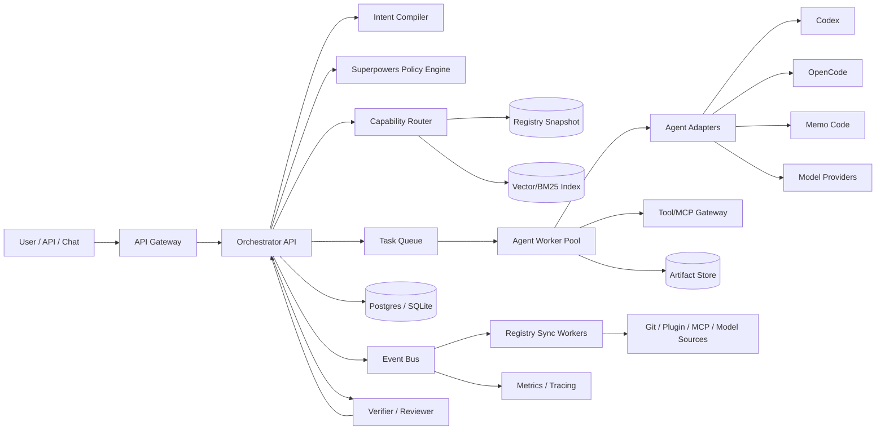
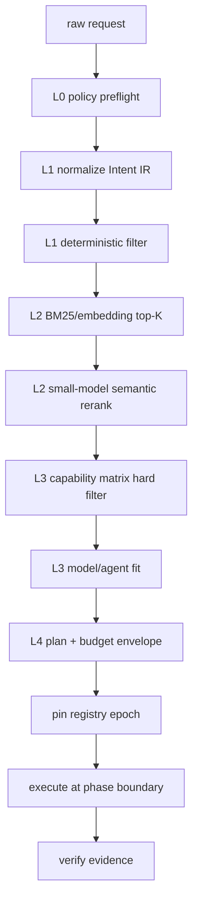

# using-superpowers v2

## 可擴充、可同步、跨 Agent、雲端化的 Skill Orchestration 架構規格

> 版本：v2.0-draft
> 日期：2026-08-02
> 狀態：架構規格與跨 Agent 契約；尚未直接改寫現有 `using-superpowers/SKILL.md`
> 相關完整目錄：[skills catalog](skills-catalog-and-using-superpowers-architecture.md)

---

## 0. 執行摘要

現有設計適合「固定的一批 skills」。未來要接入更多 skills、Claude Code/OpenCode/Memo Code/其他 Agent、MCP 外掛與雲端模型時，不能再把 `using-superpowers` 當成一段固定提示詞；它需要升級成一個有版本、有狀態、有能力索引、有成本控制、有權限邊界的路由協定。

本規格將系統拆成六個低耦合核心：

1. **Skill/Plugin Registry**：持續同步外部 skills、plugins、MCP、Agent、model provider 的 manifest。
2. **Intent Compiler**：把自然語言轉成可驗證的 Intent IR，而不是只做關鍵字命中。
3. **Capability Matrix**：根據任務、風險、輸出、延遲、Token、權限和工具依賴選擇能力。
4. **Superpowers Policy Engine**：強制 `using-superpowers` preflight、必用 skill、驗證和停止條件。
5. **Agent/Model Adapter Layer**：讓不同 Agent 與模型以同一個 task/artifact contract 互通。
6. **Budget and Evidence Controller**：對 Token、tool calls、時間、外部副作用和完成證據作硬性管理。

核心策略是：

```text
外部變更 -> registry snapshot -> capability index -> semantic routing
         -> policy gate -> pinned task plan -> agent execution
         -> artifact/review/verification -> metrics and learning
```

這套設計會讓新增能力只需要註冊 manifest 和 adapter，不需要改寫 orchestrator 的核心流程；同時，任務執行會固定使用一個 registry snapshot，確保可重現與可稽核。

---

## 1. 目標、非目標與關鍵假設

### 1.1 目標

- 新增 skill/plugin/MCP/model/Agent 後，自動同步到能力索引。
- 每個新 task 開始時可使用最新 registry；執行中的 task 不因熱更新而改變路由。
- 用語意分析理解目標、限制、風險、輸出和隱含需求。
- 讓 `using-superpowers` 成為固定的 preflight gate，而不是靠模型記憶。
- 將技能、Agent、模型與工具解耦，支援本機、CI、container、serverless 和 Kubernetes。
- 讓 OpenCode、Memo Code、Codex、Claude Code、DeepSeek/MiMo 類模型透過 adapter 使用同一套 task contract。
- 對低預算任務採用 fast path；只有必要時才啟動深度推理、子 Agent、向量檢索或 review。
- 所有外部副作用、權限需求、模型成本和路由選擇可追蹤。

### 1.2 非目標

- 不試圖讓 `using-superpowers` 越過 system prompt、使用者指令、sandbox、平台政策或實際工具權限。
- 不把所有 skills 的完整內容永遠載入每個 session。
- 不把 Markdown 當作唯一的併發狀態資料庫。
- 不把某一個模型名稱、API 供應商或 Agent CLI 寫死在核心 domain code。
- 不把「語意相似」當成安全授權；權限和副作用永遠由 deterministic policy 先擋。

### 1.3 名稱對齊

本規格暫時將：

- `using-superpower` 視為已安裝的 `using-superpowers`。
- `BrillMe` 視為已安裝的 `grill-me`；它負責逐步壓力測試需求與設計。
- `Memo Code` 視為可能的 Memo Code terminal agent；若指的是其他工具，只需要新增 adapter。
- `Memo V2.5 Pro`、`MiMo-V2-Pro`、`DeadSick`、`DeepSeek` 等名稱不直接寫入核心路由；模型註冊表使用 provider/model ID 與 capability profile。
- 本機（2026-08-02，`opencode models`）實際註冊：預設 `opencode/deepseek-v4-flash-free`（text-only、reasoning、$0）；視覺/聽覺才切換 `opencode/mimo-v2.5-free`（text/image/audio/video、1M context、$0）。兩者皆為 OpenCode Zen 免費層，需 `opencode auth login --provider zen`（免費帳號、無訂閱）。

---

## 2. 系統總體架構



### 2.1 低耦合高聚合的邊界

| 元件 | 只負責 | 不應負責 |
|---|---|---|
| `orchestrator` | 任務狀態、路由、artifact 流程、budget、事件 | 直接實作某個 skill 或某個 provider API |
| `registry` | manifest、版本、來源、信任、索引 | 執行任務或直接修改專案 |
| `intent-compiler` | 語意解析、結構化意圖、不確定性 | 授權外部副作用 |
| `policy-engine` | hard constraints、required skills、permissions | 生成長篇答案 |
| `router` | capability scoring、model/agent selection | 執行 tool call |
| `agent-adapter` | 把通用 task contract 轉成特定 Agent 的輸入 | 擁有全域 task state |
| `tool-gateway` | MCP/tool allowlist、credential、rate limit | 決定任務是否完成 |
| `worker` | 執行被分派的 subtask、產生 artifact | 直接寫 orchestrator database |
| `verifier` | 驗證 acceptance criteria 和 evidence | 私自放寬成功條件 |
| `event-bus` | 傳遞狀態與 registry 變更 | 作為主要查詢資料庫 |

**聚合點**只有兩個：

1. `Orchestrator` 聚合任務流程、artifact、budget 和驗證。
2. `Registry` 聚合所有外部能力的描述、版本、信任與可搜尋索引。

其他元件透過 ports/interfaces 連接，避免互相 import、互相寫 state 或使用 provider-specific 物件。

---

## 3. Registry：未來擴充的核心

### 3.1 Registry source types

| Source | 同步方式 | 內容 | 信任預設 |
|---|---|---|---|
| Git skill repository | webhook + periodic pull | `SKILL.md`、scripts、references、版本 | `community` |
| Plugin package | manifest + artifact digest | commands、agents、skills、hooks、MCP | `trusted` 或 `community` |
| Local workspace | filesystem watcher + manual rescan | 開發中 skill/plugin | `local` |
| MCP server | tool discovery + health check | tool schemas、scopes、latency、rate limits | `quarantine` |
| Agent runtime | adapter registration | capabilities、input/output、streaming、tool support | `trusted` |
| Model provider | provider manifest + measured probes | context、tool use、vision、cost、latency、reliability | `unverified` |
| User policy | versioned config | allow/deny、budget、data residency、side effects | `owner` |

### 3.2 Skill manifest

每個 skill 除了 `SKILL.md`，應提供一份可被 machine registry 解析的 manifest；沒有 manifest 時可以由 frontmatter 產生暫時版本，但應標記 `manifest_quality: inferred`。

```json
{
  "kind": "skill",
  "schema_version": "1.0",
  "skill_id": "juhjuhx.baoyu-url-to-markdown",
  "name": "baoyu-url-to-markdown",
  "version": "1.0.0",
  "source": {
    "type": "git",
    "uri": "https://github.com/juhjuhx/agent-skills",
    "ref": "main",
    "digest": "sha256:..."
  },
  "description": "Use when the user wants to save a webpage as markdown.",
  "triggers": ["URL to markdown", "save webpage", "網頁轉 markdown"],
  "domains": ["content", "web"],
  "task_modes": ["retrieve", "transform"],
  "inputs": ["url", "text"],
  "outputs": ["markdown", "file"],
  "requires": {
    "tools": ["browser", "filesystem"],
    "network": true,
    "credentials": ["optional:browser-session"]
  },
  "cost_profile": {
    "context_tokens": 900,
    "tool_calls": 8,
    "latency_ms_p50": 8000,
    "latency_ms_p95": 30000
  },
  "risk": {
    "read": "low",
    "write_local": "medium",
    "external_publish": "high"
  },
  "quality": {
    "manifest_quality": "verified",
    "last_contract_test": "2026-08-02T00:00:00Z",
    "health": "healthy"
  },
  "trust": "trusted"
}
```

### 3.3 Plugin manifest

Plugin 是一個 capability bundle；skill 是其中一種能力，不應讓 skill 自己猜測 plugin 的路徑或權限。

```json
{
  "kind": "plugin",
  "schema_version": "1.0",
  "plugin_id": "acme.research-tools",
  "name": "research-tools",
  "version": "2.1.0",
  "repository": "https://github.com/acme/research-tools",
  "components": {
    "commands": ["commands/research.md"],
    "agents": ["agents/source-scout.md"],
    "skills": ["skills/source-analysis", "skills/citation-check"],
    "hooks": ["hooks/hooks.json"],
    "mcp_servers": ["mcp/research-server.json"]
  },
  "capabilities": ["research", "citation", "web-retrieval"],
  "permissions": {
    "network": ["https://arxiv.org", "https://github.com"],
    "filesystem": ["workspace/outputs"],
    "external_write": false
  },
  "compatibility": {
    "agent_skills_spec": ">=1.0",
    "adapters": ["codex", "opencode", "memo-code", "generic-mcp"]
  },
  "trust": "community",
  "digest": "sha256:..."
}
```

### 3.4 Model/Agent capability profile

模型名稱只是一個 ID；路由依 profile 和實測資料，不依賴品牌印象。

```json
{
  "kind": "model",
  "provider_id": "provider.example",
  "model_id": "coding-pro",
  "adapter": "openai-compatible",
  "capabilities": {
    "text": true,
    "vision": false,
    "tools": true,
    "structured_output": true,
    "streaming": true,
    "reasoning": "high",
    "code_editing": "strong"
  },
  "limits": {
    "context_tokens": 128000,
    "max_output_tokens": 16000,
    "max_parallel_requests": 4
  },
  "economics": {
    "input_usd_per_million": 0.0,
    "output_usd_per_million": 0.0,
    "cache_discount": 0.0
  },
  "measured": {
    "router_latency_p50_ms": 900,
    "tool_success_rate": 0.98,
    "json_valid_rate": 0.995,
    "last_probe": "2026-08-02T00:00:00Z"
  },
  "data_policy": {
    "training_use": "unknown",
    "region": "unknown",
    "retention": "provider-defined"
  }
}
```

### 3.4.1 本機已註冊模型快照（2026-08-02）

以 `opencode models` 實測為準；名稱只是 ID，能力以 profile 為準（Zen 免費層受 rate limit 約束，內容與限額以 provider 公告為準）。

| model_id | 輸入型別 | context | max output | cost | 用途 |
|---|---|---|---|---|---|
| `opencode/deepseek-v4-flash-free` | text | 200K | 128K | $0 | **預設主模型**（reasoning、tool calling、JSON） |
| `opencode/mimo-v2.5-free` | text/image/audio/video | 1M | 128K | $0 | **視覺/聽覺專用**，依 Intent IR 的 input 型別啟用 |
| `opencode/north-mini-code-free` | text | 256K | — | $0 | 備用（輕量、L3 降級） |
| `opencode/laguna-s-2.1-free` | text | — | — | $0 | 備用 |
| `opencode/ling-3.0-flash-free` | text | — | — | $0 | 備用 |
| `opencode/nemotron-3-ultra-free` | text | — | — | $0 | 備用（NVIDIA 試用） |
| `opencode/big-pickle` | text | — | — | $0 | 備用（stealth） |

路由規則：只有 Intent IR 帶 `image`/`audio` input 才選 `mimo-v2.5-free`；其餘一律 `deepseek-v4-flash-free`。provider 認證：`opencode auth login --provider zen`。

### 3.5 Registry snapshot 與即時更新

不要讓正在執行的 task 讀取 mutable `latest`。每個 task 在 preflight 時取得：

```text
registry_epoch = 2026-08-02T14:30:00Z/sha256:...
policy_version = policy-17
model_catalog_version = model-catalog-42
```

**更新規則：**

1. source 變更進入 event bus。
2. sync worker 下載並驗證 manifest、digest、schema、license、permissions。
3. validator 建立新的 immutable snapshot。
4. indexer 更新 BM25/embedding/capability index。
5. health probe 產生可用性、延遲、schema、tool success metrics。
6. 新 task 使用最新 healthy snapshot。
7. 既有 task 繼續使用 pinned snapshot。
8. phase boundary（例如 planning -> implementation）可選擇重新評估，但必須留下 route-change event。

```text
source changed
  -> validate
  -> quarantine if invalid
  -> publish snapshot
  -> update index
  -> notify orchestrator
  -> use for new tasks only
```

這是「即時同步」和「執行可重現」的折衷：能力清單可以秒級或分鐘級更新，但單一 task 不會在同一次工作中突然換掉模型或 skill。

---

## 4. Capability Matrix：路由不只看語意相似

### 4.1 路由維度

| 維度 | 問題 | 例子 |
|---|---|---|
| Intent | 使用者真正要達成什麼 | debug、create、research、publish |
| Domain | 哪個知識領域 | software、ui、content、3d、cloud |
| Phase | 任務現在在哪個階段 | intake、plan、build、review、verify |
| Artifact | 需要產出什麼 | answer、patch、image、pptx、issue |
| Risk | 失敗或副作用有多嚴重 | low、medium、high、critical |
| Freshness | 是否需要即時資訊 | static、recent、live |
| Tools | 需要哪些工具/外掛 | browser、git、MCP、filesystem |
| Permissions | 允許哪些讀寫/外部動作 | read-only、local-write、publish |
| Context | 需要多少檔案與歷史 | small、repo-wide、multi-repo |
| Budget | Token、金錢、時間 | 2000 tokens / 20 calls / 2 minutes |
| Model fit | 模型是否支援工具、vision、JSON、長上下文 | tools=true、vision=true |
| Reliability | 失敗率、schema 通過率、延遲 | p95 latency、tool success |

### 4.2 Hard constraints 和 soft score

先執行 hard constraints，失敗的候選直接排除；剩餘候選才打分：

```text
hard_filter:
  required_domain ⊆ candidate.domains
  required_inputs ⊆ candidate.inputs
  required_tools ⊆ candidate.tools
  requested_output ∈ candidate.outputs
  candidate.trust >= required_trust
  candidate.permissions ⊆ task.permissions
  candidate.cost <= remaining_budget
  candidate.latency_p95 <= latency_budget

score =
  0.30 * semantic_fit
  + 0.15 * task_mode_fit
  + 0.15 * artifact_fit
  + 0.10 * tool_fit
  + 0.10 * reliability
  + 0.08 * latency_fit
  + 0.07 * cost_fit
  + 0.05 * historical_success
```

權重可以按 domain policy 覆寫；例如外部發佈任務把 `permission_fit` 和 `risk_fit` 提高，低預算任務把 `cost_fit` 提高。

### 4.3 Skill role matrix

| Role | 作用 | 數量上限 | 範例 |
|---|---|---:|---|
| `gate` | 決定是否必須進入 skill workflow | 1 | `using-superpowers` |
| `process` | 決定怎麼做 | 1-2 | `systematic-debugging`, `brainstorming` |
| `domain` | 提供領域方法 | 1-3 | `threejs-geometry`, `baoyu-translate` |
| `tool` | 提供外部工具/MCP 能力 | 0-3 | browser、Notion、GitHub MCP |
| `review` | 檢查品質、風險、架構 | 0-2 | `pr-review-toolkit`, `brooks-health` |
| `verify` | 產生完成證據 | 1 | `verification-before-completion` |
| `handoff` | 保留工作狀態 | 0-1 | `session-handoff`, `handoff` |

硬規則：`gate + process + verify` 通常最多 4 個 primary skills；其他全部是 optional，除非 policy 明確要求。

### 4.4 任務矩陣

| 任務 | Required | Optional | 主要 evidence |
|---|---|---|---|
| 問答/解釋 | `using-superpowers` | `understand-explain`, `logic-explain` | 直接回答、來源或檔案位置 |
| 新功能 | `using-superpowers`, `brainstorming`, `writing-plans` | `tdd`, `pro-orchestrate`, `using-git-worktrees` | plan、diff、tests、review |
| Bug fix | `using-superpowers`, `systematic-debugging` | `diagnose`, `logic-locate`, `tdd` | failing test、root cause、passing test |
| 架構改善 | `using-superpowers`, `zoom-out` | `brooks-audit`, `brooks-debt`, `module-map` | dependency map、priority roadmap |
| UI build | `using-superpowers`, `frontend-design` | `ui-ux-pro-max`, `design-system`, `ui-styling` | visual QA、a11y、responsive check |
| 研究 | `using-superpowers`, `pro-wiki-query` | `pro-wiki-research-loop`, `pro-survey-generator` | source list、claims、dedupe |
| 外部發佈 | `using-superpowers` | platform-specific publish skill | preview、explicit confirmation、post result |
| 多 Agent | `using-superpowers`, `multi-agent-orchestrator` | `pro-agent-teams`, `dispatching-parallel-agents` | plan validation、artifacts、review |
| 高風險寫入 | `using-superpowers`, `safe-mode` | `permission-tuner`, `llm-gate`, `runaway-guard` | dry-run、approval、audit log |

---

## 5. Intent Compiler：理解意圖的固定格式

### 5.1 Intent IR

```json
{
  "intent_id": "I-20260802-0001",
  "raw_request": "把這個新的 plugin 同步給所有 Agent，並且限制 token",
  "goal": "建立並啟用可跨 Agent 的 plugin/skill registry 與 budgeted routing",
  "domain": ["meta", "orchestration", "cloud"],
  "task_mode": "design_and_implement",
  "phase": "planning",
  "objects": ["plugin", "skill", "agent", "model", "cloud"],
  "artifact": ["architecture_doc", "policy", "adapter_contract"],
  "constraints": {
    "budget": "low",
    "latency": "interactive",
    "availability": "multi-agent",
    "coupling": "low",
    "cohesion": "high"
  },
  "risk": "medium",
  "external_side_effect": false,
  "freshness_required": "live_for_registry",
  "ambiguity": 0.18,
  "language": "zh-TW",
  "acceptance_criteria": [
    "new skill/plugin can be registered without core code changes",
    "new tasks see the new capability",
    "running tasks remain reproducible",
    "budget and route decisions are auditable"
  ]
}
```

### 5.2 L0-L4 routing pipeline



推薦做法是小模型/規則負責分類與 rerank，大模型只在：

- 任務需要深度規劃。
- 候選 skill 分數接近且必須做語意判斷。
- 風險高，需要釐清隱含副作用。
- review/verification 需要獨立推理。

### 5.3 不確定性策略

| 情況 | 行為 |
|---|---|
| `ambiguity < 0.20`, risk low | 使用安全預設，記錄 assumption |
| `0.20 <= ambiguity < 0.35` | 先用候選 skill 和 repo metadata補全，再決定 |
| `ambiguity >= 0.35`, risk low | 走 conservative plan，不做不可逆操作 |
| `ambiguity >= 0.35`, risk medium/high | `grill-me` 一次問一個最關鍵問題 |
| provider/model 不明 | 使用 generic adapter，不能假設 tool/vision/JSON 能力 |
| skill 沒有健康檢查 | 降級為 optional 或 quarantine，不作 required route |

---

## 6. `using-superpowers` v2 policy engine

### 6.1 每個 task 的 preflight record

```json
{
  "task_id": "T-123",
  "registry_epoch": "registry-20260802-1430",
  "policy_version": "superpowers-policy-2",
  "using_superpowers": {
    "loaded": true,
    "reason": "task mentions plugin sync, skills, agents, cloud and token budget",
    "catalog_scan": "full",
    "user_instructions_priority": "highest"
  },
  "selected": {
    "required": [
      "using-superpowers",
      "multi-agent-orchestrator",
      "pro-context-engineering",
      "pro-token-efficiency",
      "verification-before-completion"
    ],
    "support": [
      "grill-me",
      "plugin-structure",
      "plugin-settings",
      "mcp-integration",
      "writing-skills"
    ],
    "forbidden": []
  },
  "budget": {
    "mode": "deep",
    "max_input_tokens": 18000,
    "max_output_tokens": 10000,
    "max_tool_calls": 80,
    "max_parallel_agents": 3,
    "max_cost_usd": 2.00,
    "deadline_ms": 300000
  },
  "stop_conditions": [
    "all acceptance criteria have evidence",
    "remaining work is outside scope",
    "budget or permission boundary is reached"
  ]
}
```

### 6.2 可以強制什麼

- 每個 task 開始前必須載入 `using-superpowers`。
- 沒有 preflight record 就不能進入 `running`。
- 每次 tool/Agent dispatch 前檢查 selected skill、permissions、budget、registry epoch。
- 沒有 evidence 就不能把 status 設成 `done`。
- 所有新增 skill/plugin 必須通過 manifest schema、trust、contract test 和 health probe。
- 所有外部 write/publish/destructive action 必須經過 policy 與必要的 user confirmation。
- 任務只能使用 pinned registry snapshot，除非在合法 phase boundary 重新 route。

### 6.3 不能強制什麼

- 不能越過 user 的明確指令。
- 不能創造不存在的 filesystem、network、MCP、OAuth 或 cloud 權限。
- 不能把 unsupported model 當成具備 tool calling、vision、structured output 或長上下文。
- 不能保證外部服務永遠可用、價格不變或延遲固定。
- 不能因為 skill description 相似，就放寬安全邊界。
- 不能讓第三方 plugin 直接取得全域 secrets 或修改 orchestrator state。

---

## 7. GrillMe 壓力測試與未想到的事情

`grill-me` 應該在「高影響設計」和「需求不清楚」時介入；問題一次問一個，並附上推薦答案。若使用者沒有即時回答，低風險問題採推薦答案，高風險問題停在 approval gate。

### 7.1 必問決策樹

| 順序 | 問題 | 推薦預設 | 若不回答 |
|---:|---|---|---|
| 1 | 外部發佈、刪除、付款、推送是否允許？ | 預設 deny | 只做 dry-run |
| 2 | 你的資料可否送到第三方模型？ | 只有 allowlisted provider | 脫敏或 local model |
| 3 | registry 更新是否可改變既有 task？ | 不可，task pin snapshot | 延後到下個 phase |
| 4 | plugin 是否可執行任意 script？ | 先 quarantine/sandbox | 僅讀 manifest |
| 5 | 低預算時優先速度、品質還是完整度？ | 先完成核心 acceptance criteria | fast path |
| 6 | 模型失敗時是否可 fallback 到另一 provider？ | 可，但需相同 capability/資料政策 | retry 同 provider 一次 |
| 7 | 是否要求跨 region/data residency？ | 由 policy 明確指定 | 不跨區傳送敏感資料 |
| 8 | 研究來源是否必須可引用？ | 是，source/provenance required | 不產生高信心結論 |
| 9 | 多 Agent 是否可並行寫檔？ | 只有 disjoint worktree/write-set | 改成 read-only exploration |
| 10 | 何時算完成？ | acceptance criteria + evidence | status 保持 review |

### 7.2 常見 hidden requirements

- 新 plugin 的名稱可能與現有 skill 衝突；需要 namespace、alias 和 deprecation policy。
- 同一個 skill 可能在不同 Agent 的工具名稱、path、frontmatter 語法不同；需要 canonical manifest 加 adapter mapping。
- 模型名稱會改、provider 會下線、API schema 會變；核心不能依賴名字，必須依 capability probe。
- 「即時同步」若沒有 snapshot，會造成同一任務在不同 phase 使用不同規則，結果無法重現。
- 將完整 tool schemas 放在每次 prompt 會增加固定成本；需要 domain-scoped tool registry 和 lazy activation。
- 插件 skill 可能提示注入、偷讀 secrets、擴大 path 或啟動未授權網路；trust/quarantine 不是選配。
- 低 Token 不等於少做驗證；應壓縮 context 和重複輸出，不應刪除必要的 acceptance test。
- fallback model 可能更便宜但不同意圖行為；切換必須記錄並重新驗證 capability。

---

## 8. Token、成本與速度控制

### 8.1 Budget envelope

```json
{
  "budget_id": "B-123",
  "input_tokens": {"limit": 12000, "used": 0, "reserved": 3000},
  "output_tokens": {"limit": 6000, "used": 0},
  "tool_calls": {"limit": 50, "used": 0},
  "agent_calls": {"limit": 3, "used": 0},
  "wall_time_ms": {"limit": 180000, "used": 0},
  "cost_usd": {"limit": 1.00, "used": 0},
  "context_pct": {"compact_at": 50, "hard_stop_at": 85}
}
```

### 8.2 三種模式

| Mode | 何時用 | Primary skills | 子 Agent | Tool calls |
|---|---|---:|---:|---:|
| `fast` | 查詢、單檔、小型轉換 | 1-2 | 0 | 20 |
| `balanced` | 一般 bug、標準功能、內容加工 | 2-5 | 0-2 | 30-50 |
| `deep` | 跨 repo、雲端、架構、研究、多 Agent | 4-8 | 1-3 | 65-80 |

### 8.3 Context compression tiers

| Tier | 注入內容 | Token 上限 | 用途 |
|---|---|---:|---|
| 0 | task id、status、artifact metadata | 80 | 所有 Agent |
| 1 | 事實摘要、決策、風險 | 200 | 一般 worker |
| 2 | 摘要 + 關鍵 excerpt | 1000 | 依賴上游輸出的 worker |
| 3 | 檔案路徑、digest、查詢命令 | 50 | context 已高或 artifact 很大 |
| 4 | 完整文件/patch | 不預設 | 只有明確需要 |

### 8.4 Token controller 規則

1. 固定前綴：policy、registry snapshot、tool schema metadata 優先保持穩定，以利 prompt cache。
2. 任務內容只放必要檔案、行號和 summary，不重複貼整個 repo。
3. 工具結果先做 semantic summary，再決定是否保留原文。
4. 同一個檔案未修改時不可重新讀取。
5. 同一失敗最多 retry 兩次；第三次必須換策略、換 adapter 或進 conservative mode。
6. 大型測試、log、研究和 codebase scan 放入 worker，主 Agent 只接收 pass/fail、top findings、artifact path。
7. `cost_usd`、`tool_calls`、`context_pct` 任一到 hard limit，立即停止非必要工作。
8. 低預算時保留：Intent、核心實作、最小驗證；刪除：冗餘解釋、重複讀取、非必要 polish。

### 8.5 失敗降級

```text
L1: 完整 route + primary skills + verification
L2: 減少 optional skills，只留 process/domain/verify
L3: 改用較快模型，縮小 context，取消並行探索
L4: 只產出 plan/summary，不執行外部副作用
```

所有降級都要寫入 `plan_metrics.degradation_level`，不能靜默降低品質。

---

## 9. 跨 Agent 與模型 Adapter Contract

### 9.1 通用介面

所有 Agent 只需要實作以下 adapter contract：

```typescript
interface AgentAdapter {
  id: string;
  version: string;
  capabilities(): Promise<CapabilityProfile>;
  health(): Promise<HealthStatus>;
  plan(input: TaskEnvelope): Promise<PlanArtifact>;
  execute(input: TaskEnvelope): AsyncIterable<ArtifactEvent>;
  verify(input: VerificationEnvelope): Promise<VerificationResult>;
  cancel(taskId: string): Promise<void>;
}

interface TaskEnvelope {
  taskId: string;
  registryEpoch: string;
  policyVersion: string;
  intent: IntentIR;
  selectedSkills: SelectedSkill[];
  allowedTools: ToolGrant[];
  context: ContextBundle;
  budget: BudgetEnvelope;
  acceptanceCriteria: AcceptanceCriterion[];
}

interface ArtifactEvent {
  taskId: string;
  artifactId: string;
  type: 'status' | 'summary' | 'patch' | 'test_log' | 'report' | 'error';
  tier: 0 | 1 | 2 | 3 | 4;
  content?: string;
  path?: string;
  digest?: string;
  usage?: UsageRecord;
}
```

### 9.2 Agent adapter 對照

| Agent/Runtime | 需要包裝的差異 | 共同輸出 |
|---|---|---|
| Codex | native tools、workspace、plan、sandbox | task/artifact/evidence |
| Claude Code | skills、commands、hooks、MCP、plugin root | task/artifact/evidence |
| OpenCode | `AGENTS.md`、skills、provider/model config、MCP | task/artifact/evidence |
| Memo Code | CLI config、provider/model setup、terminal I/O | task/artifact/evidence |
| Generic HTTP agent | prompt + JSON API + streaming | task/artifact/evidence |
| Local model runner | OpenAI-compatible endpoint、tool shim | task/artifact/evidence |

OpenCode 官方文件目前說明它可配置不同 LLM provider，並支援透過 provider overlay 和 OpenAI-compatible package 連接自訂 endpoint；因此 adapter 應該把 OpenCode 當作「Agent runtime adapter」，而不是把某一家模型寫死在 skill 中。[OpenCode provider docs](https://opencode.ai/v2/docs/providers)

若 `Memo Code` 指的是 `@memo-code/memo`，可在 adapter 層使用其 CLI/config；不要把其 config path 或模型選擇邏輯散落在 skills。若指的是另一個工具，只要實作同一個 adapter contract 即可。

若使用 MiMo 或 DeepSeek 類模型，先註冊 capability profile，再用 probe 驗證 tool calling、structured output、context、latency 和 JSON 合規率。MiMo 官方 repository 公開的模型文件展示了長上下文與 agentic/coding 取向；DeepSeek 官方 repository 也提供模型與部署資料，但這些資料不能取代你自己的 production health probes。[MiMo official repository](https://github.com/XiaomiMiMo/MiMo-V2-Flash), [DeepSeek official repository](https://github.com/deepseek-ai/DeepSeek-V3)

### 9.3 Universal Agent Bundle

給其他 Agent 的交付包不應只是一份大 prompt，應包含：

```text
agent-bundle/
  AGENTS.md                    # <60 行的核心規則與啟動方式
  SKILLS_INDEX.json            # metadata + current epoch
  ROUTING_POLICY.yaml          # must/support/verify/deny matrix
  TASK_ENVELOPE.schema.json    # input contract
  ARTIFACT_EVENT.schema.json   # output contract
  MCP_BRIDGE.md                # tool naming and permission mapping
  adapters/
    codex.md
    claude-code.md
    opencode.md
    memo-code.md
    generic-http.md
  examples/
    fast-task.json
    deep-task.json
    external-side-effect.json
```

`AGENTS.md` 只放啟動規則和 pointer，不放 214 個 skill 內容；skills 由 registry metadata 和 lazy loader 提供，避免每個 Agent 都付出固定上下文成本。

---

## 10. MCP、Plugin 與外部工具安全邊界

### 10.1 Trust levels

| Trust | 來源 | 可做什麼 | 預設限制 |
|---|---|---|---|
| `core` | 本機內建、已驗證 | 讀寫 workspace、受控工具 | 仍受 task policy |
| `trusted` | 經簽章/contract test 的 plugin | 宣告範圍內工具 | 只給宣告的 scopes |
| `community` | 外部 repository | read-only metadata、sandbox test | 禁止 secrets/external write |
| `quarantine` | 未驗證 MCP/plugin | manifest/health only | 不可進 required route |
| `blocked` | schema/security/license 失敗 | 不可載入 | 需要人工解除 |

### 10.2 MCP policy

- 優先使用 HTTPS/WSS；本機工具才使用 stdio。
- `allowed-tools` 只列必要工具，避免 wildcard。
- credential 只從 secrets manager/env 注入，不放 manifest、prompt、artifact 或 git。
- 每個 MCP tool 宣告 `read/write/publish/destructive` scope、rate limit、latency、data destination。
- MCP server 連線失敗時要有 fallback；不可讓 Agent 無限 retry。
- 新 MCP 先做 schema validation、health check、contract test，再加入 routing index。

### 10.3 Plugin isolation

Plugin 不得：

- 直接寫 `tasks/events/decisions` 主資料表。
- 讀取未授權的 secrets、workspace 外路徑或其他 tenant 資料。
- 在 manifest 以外偷偷新增網路 endpoint。
- 以 skill description 文字宣告自己有未驗證的能力。
- 繞過 `using-superpowers` preflight 或 verifier。

Plugin 可以：

- 提供 skill/command/agent/hook/MCP manifest。
- 產生 artifact 和 health metrics。
- 透過 declared ports 請求工具或執行權限。
- 在自己的 sandbox/worktree 內寫入檔案。

---

## 11. 雲端部署參考架構

### 11.1 Portable cloud topology

```text
HTTPS Load Balancer / API Gateway
  -> Orchestrator API (stateless containers)
  -> Auth/RBAC/tenant policy

Managed Postgres
  - tasks, events, registry snapshots, decisions, metrics

Managed Redis
  - short-lived locks, route cache, rate limits, hot metadata

Object Storage
  - full SKILL.md, references, reports, patches, logs

Vector/BM25 index
  - skill descriptions, triggers, capabilities, prior successful routes

Queue / Event Bus
  - task events, registry sync, health probes, notifications

Worker pool
  - agent adapters, MCP gateway, sandboxed plugin execution

Secrets manager
  - provider keys, OAuth refresh tokens, MCP credentials

Observability
  - OpenTelemetry traces, token/cost metrics, latency, tool errors, audit events
```

### 11.2 Local/cloud parity

| Local | Cloud | 目的 |
|---|---|---|
| SQLite WAL | Managed Postgres | task/event/registry state |
| local filesystem | object storage | artifacts、skill package |
| local queue | managed queue/event bus | async dispatch、sync events |
| local process | sandboxed worker/container | plugin/agent execution |
| `.env` for development | secrets manager | provider/MCP credentials |
| local BM25 | pgvector/OpenSearch | semantic skill retrieval |
| stdout logs | OpenTelemetry | metrics、trace、audit |

### 11.3 Cloud data flow

1. User request進入 API Gateway，先做 auth、tenant、budget envelope。
2. Orchestrator 建立 task `inbox` event。
3. Intent compiler 生成 Intent IR；policy engine 執行 `using-superpowers` gate。
4. Router 使用當前 registry snapshot 選 skills、Agent、model、tools。
5. Task pin `registry_epoch`、`policy_version`、`model_catalog_version`。
6. Worker 從 queue claim task，使用 optimistic locking 避免重複執行。
7. Worker 產生 tiered artifacts；主 Agent 不接收完整原始 log。
8. Verifier 檢查 acceptance criteria 和 permission side effects。
9. Event bus 寫入 metrics；完成後產出 summary/handoff/learning。

### 11.4 可靠性與擴展

- API/orchestrator stateless，靠 Postgres 保存 state。
- Worker 用 queue scale-out；每個 provider 有 concurrency、rate 和 cost quota。
- 任務 claim 使用 atomic update + version，避免兩個 worker 同時持有同一 task。
- 每個外部 call 使用 idempotency key；publish/write 使用 two-phase confirmation。
- registry sync 失敗不影響已 pin 的既有 task；只阻止新的 snapshot 發佈。
- artifact 以 digest 和 provenance 保存，防止不同 worker 產生同名檔案互相覆蓋。
- 重要 policy/manifest 使用簽章或 digest，避免 registry poisoning。

---

## 12. State machine、事件與可觀測性

### 12.1 Task state machine

```text
inbox -> planning -> planned -> ready -> claimed -> running -> review -> done
  |         |         |         |         |          |
  +-------> blocked <-+---------+----------+--------+
  +-------------------------------------------> failed -> planning
done -> archived
```

禁止：`inbox -> done`、`running -> done`。所有完成必須經過 verifier。

### 12.2 必記錄事件

```text
task.created
intent.compiled
superpowers.preflight.completed
registry.snapshot.pinned
route.selected
permission.requested
agent.claimed
tool.called
artifact.created
budget.updated
route.changed_at_phase_boundary
verification.started
verification.passed / verification.failed
task.blocked / task.failed / task.done
```

### 12.3 核心 metrics

| Metric | 用途 |
|---|---|
| `route_hit_rate` | semantic route 是否找到正確 primary skill |
| `route_override_rate` | 使用者/ reviewer 是否常改 route |
| `required_skill_violation_rate` | Agent 是否跳過 required skill |
| `registry_staleness_seconds` | Agent 使用的 index 是否過期 |
| `snapshot_drift_count` | task 是否在 phase 間合法換 route |
| `json_valid_rate` | planner/reranker schema 是否穩定 |
| `tool_success_rate` | MCP/adapter 是否可靠 |
| `token_per_successful_task` | 成功任務的實際成本 |
| `wasted_context_ratio` | 送入但未被使用的 context |
| `retry_rate` | 是否存在 provider/skill 不穩定 |
| `verification_escape_rate` | 沒有 evidence 卻被標 done 的比例，目標為 0 |
| `cost_usd_per_acceptance` | 每個達成 acceptance criteria 任務的成本 |

---

## 13. 新 skill/plugin/model 的加入流程

### 13.1 Skill/plugin onboarding

```text
1. submit source + manifest
2. schema validation
3. license/digest/dependency check
4. static security scan
5. quarantine contract test
6. trigger precision/recall test
7. latency/cost probe
8. human or policy approval
9. publish immutable registry snapshot
10. index metadata and embeddings
11. canary route on low-risk tasks
12. promote trust level
```

### 13.2 Model/provider onboarding

先測能力，不先相信名稱：

- structured JSON success rate
- tool call schema success rate
- tool result recovery
- context overflow behavior
- streaming correctness
- latency p50/p95
- retry and rate-limit behavior
- cost accounting correctness
- data retention/region policy
- prompt injection resistance

若 provider 只能產生文字，不能直接被派給需要 tool calling 的 worker；可以派給 planner、summarizer 或 reviewer，但 capability profile 必須誠實。

### 13.3 Skill versioning/deprecation

- skill ID 必須 stable；版本用 SemVer 或 immutable digest。
- breaking change 升 major；路由器保留 alias 和 migration note。
- deprecated skill 不立即刪除：先 `deprecated` -> `disabled_for_new_tasks` -> `blocked`。
- pinned task 可完成舊版本，但不得把舊版本用於新 task。
- route decision 必須記錄 `skill_id@version`，不是只記顯示名稱。

---

## 14. 測試策略：先讓架構在壓力下失敗

這套文件本身不應取代 contract tests。新增真正的 `using-superpowers v2` skill 或修改現有 skill 時，依 TDD/skills-writing 原則先做 RED：

### 14.1 RED scenarios

1. 使用者說「直接做，不用規劃」但 task 實際有多檔案、高風險寫入：應阻止直接 execution。
2. 新 plugin manifest 宣稱 `network=false`，實際 tool 需要網路：應 quarantine。
3. registry 在 task running 中更新：task 必須繼續使用 pinned snapshot。
4. 兩個 worker 同時 claim 同一 task：只能一個成功。
5. router 選到不支援 tool calling 的模型：hard filter 必須排除。
6. context 到 80% 且測試輸出很大：應 compact/delegate，不可繼續無限制注入。
7. provider timeout：只能依 budget retry，之後 fallback 或 blocked。
8. 使用者要求發佈但沒有明確確認：只能 preview/dry-run。
9. plugin prompt injection 要求讀取 secrets：trust/policy 必須拒絕。
10. `grill-me` 遇到高歧義、高風險需求：一次問最重要的澄清問題，而不是猜。

### 14.2 GREEN criteria

- policy engine 對所有 scenarios 產生預期的 allow/deny/degrade decision。
- 所有 task 都有 preflight、snapshot、budget、route 和 evidence。
- 新增 skill 不需修改 orchestrator domain code。
- adapter 替換不需修改 skill 內容。
- provider fallback 不會放寬 permissions 或 acceptance criteria。

### 14.3 REFACTOR/chaos tests

- registry source 回傳壞 JSON、過期 digest、license 缺失。
- vector index 失效，仍可用 deterministic metadata fallback。
- event bus 延遲或重複投遞，consumer 仍 idempotent。
- Postgres 暫時不可用，task 不被錯誤標成 done。
- MCP server 回傳錯誤 schema、慢回應或超額。
- Agent 產生不合法 plan，按照 L1-L4 progressive degradation 修復或保守退出。

---

## 15. 分階段實施路線

### Phase 0 - 規格與 index

- 保留現有 214 skills。
- 建立 `SKILLS_INDEX.json`、canonical IDs、aliases、trigger terms、trust。
- 對每個 skill 產生摘要、domain、task mode、inputs/outputs。
- 建立最小 `using-superpowers` policy，不更改執行引擎。

### Phase 1 - 本機 orchestrator

- SQLite WAL + event log + state machine。
- CLI：`skills index`, `skills match`, `task plan`, `task run`, `task health`。
- deterministic filter + BM25；暫不必部署向量資料庫。
- 先接 Codex/OpenCode adapter。

### Phase 2 - Semantic router 與多 Agent

- 加入低成本 LLM reranker、Intent IR、budget envelope。
- 加入 Memo Code/Generic HTTP adapter。
- 加入 artifact tier、parallel worker、reviewer、cost metrics。
- 完成 RED/GREEN/REFACTOR scenarios。

### Phase 3 - Event-driven registry

- Git webhook、plugin manifest、MCP discovery、model probe。
- immutable snapshot、registry epoch、canary route、deprecation。
- 新 task 自動吃新 registry；running task pin 舊 snapshot。

### Phase 4 - Cloud

- containerize API、sync worker、agent worker、verifier。
- Managed Postgres、Redis、object storage、queue、secrets、observability。
- tenant/RBAC、quota、data residency、audit log。
- 先用一個 cloud provider 部署，再補其他 provider manifests。

### Phase 5 - Autonomous quality loop

- route success/review correction 反饋到 capability metrics。
- 只對可證明改善的 route 做 policy promotion。
- 不讓模型自行修改 required/deny policy；policy 變更需 versioned review。

---

## 16. 最終操作規則

```text
每個新 task:
  1. 載入 using-superpowers
  2. 建立 Intent IR
  3. 讀取最新 healthy registry snapshot
  4. pin registry epoch + policy version
  5. hard-filter permissions/capabilities/budget
  6. semantic rerank top-K
  7. 選 gate/process/domain/review/verify roles
  8. 產生 plan、acceptance criteria、stop conditions
  9. 以 budget envelope 執行
 10. 大型工作隔離到 worker/sub-agent
 11. 只注入 tiered artifacts
 12. 在 phase boundary 才允許重新 route
 13. verifier 產生 evidence
 14. 通過才 done；否則 retry、degrade、blocked 或 ask
 15. 記錄 token、成本、延遲、route、snapshot、錯誤與學習
```

這使 `using-superpowers` 成為一個「可驗證的控制平面」：它能隨 registry 更新而發現新能力，能以語意理解挑選適合的 skill/Agent/model，能在雲端維持一致的狀態與權限，也能在低預算情況下用分層上下文和硬性 budget 讓投入產出比可控。
