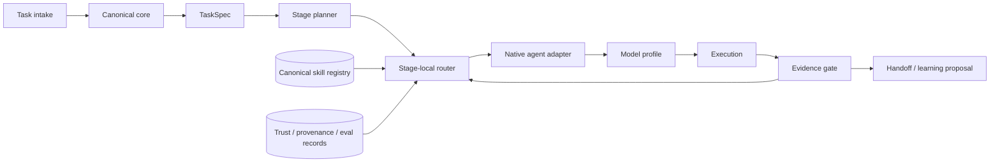

# v3 Architecture and ADRs

> Status: **proposed**. Phase 1 contracts, the provenance-bound Codex execution slice, the Phase 3A.2 metadata-first Stage Router quality pass, and the Phase 3B runtime/model evaluation harness are implemented; the current production registry, v2 runtime policy, and production model policy remain unchanged.

## System shape

The canonical core is runtime-neutral. It knows the task, stage, skill metadata, capabilities, permissions, budgets, artifacts, evidence, and policy. It does not know how a particular runtime stores a skill, loads a plugin, names a tool, or selects a provider. Those details belong in an adapter.

## Frozen decisions

All eight decisions below are **Proposed** in this documentation pass. A future implementation must preserve their intent and add executable tests before changing status.

### ADR-001 — Canonical Core + Generated Native Adapters

**Context.** The same procedure must work across several agent runtimes, while each runtime has different native packaging and lifecycle concepts.

**Decision.** Keep one canonical `SKILL.md` source and one metadata graph. Generate or hand-maintain thin native adapters that reference the canonical source and express native configuration. Never fork hundreds of skills per agent.

**Consequence.** Content fixes land once. Adapter generation, compatibility, and native UX are separate concerns. A generated adapter must carry source ref/digest and must not become an independent editable source of truth.

### ADR-002 — Stage-Local Skill Routing

**Context.** A task-level one-shot selection cannot know every skill needed after research, design, implementation, review, or verification changes the problem.

**Decision.** Plan stages first, then route independently at each stage boundary. Reroute on evidence failure or an explicit stage transition, while preserving prior artifacts and route reasons.

**Consequence.** Skill reuse is normal. Counts are bounded by relevance and budget, not by a minimum quota. A complex workflow can legitimately activate 30–50+ skills overall.

### ADR-003 — Agent Runtime != Model Provider

**Context.** An agent runtime owns tools, permissions, prompts, hooks, subagents, and state. A model/provider supplies inference capabilities. Names such as Codex, ZCode, GLM, or DeepSeek do not define the same layer.

**Decision.** Route first through runtime adapter capabilities and separately through model profiles. An adapter may select a compatible profile, but the universal core never branches on a model name or assumes that `ZCode == GLM`.

**Consequence.** Providers can change without rewriting skills. Runtime-specific identity logic remains inside the adapter.

### ADR-004 — Explicit Reasoning Artifacts

**Context.** Private hidden chain-of-thought is neither a portable API nor a safe cross-agent dependency.

**Decision.** Exchange observable artifacts: `TaskSpec`, assumptions, unknowns, decision records, stage plans, alternatives, evidence, risk, verification, and learning proposals. Each runtime may reason natively behind this boundary.

**Consequence.** Handoffs are auditable and redactable. The system does not require private reasoning disclosure.

### ADR-005 — Using-Superpowers Is the Orchestration Authority

**Context.** Individual skills and runtimes should not silently redefine task policy, required gates, permissions, or completion.

**Decision.** `using-superpowers` owns intake, routing bootstrap, stage transitions, budget envelope, evidence gates, and stop conditions. A native adapter implements the contract but cannot bypass the authority.

**Consequence.** Compose workflows, hooks, plugins, and subagents may contribute capabilities; they do not replace the canonical orchestration policy.

### ADR-006 — Deep Understanding Is Complexity/Risk-Gated Escalation

**Context.** Deep analysis for every trivial request wastes context and latency.

**Decision.** `SIMPLE` uses the normal router. `STANDARD` may use feature extraction. `COMPLEX`, `AMBIGUOUS`, `UNFAMILIAR`, `HIGH-RISK`, or `ARCHITECTURE-CHANGING` requests escalate to Deep Understanding and receive an enriched `TaskSpec`.

**Consequence.** Escalation is evidence-driven, not a default tax. A failed or unavailable escalation produces a conservative plan rather than silently lowering safety.

### ADR-007 — Learning Is Proposal/Eval/Promotion Based

**Context.** Uncontrolled self-modification can turn observations, prompts, or third-party instructions into trusted policy without review.

**Decision.** Learning follows observe → distill → candidate → duplicate check → provenance → eval → review → promotion. History can propose routing changes; only explicit human or policy approval can promote them.

**Consequence.** Learned skills remain versioned, attributable, reversible, and quarantinable. No model may silently rewrite required, deny, trust, or permission policy.

### ADR-008 — Independent Evidence Lanes Remain Independent

**Context.** A host agent's reasoning, deterministic source scans, security review, tests, and runtime behavior answer different questions.

**Decision.** Preserve separate evidence classes and provenance. OpenCodeReview native full-source and diff lanes remain distinct from delegate review and from host-agent review.

**Consequence.** Agreement is stronger when evidence is independent; one lane cannot be relabeled as another or used to erase a failure.

## Boundary rules

| Boundary | Owns | Must not own |
|---|---|---|
| Canonical core | TaskSpec, stages, routes, budgets, artifacts, evidence, policy | Provider SDKs or native filesystem layouts |
| Skill registry | Source, ref, digest, metadata, trust, graph | Task execution or permission grants |
| Stage router | Candidate filtering, role balancing, capability negotiation | Tool calls or hidden state mutation |
| Agent adapter | Native instructions, loading, commands, hooks, tools, sandbox, model handoff | Global policy or a second skill library |
| Model profile | Provider/model capabilities, limits, cost, data policy, measured health | Runtime identity or permissions escalation |
| Evidence gate | Acceptance criteria, verification, provenance, route changes | Relaxing success conditions |
| Learning controller | Candidate proposals, eval results, promotion records | Unreviewed writes into trusted core |

## Current state versus target state

| Area | Current baseline | v3 target |
|---|---|---|
| Registry | Existing machine snapshot and category manifest | Versioned metadata graph with richer fields |
| Routing | v2 task-level policy and caps | Stage-local route records, generated/curated metadata, immutable snapshots, and reroutes |
| Agent integration | Shared files and existing native conventions | Generated/native adapters under one contract |
| Runtime/model evaluation | No cross-runtime evidence contract | Separate runtime/model candidates, evidence classes, baselines, terminal outcomes, and Pareto comparison |
| Reasoning | Runtime-specific plans and text | Portable observable artifacts |
| Learning | Existing local strengths and ad hoc records | Quarantine, provenance, eval, approval, promotion |
| Review | Existing skills/tools | Independent evidence lane taxonomy |

Phase 1 implements the portable contract schemas, validation, fixtures, and compatibility projection. Phase 3A adds a deterministic one-stage selector over that compatibility view; Phase 3A.1 adds offline generated routing inference; and Phase 3A.2 adds curated field patches, role/cost convergence, and an immutable session snapshot. The resulting `StageRoute` remains consumable by the existing Codex adapter. Phase 3B adds only evaluation records and deterministic baselines; it does not select a production model, invoke adaptive routing, perform per-call routing, execute automatic handoffs, or implement the other native adapters. General stage planning, model/provider policy, reroute execution, learning promotion, and the other native adapters remain unimplemented. See [Stage Router](STAGE_ROUTER.md), [V3 quality evidence](evidence/STAGE_ROUTER_EVAL_V3.md), [Runtime/model evaluation evidence](evidence/MODEL_RUNTIME_EVAL_V1.md), [Phase 1 Machine-Readable Contracts](PHASE1_MACHINE_READABLE_CONTRACTS.md), and [Migration Plan](MIGRATION_PLAN.md).
