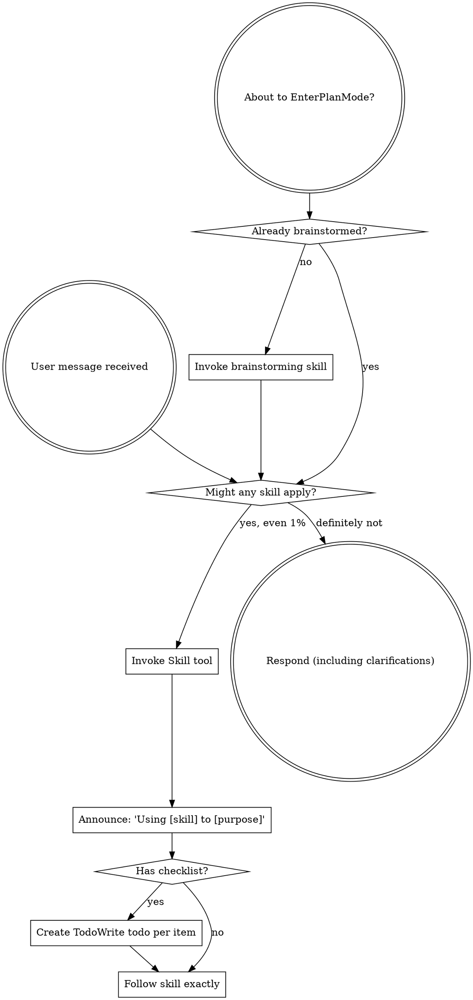

<SUBAGENT-STOP>
If you were dispatched as a subagent to execute a specific task, skip this skill.
</SUBAGENT-STOP>

<EXTREMELY-IMPORTANT>
If you think there is even a 1% chance a skill might apply to what you are doing, you ABSOLUTELY MUST invoke the skill.

IF A SKILL APPLIES TO YOUR TASK, YOU DO NOT HAVE A CHOICE. YOU MUST USE IT.

This is not negotiable. This is not optional. You cannot rationalize your way out of this.
</EXTREMELY-IMPORTANT>

## Instruction Priority

Superpowers skills override default system prompt behavior, but **user instructions always take precedence**:

1. **User's explicit instructions** (CLAUDE.md, GEMINI.md, AGENTS.md, direct requests) — highest priority
2. **Superpowers skills** — override default system behavior where they conflict
3. **Default system prompt** — lowest priority

If CLAUDE.md, GEMINI.md, or AGENTS.md says "don't use TDD" and a skill says "always use TDD," follow the user's instructions. The user is in control.

## How to Access Skills

**In Hermes Agent:** Use `skill_view(name)` to load any skill. The system prompt lists a subset of skills in `available_skills`, but you MUST also scan the full catalog when those don't match. Use `skills_list()` to get all available skills (236+), then `skill_view(name)` to load the matching one. A skill catalog file exists at `~/.hermes/hermes-skills-catalog.md` with natural-language→skill mappings for quick lookup.

**CRITICAL — Scan ALL skills, not just listed ones:** The `available_skills` in the system prompt only shows builtin skills. OpenCode-synced skills (opencode-oc category, 161+ skills) are NOT listed there but ARE available via `skill_view`. When the user describes a task in natural language, check the full catalog first. Examples: "做小紅書圖卡" → `baoyu-image-cards` (not in system prompt list); "做邏輯審查" → `logic-review` (not in system prompt list).

**Hermes auto-matching (user preference — HARD RULE):** When the user describes a need in natural language, proactively scan the full skill catalog (236+ skills) and invoke matching skills WITHOUT requiring them to name the skill or use `/` commands. SPECIFIC TRIGGER: when user message exceeds 30 characters, automatically invoke this skill to scan for matching skills. Do not wait for explicit requests. The catalog file at `~/.hermes/hermes-skills-catalog.md` has natural-language→skill mappings. Load via `skill_view(name)` immediately — don't ask the user which skill to use.

**In Claude Code:** Use the `Skill` tool. When you invoke a skill, its content is loaded and presented to you—follow it directly. Never use the Read tool on skill files.

**In Copilot CLI:** Use the `skill` tool. Skills are auto-discovered from installed plugins. The `skill` tool works the same as Claude Code's `Skill` tool.

**In Gemini CLI:** Skills activate via the `activate_skill` tool. Gemini loads skill metadata at session start and activates the full content on demand.

**In other environments:** Check your platform's documentation for how skills are loaded.

## Platform Adaptation

Skills use Claude Code tool names. Non-CC platforms: see `references/copilot-tools.md` (Copilot CLI), `references/codex-tools.md` (Codex) for tool equivalents. Gemini CLI users get the tool mapping loaded automatically via GEMINI.md.

# Using Skills

## The Rule

**Invoke relevant or requested skills BEFORE any response or action.** Even a 1% chance a skill might apply means that you should invoke the skill to check. If an invoked skill turns out to be wrong for the situation, you don't need to use it.

## Red Flags

These thoughts mean STOP—you're rationalizing:

| Thought | Reality |
|---------|---------|
| "This is just a simple question" | Questions are tasks. Check for skills. |
| "I need more context first" | Skill check comes BEFORE clarifying questions. |
| "Let me explore the codebase first" | Skills tell you HOW to explore. Check first. |
| "I can check git/files quickly" | Files lack conversation context. Check for skills. |
| "Let me gather information first" | Skills tell you HOW to gather information. |
| "This doesn't need a formal skill" | If a skill exists, use it. |
| "I remember this skill" | Skills evolve. Read current version. |
| "This doesn't count as a task" | Action = task. Check for skills. |
| "The skill is overkill" | Simple things become complex. Use it. |
| "I'll just do this one thing first" | Check BEFORE doing anything. |
| "This feels productive" | Undisciplined action wastes time. Skills prevent this. |
| "I know what that means" | Knowing the concept ≠ using the skill. Invoke it. |

## Skill Priority

When multiple skills could apply, use this order:

1. **Process skills first** (brainstorming, debugging) - these determine HOW to approach the task
2. **Implementation skills second** (frontend-design, mcp-builder) - these guide execution

"Let's build X" → brainstorming first, then implementation skills.
"Fix this bug" → debugging first, then domain-specific skills.

## Skill Types

**Rigid** (TDD, debugging): Follow exactly. Don't adapt away discipline.

**Flexible** (patterns): Adapt principles to context.

The skill itself tells you which.

## User Instructions

Instructions say WHAT, not HOW. "Add X" or "Fix Y" doesn't mean skip workflows.

## Pitfalls

- **CI lint version mismatch**: When fixing lint/format issues, check `tests/requirements.txt` or CI workflow for pinned tool versions BEFORE running locally. See `references/ci-lint-version-pitfall.md`.
- **Gateway vs chatbot framework**: When the user wants a chatbot on a messaging platform (LINE, Telegram, etc.), consider existing chatbot frameworks (AstrBot, etc.) BEFORE suggesting Hermes Gateway setup. The user may prefer a simpler, purpose-built solution over general-purpose infrastructure.
